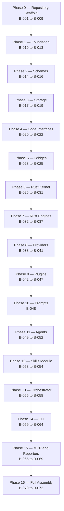

# BUILD_ORDER.md

**The complete file-by-file implementation sequence for CodeGuardian, built in phases, tested at phase boundaries.**

---

## 1. Purpose

This document defines the **exact order** in which every file in the CodeGuardian repository is written. It is not a roadmap. It is not a design document. It is the **build order** — which files to write, in what grouping, and when to test.

The unit of work is the **phase**, not the block. A block is a group of four or five files that belong together. A phase is a group of blocks that together deliver one coherent layer of the system.

You write one phase completely. Then you test it. Then you write the next phase. Then you test the whole chain. Nothing is rewritten once it has been written and accepted.

---

## 2. The Four Rules

These rules supersede any conflicting rule in an earlier version of this document.

### Rule 1 — Write once, never rewrite

Every file is written exactly once. When a block writes a file, that file is final for the rest of the build. If a later block needs to change an earlier file, that is an escalation (HALT 3), not a routine operation. The plan is designed so that this does not happen.

### Rule 2 — Blocks group four or five files

A block contains four or five files that belong together. Blocks are not split into single files, and they are not merged into twenty-file dumps. Four or five is the range. Every block is a coherent unit: one module, one package, or one tightly related set of files.

### Rule 3 — Test at phase boundaries, not block boundaries

After a phase is written, the whole phase is tested. Not after each block. Not after each file. Once per phase.

The three tests run in this order at the phase boundary:

| Test | What It Runs | Pass Condition |
|---|---|---|
| **Isolation** | The new phase's test files only | Every test in the phase passes |
| **Chain** | Every test file from every phase written so far | Every test in every phase passes |
| **Regression** | The full suite plus the cross-phase integration script | Every test passes and every cross-module API call succeeds |

A phase is not complete until all three pass. If any fails, the phase is fixed before the next phase begins.

### Rule 4 — Test cross-phase integration when moving forward

Every time the build advances from phase N to phase N+1, the phase-boundary test for phase N+1 also runs a cross-phase integration script that exercises the public API of every phase from 0 to N+1. This catches drift between phases that unit tests do not see.

The integration script grows by one section per phase. Phase 2 runs integration for phases 0-2. Phase 3 runs 0-3. And so on. Nothing that worked at phase N is allowed to silently stop working at phase N+1.

---

## 3. The Phase-Boundary Workflow

```
┌────────────────────────────────────────────────────────┐
│ Phase N                                                │
│                                                        │
│   1. Write every block in phase N, in order.           │
│      Do not test after each block.                     │
│                                                        │
│   2. Run the phase isolation test.                     │
│      pytest tests/unit/ tests/contracts/ -k <phaseN>   │
│                                                        │
│   3. Run the chain test.                               │
│      pytest tests/                                     │
│                                                        │
│   4. Run the cross-phase integration script.           │
│      python scripts/integration_phase.py --through N   │
│                                                        │
│   5. If all three are green, phase N is done.          │
│      If any is red, fix the phase and re-run.          │
└────────────────────────────────────────────────────────┘
                       │
                       ▼
┌────────────────────────────────────────────────────────┐
│ Phase N+1                                              │
│                                                        │
│   Same as above, but the integration script now        │
│   covers phases 0 through N+1.                         │
└────────────────────────────────────────────────────────┘
```

Every phase boundary is a **commit point**. The phase's code is committed only after all three tests pass.

---

## 4. The Full Build Chain



---

## 5. Phase 0 — Repository Scaffold

Configuration files, project metadata, CI, containers, documentation, and examples. No tests. The phase is complete when every file exists and the toolchain is reachable.

### Block B-001 — Root Build Configuration

| File | Purpose |
|---|---|
| `pyproject.toml` | Python package metadata, dependency list, tool configuration |
| `Cargo.toml` | Rust workspace metadata and shared dependency versions |
| `Cargo.lock` | Rust dependency lock file |
| `rust-toolchain.toml` | Rust toolchain version pin |
| `rustfmt.toml` | Rust formatting rules |

### Block B-002 — Root Project Hygiene

| File | Purpose |
|---|---|
| `clippy.toml` | Rust lint configuration |
| `justfile` | Cross-platform task runner |
| `.gitignore` | Git exclusions |
| `.codeguardianignore` | CodeGuardian's own exclusion patterns |
| `.dockerignore` | Docker build context exclusions |

### Block B-003 — Root Editor and Documentation Configuration

| File | Purpose |
|---|---|
| `.editorconfig` | Editor consistency across operating systems |
| `.env.example` | Environment variable template |
| `.python-version` | Python version pin |
| `.pre-commit-config.yaml` | Pre-commit hook configuration |
| `mkdocs.yml` | Documentation site configuration |

### Block B-004 — GitHub Configuration Part 1

| File | Purpose |
|---|---|
| `.github/CODEOWNERS` | Code ownership rules |
| `.github/dependabot.yml` | Dependency update automation |
| `.github/PULL_REQUEST_TEMPLATE.md` | Pull request template |
| `.github/ISSUE_TEMPLATE/bug_report.md` | Bug report template |
| `.github/ISSUE_TEMPLATE/feature_request.md` | Feature request template |

### Block B-005 — GitHub Configuration Part 2

| File | Purpose |
|---|---|
| `.github/ISSUE_TEMPLATE/plugin_proposal.md` | Plugin proposal template |
| `.github/workflows/ci.yml` | Continuous integration pipeline |
| `.github/workflows/docs.yml` | Documentation build workflow |
| `.github/workflows/release.yml` | Release pipeline |
| `.github/workflows/security.yml` | Security scanning workflow |

### Block B-006 — Container Configuration

| File | Purpose |
|---|---|
| `.devcontainer/devcontainer.json` | VS Code dev container configuration |
| `.devcontainer/Dockerfile` | Dev container image |
| `docker/Dockerfile.python-sandbox` | Python sandbox base image (Docker fallback) |
| `docker/Dockerfile.typescript-sandbox` | TypeScript sandbox base image (Docker fallback) |
| `benchmarks/README.md` | Benchmark documentation |

### Block B-007 — Benchmarks, Skills, and Project Front Door

| File | Purpose |
|---|---|
| `benchmarks/fixtures/.gitkeep` | Placeholder for benchmark input data |
| `benchmarks/baselines/.gitkeep` | Placeholder for benchmark baseline results |
| `skills/README.md` | Bundled skills documentation |
| `LICENSE` | Apache 2.0 license text |
| `README.md` | Project front door |

### Block B-008 — Project Documentation

| File | Purpose |
|---|---|
| `CHANGELOG.md` | Release history |
| `CONTRIBUTING.md` | Contribution guide |
| `CODE_OF_CONDUCT.md` | Community guidelines |
| `SECURITY.md` | Security policy and disclosure process |
| `examples/configs/minimal.toml` | Minimal configuration example |

### Block B-009 — Examples

| File | Purpose |
|---|---|
| `examples/configs/local_models.toml` | Local model configuration example |
| `examples/configs/multi_provider.toml` | Multi-provider configuration example |
| `examples/configs/enterprise.toml` | Enterprise configuration example |
| `examples/skills/python-add-type-hints/SKILL.md` | Example Python skill |
| `examples/skills/typescript-extract-interface/SKILL.md` | Example TypeScript skill |

**Phase boundary test:** every file exists, `just --list` runs, `pre-commit install` succeeds, no syntax errors in any TOML, YAML, or JSON file.

---

## 6. Phase 1 — Foundation

The package identity, the error taxonomy, the retry and redaction engines, and the configuration system. Everything downstream imports from here.

### Block B-010 — Package Identity and Error Codes

| File | Purpose |
|---|---|
| `python/codeguardian/version.py` | Single source of truth for the version string |
| `python/codeguardian/__init__.py` | Package entry point |
| `python/pyproject.toml` | Inner package metadata |
| `python/codeguardian/core/errors/codes.py` | Every error code as a string constant |
| `python/codeguardian/core/errors/taxonomy.py` | Error categories, retry policies, and the base exception |

### Block B-011 — Error Runtime

| File | Purpose |
|---|---|
| `python/codeguardian/core/errors/__init__.py` | Public surface of the errors package |
| `python/codeguardian/core/errors/translation.py` | Standard library exception translation |
| `python/codeguardian/core/errors/retry.py` | Retry engine honoring category policies |
| `python/codeguardian/core/errors/redaction.py` | Secret redaction walker |
| `tests/unit/core/test_errors.py` | Tests for the taxonomy and retry engine |

### Block B-012 — Configuration Package

| File | Purpose |
|---|---|
| `python/codeguardian/core/config/__init__.py` | Public surface of the config package |
| `python/codeguardian/core/config/schema.py` | Typed dataclass tree and validator |
| `python/codeguardian/core/config/defaults.py` | Every default value in one place |
| `python/codeguardian/core/config/loader.py` | Config file loader with path resolution |
| `tests/unit/core/test_config.py` | Tests for the schema and validator |

### Block B-013 — Configuration Secrets and Remaining Tests

| File | Purpose |
|---|---|
| `python/codeguardian/core/config/secrets.py` | OS keychain wrapper for API keys |
| `tests/unit/core/test_translation.py` | Tests for the translation layer |
| `tests/unit/core/test_redaction.py` | Tests for the redaction walker |
| `tests/unit/core/test_config_secrets.py` | Tests for the secrets module |

**Phase boundary test:**
- Isolation: `pytest tests/unit/core/ -v`
- Chain: `pytest tests/ -v`
- Integration: import and use every public symbol from phases 0 and 1 in one script

---

## 7. Phase 2 — Schemas

Every JSON Schema that defines an artifact CodeGuardian produces or consumes.

### Block B-014 — Core Structural Schemas

| File | Purpose |
|---|---|
| `schemas/cpg.json` | Code Property Graph metadata |
| `schemas/runtime-contract-map.json` | Runtime contract map |
| `schemas/recon.json` | Reconnaissance manifest |
| `schemas/blast-radius.json` | Blast Radius Report |
| `schemas/contract-assertions.json` | Contract assertions |

### Block B-015 — Flow and Verification Schemas

| File | Purpose |
|---|---|
| `schemas/context-pack.json` | Context Pack |
| `schemas/verification.json` | Verifier verdict |
| `schemas/plan-approval.json` | Plan approval record |
| `schemas/consent.json` | Apply consent record |
| `schemas/checkpoint.json` | Checkpoint state |

### Block B-016 — Output and Extension Schemas

| File | Purpose |
|---|---|
| `schemas/audit-entry.json` | One entry in the audit log |
| `schemas/plugin-manifest.json` | Plugin manifest |
| `schemas/skill.json` | Skill frontmatter |
| `schemas/run-summary.json` | Run summary |

**Phase boundary test:**
- Isolation: `python scripts/validate_schemas.py` (validates every schema against the meta-schema)
- Chain: `pytest tests/`
- Integration: every schema referenced from code that already exists

---

## 8. Phase 3 — Storage

SQLite metadata, filesystem artifacts, graph file access, cache, skill store, migrations, and cleanup.

### Block B-017 — Migrations, SQLite Store, and Filesystem Store

| File | Purpose |
|---|---|
| `python/codeguardian/core/storage/__init__.py` | Storage facade |
| `python/codeguardian/core/storage/migrations/__init__.py` | Migration package init |
| `python/codeguardian/core/storage/migrations/001_initial.sql` | Initial schema |
| `python/codeguardian/core/storage/sqlite_store.py` | WAL-mode SQLite access |
| `python/codeguardian/core/storage/filesystem_store.py` | Artifact read and write |

### Block B-018 — Graph, Cache, and Migrations Runner

| File | Purpose |
|---|---|
| `python/codeguardian/core/storage/graph_store.py` | Code Property Graph binary file access |
| `python/codeguardian/core/storage/cache.py` | LRU and disk cache |
| `python/codeguardian/core/storage/migration_runner.py` | Migration runner |
| `python/codeguardian/core/storage/cleanup.py` | Background retention and cleanup |

### Block B-019 — Skill Store and Storage Tests

| File | Purpose |
|---|---|
| `python/codeguardian/core/storage/skill_store.py` | Markdown, FTS5, and vector index for skills |
| `tests/unit/core/test_storage.py` | Tests for the storage layer |
| `tests/unit/core/test_sqlite_wal.py` | Tests for SQLite WAL configuration |
| `tests/unit/core/test_skill_store.py` | Tests for the skill store |

**Phase boundary test:**
- Isolation: `pytest tests/unit/core/test_storage.py tests/unit/core/test_sqlite_wal.py tests/unit/core/test_skill_store.py -v`
- Chain: `pytest tests/`
- Integration: write and read a full config, an error, and a storage record in one script

---

## 9. Phase 4 — Code Interfaces

Every Protocol that defines a component boundary. No implementations. The interfaces are the contract.

### Block B-020 — Core Provider Interfaces

| File | Purpose |
|---|---|
| `python/codeguardian/interfaces/__init__.py` | Package init |
| `python/codeguardian/interfaces/repository.py` | RepositoryProvider Protocol |
| `python/codeguardian/interfaces/apply.py` | ApplyProvider Protocol |
| `python/codeguardian/interfaces/model.py` | ModelProvider Protocol |
| `python/codeguardian/interfaces/sandbox.py` | SandboxBackend Protocol |

### Block B-021 — Core Engine Interfaces

| File | Purpose |
|---|---|
| `python/codeguardian/interfaces/orchestrator.py` | Orchestrator Protocol |
| `python/codeguardian/interfaces/agent.py` | Agent Protocol |
| `python/codeguardian/interfaces/tool.py` | ToolPlugin Protocol |
| `python/codeguardian/interfaces/verifier.py` | VerifierPlugin Protocol |
| `python/codeguardian/interfaces/reporter.py` | ReporterPlugin Protocol |

### Block B-022 — Extension Interfaces and Bridge Protocol

| File | Purpose |
|---|---|
| `python/codeguardian/interfaces/language.py` | LanguagePlugin Protocol |
| `python/codeguardian/interfaces/mcp_client.py` | MCPClient Protocol |
| `python/codeguardian/interfaces/mcp_server.py` | MCPServer Protocol |
| `python/codeguardian/core/bridges/__init__.py` | Bridge package init |
| `python/codeguardian/core/bridges/protocol.py` | Bridge message schemas |

**Phase boundary test:**
- Isolation: every Protocol imports cleanly; type checkers pass
- Chain: `pytest tests/`
- Integration: a dummy class for each Protocol satisfies static type checking

---

## 10. Phase 5 — Bridges

Python-Rust communication: in-process PyO3 and out-of-process JSON-RPC.

### Block B-023 — Python Bridge Implementations

| File | Purpose |
|---|---|
| `python/codeguardian/core/bridges/pyo3_bridge.py` | Batched PyO3 calls |
| `python/codeguardian/core/bridges/jsonrpc_bridge.py` | JSON-RPC over stdio |
| `rust/crates/codeguardian-rpc/Cargo.toml` | RPC crate metadata |
| `rust/crates/codeguardian-rpc/src/lib.rs` | RPC crate entry point |
| `rust/crates/codeguardian-rpc/src/protocol.rs` | RPC message types |

### Block B-024 — Rust RPC and Kernel Crate Skeleton

| File | Purpose |
|---|---|
| `rust/crates/codeguardian-rpc/src/server.rs` | RPC server side |
| `rust/crates/codeguardian-rpc/src/client.rs` | RPC client side |
| `rust/crates/codeguardian-kernel/Cargo.toml` | Kernel crate metadata |
| `rust/crates/codeguardian-kernel/src/lib.rs` | Kernel crate entry point |

### Block B-025 — Bridge Tests

| File | Purpose |
|---|---|
| `tests/integration/__init__.py` | Integration test package init |
| `tests/integration/test_pyo3_bridge.py` | Tests for the PyO3 bridge |
| `tests/integration/test_jsonrpc_bridge.py` | Tests for the JSON-RPC bridge |
| `tests/integration/test_phase_pipeline.py` | Skeleton for phase pipeline tests |

**Phase boundary test:**
- Isolation: `pytest tests/integration/test_pyo3_bridge.py tests/integration/test_jsonrpc_bridge.py -v`
- Chain: `pytest tests/`
- Integration: `cargo test --workspace` for the RPC crate, plus a Python-to-Rust round trip

---

## 11. Phase 6 — Rust Kernel

Tree-sitter parsing, AST, CFG, PDG, call graph, symbol table, Code Property Graph merge, incremental updates, and query.

### Block B-026 — Parser and AST

| File | Purpose |
|---|---|
| `rust/crates/codeguardian-kernel/src/parser.rs` | Tree-sitter wrapper |
| `rust/crates/codeguardian-kernel/src/ast.rs` | AST node types |
| `rust/crates/codeguardian-kernel/src/symbol_table.rs` | Symbol extraction |
| `rust/crates/codeguardian-kernel/src/call_graph.rs` | Caller and callee edges |

### Block B-027 — Control Flow and Dependence

| File | Purpose |
|---|---|
| `rust/crates/codeguardian-kernel/src/cfg.rs` | Control Flow Graph builder |
| `rust/crates/codeguardian-kernel/src/pdg.rs` | Program Dependence Graph builder |

### Block B-028 — CPG Merge and Incremental Updates

| File | Purpose |
|---|---|
| `rust/crates/codeguardian-kernel/src/cpg.rs` | Code Property Graph merge |
| `rust/crates/codeguardian-kernel/src/incremental.rs` | Incremental graph updates |
| `rust/crates/codeguardian-kernel/src/query.rs` | Graph query interface |

### Block B-029 — PyO3 Bindings for the Kernel

| File | Purpose |
|---|---|
| `rust/crates/codeguardian-pyo3/Cargo.toml` | PyO3 crate metadata |
| `rust/crates/codeguardian-pyo3/src/lib.rs` | PyO3 module entry |
| `rust/crates/codeguardian-pyo3/src/kernel.rs` | Kernel bindings |

### Block B-030 — Kernel Tests

| File | Purpose |
|---|---|
| `tests/unit/rust/__init__.py` | Rust unit test package init |
| `tests/unit/rust/test_kernel.py` | Python tests against the kernel bindings |

**Phase boundary test:**
- Isolation: `cargo test -p codeguardian-kernel` and `pytest tests/unit/rust/test_kernel.py`
- Chain: `pytest tests/` and `cargo test --workspace`
- Integration: parse a multi-file Python project through the PyO3 bridge, build the CPG, and verify node counts

---

## 12. Phase 7 — Rust Engines

Blast radius, sandbox, audit, policy, and their PyO3 bindings.

### Block B-031 — Blast Radius Crate

| File | Purpose |
|---|---|
| `rust/crates/codeguardian-blast/Cargo.toml` | Blast crate metadata |
| `rust/crates/codeguardian-blast/src/lib.rs` | Blast crate entry |
| `rust/crates/codeguardian-blast/src/callers.rs` | Direct and transitive callers |
| `rust/crates/codeguardian-blast/src/contracts.rs` | Contract violation detection |

### Block B-032 — Blast Radius Continued

| File | Purpose |
|---|---|
| `rust/crates/codeguardian-blast/src/coverage.rs` | Coverage gap detection |
| `rust/crates/codeguardian-blast/src/score.rs` | Blast score computation |
| `rust/crates/codeguardian-blast/src/recommendation.rs` | Proceed, review, or block |

### Block B-033 — Sandbox Crate

| File | Purpose |
|---|---|
| `rust/crates/codeguardian-sandbox/Cargo.toml` | Sandbox crate metadata |
| `rust/crates/codeguardian-sandbox/src/lib.rs` | Sandbox crate entry |
| `rust/crates/codeguardian-sandbox/src/backend.rs` | SandboxBackend trait |
| `rust/crates/codeguardian-sandbox/src/quotas.rs` | Resource limit enforcement |
| `rust/crates/codeguardian-sandbox/src/network.rs` | Network isolation rules |

### Block B-034 — Sandbox Backends

| File | Purpose |
|---|---|
| `rust/crates/codeguardian-sandbox/src/bubblewrap.rs` | Bubblewrap backend (v1 Linux default) |
| `rust/crates/codeguardian-sandbox/src/docker.rs` | Docker backend (v1 fallback) |
| `rust/crates/codeguardian-sandbox/src/seatbelt.rs` | Seatbelt backend (stub in v1) |
| `rust/crates/codeguardian-sandbox/src/firecracker.rs` | Firecracker backend (stub in v1) |
| `rust/crates/codeguardian-sandbox/src/pool.rs` | Warm container pool |

### Block B-035 — Audit and Policy Crates

| File | Purpose |
|---|---|
| `rust/crates/codeguardian-audit/Cargo.toml` | Audit crate metadata |
| `rust/crates/codeguardian-audit/src/lib.rs` | Audit crate entry |
| `rust/crates/codeguardian-audit/src/writer.rs` | Append-only writer |
| `rust/crates/codeguardian-audit/src/hash_chain.rs` | Hash chain construction |
| `rust/crates/codeguardian-audit/src/verify.rs` | Chain verification |

### Block B-036 — Audit Export, Policy Crate, and PyO3 Bindings

| File | Purpose |
|---|---|
| `rust/crates/codeguardian-audit/src/export.rs` | Export formats |
| `rust/crates/codeguardian-policy/Cargo.toml` | Policy crate metadata |
| `rust/crates/codeguardian-policy/src/lib.rs` | Policy crate entry |
| `rust/crates/codeguardian-policy/src/sandbox_policy.rs` | Sandbox policy enforcement |
| `rust/crates/codeguardian-policy/src/plugin_permissions.rs` | Plugin permission enforcement |

### Block B-037 — Policy Continued and PyO3 Engine Bindings

| File | Purpose |
|---|---|
| `rust/crates/codeguardian-policy/src/resource_limits.rs` | Resource limit enforcement |
| `rust/crates/codeguardian-pyo3/src/blast.rs` | Blast engine bindings |
| `rust/crates/codeguardian-pyo3/src/policy.rs` | Policy engine bindings |
| `tests/unit/rust/test_blast.py` | Blast engine tests |
| `tests/unit/rust/test_sandbox.py` | Sandbox tests |
| `tests/unit/rust/test_audit.py` | Audit tests |

**Phase boundary test:**
- Isolation: `cargo test --workspace`
- Chain: `pytest tests/`
- Integration: parse a repository, compute blast radius, write an audit entry, verify the hash chain

---

## 13. Phase 8 — Providers

Repository providers, model providers, the apply provider, and the Python sandbox backends.

### Block B-038 — Repository Providers

| File | Purpose |
|---|---|
| `python/codeguardian/core/providers/__init__.py` | Provider package init |
| `python/codeguardian/core/providers/local_repository.py` | Local filesystem provider |
| `python/codeguardian/core/providers/github_repository.py` | GitHub provider |
| `python/codeguardian/core/providers/gitlab_repository.py` | GitLab provider |
| `python/codeguardian/core/providers/apply_provider.py` | Apply provider (consent-gated) |

### Block B-039 — Model Providers

| File | Purpose |
|---|---|
| `python/codeguardian/core/providers/anthropic_model.py` | Anthropic provider |
| `python/codeguardian/core/providers/openai_model.py` | OpenAI provider |
| `python/codeguardian/core/providers/deepseek_model.py` | DeepSeek provider |
| `python/codeguardian/core/providers/openai_compatible.py` | OpenAI-compatible provider |

### Block B-040 — Python Sandbox Backends

| File | Purpose |
|---|---|
| `python/codeguardian/core/sandbox/__init__.py` | Sandbox package init |
| `python/codeguardian/core/sandbox/backend_selector.py` | Backend chooser |
| `python/codeguardian/core/sandbox/bubblewrap_backend.py` | Bubblewrap (v1 Linux default) |
| `python/codeguardian/core/sandbox/docker_backend.py` | Docker (v1 fallback) |
| `python/codeguardian/core/sandbox/seatbelt_backend.py` | Seatbelt (stub in v1) |
| `python/codeguardian/core/sandbox/firecracker_backend.py` | Firecracker (stub in v1) |

### Block B-041 — Provider and Sandbox Contract Tests

| File | Purpose |
|---|---|
| `tests/contracts/__init__.py` | Contract test package init |
| `tests/contracts/test_repository_contract.py` | RepositoryProvider contract |
| `tests/contracts/test_apply_contract.py` | ApplyProvider contract |
| `tests/contracts/test_model_contract.py` | ModelProvider contract |
| `tests/contracts/test_sandbox_contract.py` | SandboxBackend contract |

**Phase boundary test:**
- Isolation: `pytest tests/contracts/ -v`
- Chain: `pytest tests/`
- Integration: clone a local repository, compute blast radius, run a Python file in the sandbox, and verify the audit chain

---

## 14. Phase 9 — Plugins

Plugin loader, registry, manifest, fault barrier, versioning, and the bundled language, tool, and reporter plugins.

### Block B-042 — Plugin Loader Infrastructure

| File | Purpose |
|---|---|
| `python/codeguardian/core/plugins/__init__.py` | Plugin package init |
| `python/codeguardian/core/plugins/manifest.py` | Manifest schema and validation |
| `python/codeguardian/core/plugins/registry.py` | Plugin registry |
| `python/codeguardian/core/plugins/loader.py` | Entry-point discovery |
| `python/codeguardian/core/plugins/fault_barrier.py` | Fault isolation |

### Block B-043 — Plugin Versioning and Bundled Language Plugins Part 1

| File | Purpose |
|---|---|
| `python/codeguardian/core/plugins/versioning.py` | N and N-1 compatibility |
| `python/codeguardian/plugins_bundled/__init__.py` | Bundled plugin package init |
| `python/codeguardian/plugins_bundled/languages/__init__.py` | Language plugin package init |
| `python/codeguardian/plugins_bundled/languages/python/plugin.py` | Python language plugin |
| `python/codeguardian/plugins_bundled/languages/python/pyproject.toml` | Python plugin metadata |

### Block B-044 — Bundled Language Plugins Part 2

| File | Purpose |
|---|---|
| `python/codeguardian/plugins_bundled/languages/typescript/plugin.py` | TypeScript language plugin |
| `python/codeguardian/plugins_bundled/languages/typescript/pyproject.toml` | TypeScript plugin metadata |
| `python/codeguardian/plugins_bundled/tools/__init__.py` | Tool plugin package init |
| `python/codeguardian/plugins_bundled/tools/ast_grep/plugin.py` | ast-grep plugin |
| `python/codeguardian/plugins_bundled/tools/ast_grep/pyproject.toml` | ast-grep plugin metadata |

### Block B-045 — Bundled Tool and Reporter Plugins

| File | Purpose |
|---|---|
| `python/codeguardian/plugins_bundled/tools/code_analysis/plugin.py` | Code analysis plugin |
| `python/codeguardian/plugins_bundled/tools/code_analysis/pyproject.toml` | Code analysis plugin metadata |
| `python/codeguardian/plugins_bundled/reporters/__init__.py` | Reporter plugin package init |
| `python/codeguardian/plugins_bundled/reporters/sarif_reporter/plugin.py` | SARIF reporter plugin |
| `python/codeguardian/plugins_bundled/reporters/sarif_reporter/pyproject.toml` | SARIF plugin metadata |

### Block B-046 — Plugin Contract Tests

| File | Purpose |
|---|---|
| `tests/contracts/test_language_contract.py` | LanguagePlugin contract |
| `tests/contracts/test_tool_contract.py` | ToolPlugin contract |
| `tests/contracts/test_verifier_contract.py` | VerifierPlugin contract |
| `tests/contracts/test_reporter_contract.py` | ReporterPlugin contract |

### Block B-047 — Plugin Integration Tests

| File | Purpose |
|---|---|
| `tests/integration/test_plugin_loading.py` | Plugin discovery and fault isolation |

**Phase boundary test:**
- Isolation: `pytest tests/contracts/test_language_contract.py tests/contracts/test_tool_contract.py tests/contracts/test_reporter_contract.py -v`
- Chain: `pytest tests/`
- Integration: install a dummy plugin via entry point, discover it, call it, and confirm the core is unaffected when the plugin crashes

---

## 15. Phase 10 — Prompts

### Block B-048 — All Prompt Files

| File | Purpose |
|---|---|
| `prompts/analyst/v1.0.0.md` | Analyst prompt |
| `prompts/tester/v1.0.0.md` | Tester prompt |
| `prompts/writer/v1.0.0.md` | Writer prompt |
| `prompts/correctness_verifier/v1.0.0.md` | Correctness verifier prompt |
| `prompts/security_verifier/v1.0.0.md` | Security verifier prompt |
| `prompts/contract_verifier/v1.0.0.md` | Contract verifier prompt |
| `prompts/skill_curator/v1.0.0.md` | Skill curator prompt |

**Phase boundary test:**
- Isolation: every prompt renders with test variables
- Chain: `pytest tests/`
- Integration: load and render every prompt through the same code path

---

## 16. Phase 11 — Agents

Recon agent, blast radius agent, analyst, tester, writer, and the three verifiers.

### Block B-049 — Deterministic Agents

| File | Purpose |
|---|---|
| `python/codeguardian/core/agents/__init__.py` | Agent package init |
| `python/codeguardian/core/agents/recon.py` | Recon agent (deterministic) |
| `python/codeguardian/core/agents/blast.py` | Blast radius agent (deterministic) |
| `python/codeguardian/core/agents/analyst.py` | Analyst agent |
| `python/codeguardian/core/agents/tester.py` | Tester agent |

### Block B-050 — Writer and Verifiers

| File | Purpose |
|---|---|
| `python/codeguardian/core/agents/writer.py` | Writer agent |
| `python/codeguardian/core/agents/correctness_verifier.py` | Correctness verifier |
| `python/codeguardian/core/agents/security_verifier.py` | Security verifier |
| `python/codeguardian/core/agents/contract_verifier.py` | Contract verifier |
| `python/codeguardian/core/agents/skill_curator.py` | Skill curator |

### Block B-051 — Agent Tests

| File | Purpose |
|---|---|
| `tests/unit/core/test_agents.py` | Unit tests for each agent |
| `tests/e2e/__init__.py` | E2E test package init |
| `tests/e2e/test_blast_radius.py` | Blast radius accuracy tests |

**Phase boundary test:**
- Isolation: `pytest tests/unit/core/test_agents.py tests/e2e/test_blast_radius.py -v`
- Chain: `pytest tests/`
- Integration: run the recon agent against a fixture repository and verify recon.json validates against the schema

---

## 17. Phase 12 — Skills Module

### Block B-052 — Skill Library

| File | Purpose |
|---|---|
| `python/codeguardian/core/skills/__init__.py` | Skills package init |
| `python/codeguardian/core/skills/library.py` | Skill library operations |
| `python/codeguardian/core/skills/indexer.py` | FTS5 indexing |
| `python/codeguardian/core/skills/retriever.py` | Semantic retrieval |
| `python/codeguardian/core/skills/embeddings.py` | Vector embeddings |

### Block B-053 — Skill Tests

| File | Purpose |
|---|---|
| `tests/unit/core/test_skills.py` | Tests for the skill library |

**Phase boundary test:**
- Isolation: `pytest tests/unit/core/test_skills.py -v`
- Chain: `pytest tests/`
- Integration: store a skill, retrieve it by semantic similarity, and rebuild the index from Markdown

---

## 18. Phase 13 — Orchestrator

### Block B-054 — Orchestrator Core

| File | Purpose |
|---|---|
| `python/codeguardian/core/orchestrator/__init__.py` | Orchestrator package init |
| `python/codeguardian/core/orchestrator/phase_gates.py` | Phase entry and exit conditions |
| `python/codeguardian/core/orchestrator/consent.py` | Plan approval and apply consent |
| `python/codeguardian/core/orchestrator/verification_prompt.py` | Per-run verification prompt |
| `python/codeguardian/core/orchestrator/checkpointing.py` | Resume from last checkpoint |

### Block B-055 — Orchestrator Implementation

| File | Purpose |
|---|---|
| `python/codeguardian/core/orchestrator/langgraph_orchestrator.py` | Full pipeline implementation |

### Block B-056 — Telemetry

| File | Purpose |
|---|---|
| `python/codeguardian/core/telemetry/__init__.py` | Telemetry package init |
| `python/codeguardian/core/telemetry/metrics.py` | Metrics collection |
| `python/codeguardian/core/telemetry/tracing.py` | LangSmith trace correlation |
| `python/codeguardian/core/telemetry/langsmith.py` | LangSmith integration |

### Block B-057 — Orchestrator Tests

| File | Purpose |
|---|---|
| `tests/unit/core/test_orchestrator.py` | Orchestrator unit tests |
| `tests/unit/core/test_phase_gates.py` | Phase gate tests |
| `tests/unit/core/test_checkpointing.py` | Checkpoint and resume tests |
| `tests/unit/core/test_consent.py` | Consent gate tests |
| `tests/unit/core/test_telemetry.py` | Telemetry tests |

**Phase boundary test:**
- Isolation: `pytest tests/unit/core/ -v`
- Chain: `pytest tests/`
- Integration: run the full pipeline on a fixture repository, kill the process mid-run, resume, and verify the state is consistent

---

## 19. Phase 14 — CLI

### Block B-058 — CLI Entry Point and Commands Part 1

| File | Purpose |
|---|---|
| `python/codeguardian/cli/__init__.py` | CLI package init |
| `python/codeguardian/cli/main.py` | CLI entry point |
| `python/codeguardian/cli/commands/__init__.py` | Command package init |
| `python/codeguardian/cli/commands/run.py` | `codeguardian run` |
| `python/codeguardian/cli/commands/recon.py` | `codeguardian recon` |

### Block B-059 — CLI Commands Part 2

| File | Purpose |
|---|---|
| `python/codeguardian/cli/commands/blast.py` | `codeguardian blast` |
| `python/codeguardian/cli/commands/verify.py` | `codeguardian verify` |
| `python/codeguardian/cli/commands/skill.py` | `codeguardian skill` |
| `python/codeguardian/cli/commands/serve.py` | `codeguardian serve` |
| `python/codeguardian/cli/commands/config.py` | `codeguardian config` |

### Block B-060 — CLI Views

| File | Purpose |
|---|---|
| `python/codeguardian/cli/views/__init__.py` | View package init |
| `python/codeguardian/cli/views/recon_view.py` | Reconnaissance dashboard |
| `python/codeguardian/cli/views/blast_view.py` | Blast radius visualization |
| `python/codeguardian/cli/views/plan_view.py` | Plan approval view |
| `python/codeguardian/cli/views/diff_view.py` | Diff preview |
| `python/codeguardian/cli/views/verify_view.py` | Verification report |

### Block B-061 — CLI UI Components

| File | Purpose |
|---|---|
| `python/codeguardian/cli/ui/__init__.py` | UI package init |
| `python/codeguardian/cli/ui/rich_output.py` | Rich panels |
| `python/codeguardian/cli/ui/textual_app.py` | Textual TUI |
| `python/codeguardian/cli/ui/prompts.py` | prompt_toolkit input |
| `python/codeguardian/cli/ui/progress.py` | Progress bars |

### Block B-062 — CLI Output Modes

| File | Purpose |
|---|---|
| `python/codeguardian/cli/output/__init__.py` | Output package init |
| `python/codeguardian/cli/output/human.py` | Human-readable output |
| `python/codeguardian/cli/output/json.py` | JSON output |
| `python/codeguardian/cli/output/sarif.py` | SARIF output |

### Block B-063 — CLI Tests Part 1

| File | Purpose |
|---|---|
| `tests/unit/cli/__init__.py` | CLI test package init |
| `tests/unit/cli/test_commands.py` | Command tests |

### Block B-064 — CLI Tests Part 2

| File | Purpose |
|---|---|
| `tests/unit/cli/test_views.py` | View tests |
| `tests/unit/cli/test_output.py` | Output mode tests |

**Phase boundary test:**
- Isolation: `pytest tests/unit/cli/ -v`
- Chain: `pytest tests/`
- Integration: run every CLI command end-to-end with `--json` and verify schema conformance of every output

---

## 20. Phase 15 — MCP and Reporters

### Block B-065 — MCP Client

| File | Purpose |
|---|---|
| `python/codeguardian/core/mcp/__init__.py` | MCP package init |
| `python/codeguardian/core/mcp/client.py` | Dynamic MCP client |
| `python/codeguardian/core/mcp/transports.py` | stdio and streamable HTTP transports |

### Block B-066 — MCP Server

| File | Purpose |
|---|---|
| `python/codeguardian/core/mcp/server.py` | MCP server |
| `python/codeguardian/core/mcp/tools.py` | Exposed tool definitions |

### Block B-067 — Reporters

| File | Purpose |
|---|---|
| `python/codeguardian/core/reporting/__init__.py` | Reporting package init |
| `python/codeguardian/core/reporting/diff.py` | Diff generation |
| `python/codeguardian/core/reporting/pr_description.py` | PR and MR description |
| `python/codeguardian/core/reporting/blast_summary.py` | Blast radius summary |
| `python/codeguardian/core/reporting/run_summary.py` | Run summary |

### Block B-068 — Reporter Output Formats

| File | Purpose |
|---|---|
| `python/codeguardian/core/reporting/json_reporter.py` | JSON reporter |
| `python/codeguardian/core/reporting/sarif_reporter.py` | SARIF reporter |
| `python/codeguardian/core/reporting/markdown_reporter.py` | Markdown reporter |
| `tests/contracts/test_reporter_contract.py` | Reporter contract tests |

### Block B-069 — MCP Tests

| File | Purpose |
|---|---|
| `tests/contracts/test_mcp_client_contract.py` | MCP client contract |
| `tests/contracts/test_mcp_server_contract.py` | MCP server contract |
| `tests/integration/test_mcp_integration.py` | MCP end-to-end integration |

**Phase boundary test:**
- Isolation: `pytest tests/contracts/test_mcp_client_contract.py tests/contracts/test_mcp_server_contract.py tests/contracts/test_reporter_contract.py -v`
- Chain: `pytest tests/`
- Integration: a third-party MCP client calls CodeGuardian's refactor tool and receives a valid response

---

## 21. Phase 16 — Full Assembly

### Block B-070 — Entry Point and Scripts

| File | Purpose |
|---|---|
| `python/codeguardian/__main__.py` | `python -m codeguardian` entry point |
| `scripts/build_rust.py` | Rust crate build script |
| `scripts/build_pyo3.py` | PyO3 bindings build script |
| `scripts/build_docs.py` | Documentation build script |
| `scripts/package.py` | Distribution packaging script |

### Block B-071 — Release and Migration Scripts

| File | Purpose |
|---|---|
| `scripts/release.py` | Release automation |
| `scripts/benchmark.py` | Performance benchmark runner |
| `scripts/migrate.py` | Schema migration runner |
| `scripts/validate_schemas.py` | Schema validation script |
| `scripts/integration_phase.py` | Cross-phase integration script |

### Block B-072 — End-to-End Tests and Fixtures

| File | Purpose |
|---|---|
| `tests/__init__.py` | Test package init |
| `tests/conftest.py` | Shared test fixtures |
| `tests/fixtures/__init__.py` | Fixture package init |
| `tests/fixtures/repositories.py` | Repository fixtures |
| `tests/fixtures/models.py` | Model fixtures |
| `tests/fixtures/sandboxes.py` | Sandbox fixtures |
| `tests/e2e/test_full_pipeline.py` | Full pipeline E2E test |
| `tests/e2e/test_legacy_refactor.py` | Legacy refactor E2E test |

**Phase boundary test:**
- Isolation: `pytest tests/e2e/ -v`
- Chain: `pytest tests/`
- Integration: the full pipeline runs against every fixture repository and produces a valid diff, a PR description, and a hash-valid audit log

---

## 22. Cumulative Phase Integration

At each phase boundary, the integration script covers every phase completed so far.

| Phase Boundary | Integration Covers |
|---|---|
| Phase 0 | File presence, toolchain reachability |
| Phase 1 | Package import, error taxonomy, retry engine, redaction, config load and validate |
| Phase 2 | Every schema validates against the meta-schema |
| Phase 3 | Storage read and write, SQLite WAL, cache hit and miss, skill store round trip |
| Phase 4 | Every Protocol imports, a dummy satisfies static type checking |
| Phase 5 | Python to Rust round trip through both bridges |
| Phase 6 | Parse a repository, build the CPG, run a query |
| Phase 7 | Blast radius computation, sandbox execute, audit hash chain |
| Phase 8 | Clone a local repo, call a model provider stub, run a Python file in the sandbox |
| Phase 9 | Install a plugin, discover it, isolate its failure |
| Phase 10 | Render every prompt through one code path |
| Phase 11 | Run recon, blast, analyst, tester, writer against a fixture |
| Phase 12 | Store a skill, retrieve it, rebuild the index |
| Phase 13 | Full pipeline with checkpoint and resume |
| Phase 14 | Every CLI command end-to-end |
| Phase 15 | MCP client and server round trip, every reporter format |
| Phase 16 | Full pipeline on every fixture, every artifact validates |

The integration script lives at `scripts/integration_phase.py` and is written at B-071. Until then, each phase boundary runs its integration steps manually.

---

## 23. The Rule

> **One phase at a time. Write every file once. Test at the phase boundary. Never rewrite a file that has already passed. Commit only when the phase is green.**

---

## 24. Summary

| Phase | Blocks | Files |
|---|---|---|
| Phase 0 — Scaffold | 9 | 45 |
| Phase 1 — Foundation | 4 | 19 |
| Phase 2 — Schemas | 3 | 14 |
| Phase 3 — Storage | 3 | 12 |
| Phase 4 — Code Interfaces | 3 | 14 |
| Phase 5 — Bridges | 3 | 11 |
| Phase 6 — Rust Kernel | 5 | 14 |
| Phase 7 — Rust Engines | 7 | 31 |
| Phase 8 — Providers | 4 | 20 |
| Phase 9 — Plugins | 6 | 25 |
| Phase 10 — Prompts | 1 | 7 |
| Phase 11 — Agents | 3 | 10 |
| Phase 12 — Skills Module | 2 | 6 |
| Phase 13 — Orchestrator | 4 | 14 |
| Phase 14 — CLI | 7 | 27 |
| Phase 15 — MCP and Reporters | 5 | 17 |
| Phase 16 — Full Assembly | 3 | 18 |
| **Total** | **74** | **304** |

74 blocks. Every block has 4 or 5 files. Every phase ends with three tests. Every phase re-runs the integration from Phase 0 forward.

---

## 25. Related Documents

- `docs/04-architecture.md` — what each phase builds
- `docs/05-data-model.md` — schemas each phase produces or consumes
- `docs/06-api-contracts.md` — interfaces each phase implements
- `docs/08-repository-structure.md` — where each file lives
- `docs/08A-module-relationships.md` — how phases depend on each other
- `docs/10-testing-cicd-deployment.md` — how the phase boundary tests run in CI
- `skills.md` — the operating manual for the agent executing this plan
