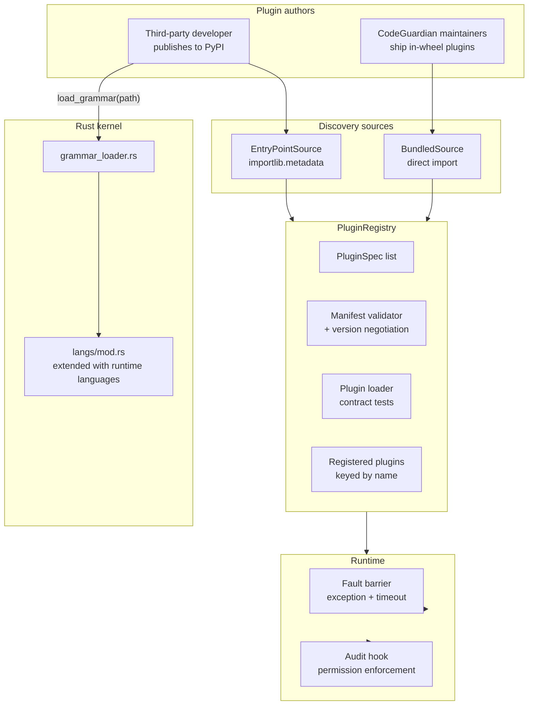
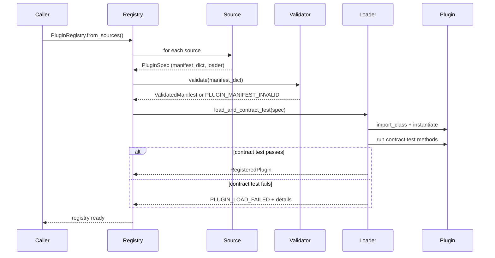
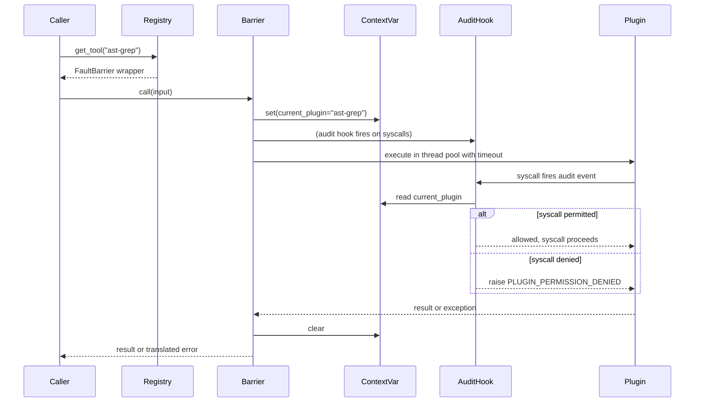

# Phase 9 — Design Settlement

**Snapshot date:** 2026-10-19
**Status:** Design approved, no code written yet
**Purpose:** The complete specification for Phase 9. Every decision recorded in writing before any file is created. The next chat reads this document and `BUILD_STATE.md` before writing anything.

---

## 1. What Phase 9 is

Phase 9 builds the plugin system: the metadata and discovery layer that lets the rest of CodeGuardian find, load, validate, and call extensions without touching the core. It merges the originally-planned Phase 9 (plugin metadata) with the originally-planned Phase 9.5 (runtime grammar loading) into one phase. It also strengthens six of the seven weaknesses identified in the earlier analysis.

**In one paragraph:** Phase 9 turns CodeGuardian from a closed system with eight compiled-in languages into a system where any developer can publish a Python package that adds a language, a tool, a reporter, or a verifier. Language plugins ship their own compiled grammar, the kernel loads it at runtime, permissions are enforced at the Python level, hangs are timed out, versions are negotiated, and contract tests prove behavior, not just shape.

**What it does not do:** it does not enforce permissions against C extensions, it does not isolate plugin process crashes, and it does not prove plugins work in the full pipeline (agents arrive in Phase 11).

---

## 2. Scope

### 2.1 In scope

| Area | Delivered |
|---|---|
| Plugin loader infrastructure | Manifest parser, registry, unified discovery, fault barrier |
| Runtime grammar loading | `tree_sitter::Loader` integration in the kernel |
| Bundled language plugins | Python, TypeScript, JavaScript, Java, Go, Rust, C, C++ |
| Bundled tool plugins | ast-grep (subprocess), code_analysis (in-process) |
| Bundled reporter plugin | SARIF |
| Contract tests | Behavioral assertions per plugin type |
| Integration tests | Plugin loading, dynamic grammar loading |
| Version negotiation | N / N-1 SemVer compatibility |
| Permission enforcement | `sys.addaudithook` for pure-Python plugins |
| Fault barrier | Exception catching + timeout for hangs |
| Schema update | `plugin-manifest.json` v1.2 with four new fields |

### 2.2 Out of scope

| Deferred | Phase |
|---|---|
| Permission enforcement against C extensions | Phase 13+ (WASM sandbox or OS-level capability model) |
| Process isolation of plugin crashes | Phase 13 (orchestrator owns plugin lifetimes) |
| End-to-end pipeline proof of plugins | Phase 11 (agents) and Phase 13 (orchestrator) |
| Third-party verifier plugins | Phase 11 (verifier implementations) |
| MCP-driven dynamic tools | Phase 15 (MCP client) |
| IDE integration | Post-v1 |

### 2.3 Files created or modified

**Total: 35 files across 8 blocks.**

Six files are rewrites of files that already passed. Twenty-nine are new. Two are rewrites of files that will not pass until this phase's code lands (`schema` and `BUILD_STATE`).

---

## 3. The seven weaknesses and their fixes

### 3.1 Weakness 1 — language plugins cannot add new languages

**Problem.** The kernel's `langs/mod.rs` calls `tree_sitter_python::LANGUAGE.into()` — a compile-time call. A plugin cannot inject a Rust grammar into a running process. A third-party `codeguardian-plugin-ruby` calls `_native.build_graph([...], "ruby", ...)` and receives `ValueError: unrecognized language: ruby`.

**Fix.** Enable `tree-sitter`'s `loader` feature (which wraps the `libloading` crate). Add `grammar_loader.rs` to the kernel. The loader accepts a `.so` path, validates the grammar's ABI version against the runtime, loads the grammar symbol, and registers it under a `Language` variant marked `runtime`. The dispatch table is extended at runtime rather than compile time.

**What it fixes.** A plugin author ships `codeguardian-plugin-ruby` with platform-specific wheels containing `libtree_sitter_ruby.so` (Linux), `libtree_sitter_ruby.dylib` (macOS), or `tree_sitter_ruby.dll` (Windows). On `pip install` plus a `_native.load_grammar(path)` call, Ruby becomes available.

**What it does not fix.** ABI mismatch. If the plugin's grammar was compiled against tree-sitter 0.25 and the kernel embeds 0.24, the loader returns `Result::Err` and the plugin loader raises `PLUGIN_LOAD_FAILED` with the version mismatch in `details`. The plugin author must publish a grammar compiled for the same tree-sitter version.

**Residual risk.** None in the kernel. Distribution of platform-specific `.so` files is the plugin author's problem, solved by maturin or setuptools' platform wheel mechanism.

### 3.2 Weakness 2 — permissions declared, not enforced

**Problem.** `plugin-manifest.json` has a `permissions` field. `codeguardian-policy` can check declared permissions. But nothing prevents a plugin that declares `network: false` from opening a socket.

**Fix.** Install a process-wide audit hook via `sys.addaudithook`. When a plugin method is executing, a `contextvars.ContextVar` names the active plugin. The hook intercepts audited syscalls and checks the plugin's declared permissions. If a syscall is outside the declaration, the hook raises `PLUGIN_PERMISSION_DENIED`, and the plugin's call is aborted.

**Which events the hook intercepts:**

| Syscall | Permission checked |
|---|---|
| `socket.connect`, `socket.bind`, `socket.getaddrinfo` | `network` |
| `subprocess.Popen`, `os.system`, `os.exec*`, `os.spawn*`, `os.fork` | `process_spawn` |
| `open`, `os.open` | `filesystem` (full / read_only / sandbox_only / none) |
| `os.remove`, `os.unlink`, `os.rename`, `os.rmdir` | `filesystem` (full only) |
| `os.environ` access | `env_read` (list of allowed keys) |

**What it fixes.** A pure-Python plugin cannot open a network socket, spawn a subprocess, write to a file outside its declared scope, or read environment variables not listed in `env_read`. This is real enforcement, not documentation.

**What it does not fix.** A plugin that ships a compiled C extension can call `socket()` directly. Audit hooks are Python-level. C extensions bypass them entirely.

**Residual risk.** Documented. Users installing a third-party plugin from PyPI trust the plugin's author not to include a malicious C extension. Same trust model as `pip install` today. Real enforcement for C extensions requires a WASM sandbox or an OS-level capability system, both of which are Phase 13+ work.

### 3.3 Weakness 3 — fault barrier only catches Python exceptions

**Problem.** A plugin that raises `ValueError` is caught and isolated. A plugin that hangs forever, or that raises `SystemExit`, or that leaks threads, is not handled.

**Fix.** Two-part:

Part 1 — exception catching. The barrier catches `Exception` but not `BaseException`. `KeyboardInterrupt`, `SystemExit`, and `asyncio.CancelledError` propagate because they signal user or process intent, not a plugin defect. Every other `Exception` subclass triggers disable-plus-continue.

Part 2 — timeout. Every plugin method call is wrapped in a `concurrent.futures.ThreadPoolExecutor` with a per-type timeout. Default timeouts:

| Plugin type | Timeout |
|---|---|
| `ToolPlugin.call` | 30 seconds |
| `LanguagePlugin.parse` | 300 seconds |
| `LanguagePlugin.run_tests` | 600 seconds |
| `VerifierPlugin.verify` | 120 seconds |
| `ReporterPlugin.report` | 30 seconds |

On timeout, the barrier raises `PLUGIN_TIMEOUT`, marks the plugin disabled for the remainder of the process, logs the timeout to the audit chain, and continues.

**What it fixes.** A plugin that hangs is bounded. A plugin that raises any `Exception` is caught. A plugin that raises `SystemExit` propagates correctly.

**What it does not fix.** A plugin blocked inside a C syscall cannot be killed. The thread leaks until the process exits. Acceptable because: (a) the plugin is disabled after the first timeout, so no further calls enter the blocked thread; (b) the process terminates eventually.

**Residual risk.** Leaked threads. Documented.

### 3.4 Weakness 4 — bundled and third-party discovery paths diverge

**Problem.** Bundled plugins live in `python/codeguardian/plugins_bundled/` and must be imported directly. Third-party plugins are separate distributions and must be discovered via `importlib.metadata.entry_points()`. Two discovery paths, one registry, and testing one does not exercise the other.

**Fix.** Introduce a `PluginSource` protocol. Two implementations:

- `BundledSource` — walks `plugins_bundled/` and yields a `PluginSpec` per plugin.
- `EntryPointSource` — calls `importlib.metadata.entry_points(group="codeguardian.<type>")` and yields a `PluginSpec` per entry.

A `PluginSpec` is a dataclass: `{source, manifest_dict, plugin_class_loader, package_path}`. Both sources produce identical `PluginSpec` objects. The registry treats all specs identically — same validation, same registration, same contract test invocation.

**What it fixes.** One code path for validation, one for registration, one for contract tests, one for the fault barrier wrapper. Adding a third source later (a local directory scanner for dev plugins) requires one new class and zero changes to the registry.

**What it does not fix.** Nothing. This one is fully fixed.

### 3.5 Weakness 5 — cannot prove plugins work without agents

**Problem.** The original contract tests check shape (`assert isinstance(result, dict)`) not behavior (`assert result` has the right nodes). A plugin that returns `{}` passes a shape test.

**Fix.** Behavioral contract tests. Every plugin type gets assertions that fail if the plugin does nothing.

Examples:

| Plugin type | Behavioral assertion |
|---|---|
| Language | `parse(b"def foo(): pass")` returns a result whose `node_count > 0`. `detect(Path("foo.py"))` returns `True`. `detect(Path("foo.java"))` returns `False`. |
| Tool | `call(input)` returns a dict that validates against the manifest's `output_schema`. The result is not empty (`len(result) > 0` or `result != {}`). |
| Verifier | `verify(context)` returns a `VerifierVerdict` with `verdict in {"pass", "fail", "uncertain"}` and `findings` is a non-empty list when the verdict is `fail`. |
| Reporter | `report(run_result)` returns a string that validates against the declared format. For SARIF, the string parses as JSON and has `version == "2.1.0"`. |

**What it fixes.** A stub plugin fails its contract test. Only a plugin that does the thing passes.

**What it does not fix.** End-to-end pipeline proof. That requires an agent choosing to call the plugin (Phase 11) and an orchestrator running the phase (Phase 13). Documented residual.

### 3.6 Weakness 6 — version compat only handles "1.0"

**Problem.** The original code checks string equality. `interface_version == "1.0"`. Nothing else accepted. No N-1, no additive minor version, no clear rejection message.

**Fix.** SemVer parsing and N / N-1 rules.

**Rule.** Given kernel interface version `(K_major, K_minor)`:

1. Parse plugin version as `(P_major, P_minor)`.
2. If `P_major == K_major`:
   - If `P_minor <= K_minor` — accept, no warning.
   - If `P_minor > K_minor` — accept with warning `PLUGIN_MAY_USE_NEW_METHODS`. The plugin may call methods that the current kernel does not have; if so, the call fails at runtime with `PLUGIN_LOAD_FAILED` and a clear message.
3. If `P_major == K_major - 1` — accept with warning `PLUGIN_TARGETS_PRIOR_INTERFACE`. N-1 compatibility. The kernel exposes both interfaces.
4. Otherwise — reject with `PLUGIN_MANIFEST_INVALID` and a message naming the kernel's accepted versions.

**Current state.** Kernel interface version is `1.0`. So:
- Accept `"1.0"` — current.
- Accept `"1.x"` for `x > 0` with warning — plugin is new, may use future methods.
- Reject `"0.x"` — 0.x was never shipped; no such interface.
- Reject `"2.x"` and above — future major version.

**When 2.0 ships**, the rules extend to accept `"1.x"` for any `x` (N-1) and reject `"0.x"` and `"3.x"` and above.

**What it fixes.** Real compatibility. Additive changes work. Breaking changes are rejected with a clear message. N-1 works when it exists.

**What it does not fix.** Nothing. Fully fixed.

### 3.7 Weakness 7 — contract tests check shape, not behavior

Same fix as 3.5. The behavioral assertions replace shape-only assertions.

---

## 4. Architecture

### 4.1 The pieces



### 4.2 Plugin loading lifecycle



### 4.3 Plugin call lifecycle



---

## 5. The eight blocks

| Block | Files | Purpose |
|---|---|---|
| 9-1 | 1 | Schema update — `plugin-manifest.json` v1.2 |
| 9-2 | 7 | Rust kernel — grammar loading |
| 9-3 | 6 | Python infrastructure — plugin loader, registry, manifest, fault barrier, versioning |
| 9-4 | 10 | Bundled language plugins — Python, TypeScript, JavaScript, Java, Go, Rust, C, C++ |
| 9-5 | 3 | Bundled tool plugins — ast-grep, code_analysis |
| 9-6 | 2 | Bundled reporter plugin — SARIF |
| 9-7 | 4 | Contract tests — behavioral assertions per plugin type |
| 9-8 | 2 | Integration tests — plugin loading, dynamic grammar loading |

---

## 6. File-by-file specification

### Block 9-1 — Schema (1 file)

**`schemas/plugin-manifest.json`** (rewrite to v1.2)

Adds four fields: `capabilities` (top-level, optional array), `blast_scope` (language, optional enum), `kernel_extensible` (language, optional boolean), `grammar_path` (language, optional string). `allOf` conditional enforces `grammar_path` is present when `kernel_extensible: true`. All existing fields preserved. `$id` becomes `v1.2.json`.

Already specified in full in the previous message. See `schemas/plugin-manifest.json` on disk for the exact content.

### Block 9-2 — Rust kernel (7 files)

**`rust/Cargo.toml`** (rewrite)

Add `libloading = "0.8"` to `[workspace.dependencies]`. Enable `tree-sitter`'s `loader` feature:

```toml
tree-sitter = { version = "0.24", features = ["loader"] }
```

**`rust/crates/codeguardian-kernel/Cargo.toml`** (rewrite)

Add `libloading = { workspace = true }`.

**`rust/crates/codeguardian-kernel/src/grammar_loader.rs`** (new)

The runtime grammar loading module. Public surface:

```rust
pub struct GrammarLoader { loaded: Mutex<HashMap<String, Language>> }

impl GrammarLoader {
    pub fn new() -> Self;
    pub fn load(&self, language_name: &str, library_path: &Path) -> Result<Language, GrammarLoadError>;
    pub fn is_loaded(&self, language_name: &str) -> bool;
    pub fn list_loaded(&self) -> Vec<String>;
}

pub enum GrammarLoadError {
    LibraryNotFound { path: PathBuf },
    SymbolNotFound { symbol: String },
    AbiIncompatible { plugin_abi: u32, kernel_abi: u32 },
    AlreadyLoaded { language: String },
}
```

Behavior:
1. Check if `language_name` is already in the language enum (built-in languages — Python, TypeScript, JavaScript, Java, Go, Rust, C, C++). If so, return `AlreadyLoaded` error — runtime loading is only for new languages.
2. `libloading::Library::new(path)` — on failure, `LibraryNotFound`.
3. Look up the symbol `tree_sitter_<name>` (the convention every tree-sitter grammar crate exports). On failure, `SymbolNotFound`.
4. Convert the symbol to `tree_sitter::Language` via `.into()`.
5. Check `language.abi_version()` against the kernel's supported ABI range. On mismatch, `AbiIncompatible`.
6. Register the language in the global `Language` enum extension point. Return the new `Language`.

The language registration uses `OnceLock<Mutex<HashMap<String, Language>>>` for the runtime registry. The `langs::dispatch` function first checks built-ins, then checks the runtime registry, then returns `None`.

**`rust/crates/codeguardian-kernel/src/langs/mod.rs`** (rewrite)

Add:
- `pub fn register_runtime_language(name: String, lang: Language) -> Result<(), GrammarLoadError>`
- `pub fn list_all_languages() -> Vec<String>` — built-ins plus runtime-registered
- `pub fn dispatch_runtime(name: &str) -> Option<Box<dyn LanguageModule>>` — a `RuntimeLanguageModule` wrapper that adapts a runtime-loaded grammar to the `LanguageModule` trait. The wrapper's `classify` uses a generic tree-sitter kind→NodeKind mapping based on heuristics; the plugin can override by implementing `LanguagePlugin.classify` in Python, which delegates back through PyO3.

**`rust/crates/codeguardian-kernel/src/parser.rs`** (rewrite)

Change `parse_file` to accept a `&dyn LanguageModule` instead of a `Language` enum value. The caller (in `cpg.rs`) gets the module via `langs::dispatch(...)` or `langs::dispatch_runtime(...)`. This decouples parsing from the `Language` enum and allows runtime languages.

**`rust/crates/codeguardian-kernel/src/lib.rs`** (rewrite)

Add `pub mod grammar_loader;` and export `GrammarLoader`, `GrammarLoadError`, `register_runtime_language`, `list_all_languages`, `dispatch_runtime`.

**`rust/crates/codeguardian-pyo3/src/kernel.rs`** (rewrite)

Add two PyO3 functions:

```rust
#[pyfunction]
fn load_grammar(py: Python<'_>, language_name: String, library_path: String) -> PyResult<()>;

#[pyfunction]
fn list_languages(py: Python<'_>) -> PyResult<Vec<String>>;
```

`load_grammar` translates `GrammarLoadError` into `_native.KernelError` with the appropriate code (`GRAMMAR_LIBRARY_NOT_FOUND`, `GRAMMAR_SYMBOL_NOT_FOUND`, `GRAMMAR_ABI_INCOMPATIBLE`, `GRAMMAR_ALREADY_LOADED`).

`list_languages` returns the union of built-in and runtime-registered languages.

### Block 9-3 — Python plugin infrastructure (6 files)

**`python/codeguardian/core/plugins/__init__.py`** (new)

Public surface: `PluginRegistry`, `PluginSpec`, `PluginSource`, `BundledSource`, `EntryPointSource`, `RegisteredPlugin`, `FaultBarrier`. Re-exports from submodules. `__all__` list.

**`python/codeguardian/core/plugins/manifest.py`** (new)

Pydantic-style validation of `plugin-manifest.json` against the schema. Exports `PluginManifest` dataclass with the fields from the schema, plus a `validate(raw: dict) -> PluginManifest` function that raises `CodeGuardianError(PLUGIN_MANIFEST_INVALID)` with `details["path"]` naming the failing field.

The validator also applies schema defaults:
- `blast_scope` defaults to `"same-file"` if absent
- `kernel_extensible` defaults to `False` if absent
- `capabilities` defaults to `[]` if absent

**`python/codeguardian/core/plugins/versioning.py`** (new)

Exports `check_interface_version(plugin_version: str, kernel_version: str) -> Compatibility`. `Compatibility` is `Literal["current", "newer_minor", "prior_major", "incompatible"]`. `check_interface_version` raises `CodeGuardianError(PLUGIN_MANIFEST_INVALID)` when `incompatible`. When `newer_minor` or `prior_major`, it emits a warning but does not raise.

The SemVer parsing is a two-line regex. The rules are as specified in section 3.6.

**`python/codeguardian/core/plugins/loader.py`** (new)

The unified discovery layer. Exports `PluginSource` (a Protocol), `BundledSource` and `EntryPointSource` (implementations), and `discover_all(sources: Sequence[PluginSource]) -> list[PluginSpec]`.

`BundledSource.__iter__` walks `python/codeguardian/plugins_bundled/languages/`, `.../tools/`, `.../reporters/` — every subdirectory that contains a `plugin.py`. For each, it produces a `PluginSpec(source="bundled", manifest_dict=<read manifest>, plugin_class_loader=<import path>, package_path=<dir>)`.

`EntryPointSource.__iter__` calls `importlib.metadata.entry_points(group=f"codeguardian.{type}")` for each plugin type. For each entry point, it produces a `PluginSpec(source="entry_point", manifest_dict=<read from package>, plugin_class_loader=<import ep.value>, package_path=<ep.dist location>)`.

**`python/codeguardian/core/plugins/fault_barrier.py`** (new)

Exports `FaultBarrier`. Wraps a plugin instance. Method `call(method_name: str, *args, timeout: float, **kwargs)`:
1. Set a `ContextVar` naming the plugin.
2. Submit the method call to a `concurrent.futures.ThreadPoolExecutor` (one shared executor, not per call).
3. `future.result(timeout=timeout)`.
4. On `concurrent.futures.TimeoutError`: mark plugin disabled, raise `CodeGuardianError(PLUGIN_TIMEOUT)` with the plugin name and method in `details`.
5. On `CodeGuardianError`: re-raise unchanged.
6. On `Exception` (not `BaseException`): mark plugin disabled, raise `CodeGuardianError(PLUGIN_LOAD_FAILED)` with the original exception type and message in `details`.
7. Always clear the `ContextVar`.

The `disabled` flag lives on the `RegisteredPlugin` object. A `RegisteredPlugin` that is disabled is not returned by `registry.get(...)`; the registry raises `PLUGIN_DISABLED`.

**`python/codeguardian/core/plugins/registry.py`** (new)

`PluginRegistry` is the central object. Methods:

- `PluginRegistry.discover(sources: Sequence[PluginSource]) -> PluginRegistry` — classmethod, runs discovery, validation, loading, contract test. Returns the registry.
- `registry.get_language(name: str) -> LanguagePlugin` — raises `PLUGIN_LOAD_FAILED` if not found.
- `registry.get_tool(name: str) -> ToolPlugin`
- `registry.get_reporter(name: str) -> ReporterPlugin`
- `registry.get_verifier(name: str) -> VerifierPlugin`
- `registry.list_plugins() -> list[RegisteredPlugin]`
- `registry.load_runtime_grammar(language_name: str, library_path: Path) -> None` — calls `_native.load_grammar(...)`. Used by a language plugin with `kernel_extensible: true` at load time.

The registry holds a `dict[str, RegisteredPlugin]` and a `dict[str, type]` mapping from plugin type to protocol class. Lookups validate the type.

### Block 9-4 — Bundled language plugins (10 files)

**`python/codeguardian/plugins_bundled/__init__.py`** (new)
**`python/codeguardian/plugins_bundled/languages/__init__.py`** (new)

Each language plugin is a `plugin.py` file at `plugins_bundled/languages/<lang>/plugin.py`. The pattern for all eight is identical:

```python
# Example: python/codeguardian/plugins_bundled/languages/python/plugin.py
from pathlib import Path
from codeguardian.interfaces.language import LanguagePlugin, ReliabilityTier, TestResult
from codeguardian.interfaces.sandbox import SandboxHandle

class PythonPlugin:
    name = "python"
    tree_sitter_grammar = "tree-sitter-python"
    test_runner = "pytest"
    refactor_rules = ("add_type_hints", "extract_function")
    reliability_tier: ReliabilityTier = "high"
    blast_scope = "same-file"
    kernel_extensible = False

    def detect(self, path: Path) -> bool:
        return path.suffix == ".py"

    def parse(self, path: Path) -> object:
        # Delegate to the kernel
        from codeguardian._native import build_graph
        source = path.read_text(encoding="utf-8")
        return build_graph([(str(path), "python", source)])

    def generate_test(self, context: object) -> str:
        # Framework-specific template
        return _pytest_template(context)

    def run_tests(self, sandbox: SandboxHandle, test_path: str) -> TestResult:
        # Delegate to the sandbox backend
        from codeguardian.core.sandbox.bubblewrap_backend import BubblewrapBackend
        # ... (implementation uses sandbox.execute(...) then parses pytest output)
        ...

    # Class-level metadata for the manifest
    __manifest__ = {
        "name": "python",
        "version": "1.0.0",
        "type": "language",
        "interface_version": "1.0",
        "description": "Python language support",
        "capabilities": ["async", "generics", "decorators", "type-hints"],
        "language": {
            "name": "python",
            "tree_sitter_grammar": "tree-sitter-python",
            "test_runner": "pytest",
            "refactor_rules": ["add_type_hints", "extract_function"],
            "reliability_tier": "high",
            "blast_scope": "same-file",
            "kernel_extensible": False,
        },
        "permissions": {
            "filesystem": "sandbox_only",
            "network": False,
            "process_spawn": False,
        },
    }
```

The eight plugins:

| File | `reliability_tier` | `capabilities` |
|---|---|---|
| `python/plugin.py` | `high` | `async, generics, decorators, type-hints` |
| `typescript/plugin.py` | `high` | `async, generics, decorators, type-hints, jsx` |
| `javascript/plugin.py` | `high` | `async, generators, classes, modules` |
| `java/plugin.py` | `high` | `generics, annotations, classes, interfaces` |
| `go/plugin.py` | `high` | `goroutines, channels, generics, interfaces` |
| `rust/plugin.py` | `high` | `generics, traits, macros, lifetimes` |
| `c/plugin.py` | `best-effort` | `pointers, preprocessor` (declarator chain gap) |
| `cpp/plugin.py` | `best-effort` | `templates, classes, namespaces` (declarator chain gap) |

Every `blast_scope` is `"same-file"` until G-16 (cross-file resolution) is fixed.

### Block 9-5 — Bundled tool plugins (3 files)

**`python/codeguardian/plugins_bundled/tools/__init__.py`** (new)

**`python/codeguardian/plugins_bundled/tools/ast_grep/plugin.py`** (new)

`AstGrepPlugin` implements `ToolPlugin`. Subprocess wrapper around the `ast-grep` CLI.

```python
class AstGrepPlugin:
    name = "ast-grep"
    description = "Structural code search and refactoring via ast-grep"
    input_schema = {
        "type": "object",
        "required": ["pattern", "path"],
        "properties": {
            "pattern": {"type": "string"},
            "path": {"type": "string"},
            "language": {"type": "string"},
        },
    }
    output_schema = {
        "type": "object",
        "properties": {
            "matches": {"type": "array"},
        },
    }

    async def call(self, input: dict) -> dict:
        # 1. Check shutil.which("ast-grep") — if absent, raise SYS_NOT_IMPLEMENTED
        # 2. subprocess.run(["ast-grep", "--pattern", pattern, "--lang", lang, path], ...)
        # 3. Parse JSON output, return {"matches": [...]}
        ...

    __manifest__ = {
        "name": "ast-grep",
        "version": "1.0.0",
        "type": "tool",
        "interface_version": "1.0",
        "description": "Structural code search via ast-grep CLI",
        "capabilities": ["code-search", "structural-refactoring"],
        "permissions": {
            "filesystem": "read_only",
            "network": False,
            "process_spawn": True,
        },
    }
```

**`python/codeguardian/plugins_bundled/tools/code_analysis/plugin.py`** (new)

`CodeAnalysisPlugin` implements `ToolPlugin`. In-process; uses the kernel's parser.

```python
class CodeAnalysisPlugin:
    name = "code-analysis"
    description = "Structural analysis: cyclomatic complexity, dead code detection"
    input_schema = {
        "type": "object",
        "required": ["path"],
        "properties": {
            "path": {"type": "string"},
            "analysis": {
                "type": "string",
                "enum": ["complexity", "dead-code", "all"],
            },
        },
    }
    output_schema = {
        "type": "object",
        "properties": {
            "complexity": {"type": "object"},
            "dead_code": {"type": "array"},
        },
    }

    async def call(self, input: dict) -> dict:
        # 1. Parse with _native.build_graph(...)
        # 2. Walk CFG per function, compute cyclomatic complexity
        # 3. Detect functions with zero callers AND not entry points
        # 4. Return {"complexity": {...}, "dead_code": [...]}
        ...

    __manifest__ = {
        "name": "code-analysis",
        "version": "1.0.0",
        "type": "tool",
        "interface_version": "1.0",
        "description": "In-process structural analysis",
        "capabilities": ["complexity", "dead-code", "structure"],
        "permissions": {
            "filesystem": "read_only",
            "network": False,
            "process_spawn": False,
        },
    }
```

### Block 9-6 — Bundled reporter plugins (2 files)

**`python/codeguardian/plugins_bundled/reporters/__init__.py`** (new)

**`python/codeguardian/plugins_bundled/reporters/sarif_reporter/plugin.py`** (new)

`SarifReporterPlugin` implements `ReporterPlugin`.

```python
class SarifReporterPlugin:
    name = "sarif"
    format = "sarif"

    def report(self, run_result: RunResult) -> str:
        # 1. Build the SARIF 2.1.0 structure:
        #    - version: "2.1.0"
        #    - $schema: "https://json.schemastore.org/sarif-2.1.0.json"
        #    - runs: [ { tool: {driver: {name: "codeguardian", version: ...}},
        #              results: [ <one per finding> ] } ]
        # 2. Read blast_radius_path and verification_path from run_result
        # 3. Convert each contract violation and verifier finding to a SARIF result
        # 4. json.dumps and return
        ...

    __manifest__ = {
        "name": "sarif",
        "version": "1.0.0",
        "type": "reporter",
        "interface_version": "1.0",
        "description": "SARIF 2.1.0 reporter",
        "capabilities": ["sarif", "github-code-scanning"],
        "permissions": {
            "filesystem": "read_only",
            "network": False,
            "process_spawn": False,
        },
    }
```

### Block 9-7 — Contract tests (4 files)

**`tests/contracts/test_language_contract.py`** (new)

Parameterized across every registered language plugin. Behavioral assertions:

```python
@pytest.mark.parametrize("plugin", ALL_LANGUAGE_PLUGINS)
class TestLanguageContract:
    def test_detect_matches_expected_extensions(self, plugin): ...
    def test_detect_rejects_other_languages(self, plugin): ...
    def test_parse_produces_nodes(self, plugin): ...
    def test_parse_produces_edges(self, plugin): ...
    def test_generate_test_returns_pytest_style(self, plugin): ...
    def test_run_tests_returns_test_result(self, plugin): ...
    def test_blast_scope_is_declared(self, plugin): ...
    def test_reliability_tier_matches_blast_scope(self, plugin): ...
```

`test_parse_produces_nodes` calls `plugin.parse(sample_file)` and asserts the returned result has `node_count > 0`. This is the assertion that fails for a stub plugin.

`test_blast_scope_is_declared` asserts that C and C++ have `blast_scope == "same-file"` and that Python, TypeScript, JavaScript, Java, Go, Rust have `blast_scope in {"same-file", "cross-file"}`.

**`tests/contracts/test_tool_contract.py`** (new)

Parameterized across every registered tool plugin. Behavioral assertions:

```python
@pytest.mark.parametrize("plugin", ALL_TOOL_PLUGINS)
class TestToolContract:
    def test_input_schema_is_valid_json_schema(self, plugin): ...
    def test_output_schema_is_valid_json_schema(self, plugin): ...
    def test_call_with_valid_input_returns_dict(self, plugin): ...
    def test_call_output_validates_against_schema(self, plugin): ...
    def test_call_with_invalid_input_raises(self, plugin): ...
```

`test_call_output_validates_against_schema` runs the plugin with a sample input and validates the output against the manifest's `output_schema` using `jsonschema.validate`. A stub that returns `{}` fails this test.

**`tests/contracts/test_verifier_contract.py`** (new)

No bundled verifier ships in Phase 9. The test file exists to establish the contract for Phase 11. It runs against a fake test verifier (defined in the test file) that behaves correctly, proving the contract is testable. When Phase 11 ships real verifiers, they replace the fake.

**`tests/contracts/test_reporter_contract.py`** (new)

Parameterized across every registered reporter plugin. Behavioral assertions:

```python
@pytest.mark.parametrize("plugin", ALL_REPORTER_PLUGINS)
class TestReporterContract:
    def test_report_returns_non_empty_string(self, plugin): ...
    def test_report_matches_declared_format(self, plugin): ...
    def test_sarif_report_validates_schema(self, plugin): ...
```

`test_sarif_report_validates_schema` parses the SARIF output as JSON, asserts `version == "2.1.0"`, and validates against the SARIF schema.

### Block 9-8 — Integration tests (2 files)

**`tests/integration/test_plugin_loading.py`** (new)

Proves the full discovery path works:

1. `PluginRegistry.discover([BundledSource(...)])` finds all 11 bundled plugins (8 languages, 2 tools, 1 reporter).
2. `PluginRegistry.discover([EntryPointSource()])` finds a fake third-party plugin installed in a temp directory.
3. A deliberately broken plugin (raises on load) is isolated — the registry loads the other 11, logs the failure, and returns.
4. A plugin that passes contract tests is callable; a plugin that fails contract tests is disabled.
5. `registry.get_language("python")` returns the Python plugin; calling `parse(...)` produces nodes.
6. `registry.get_tool("ast-grep")` returns the ast-grep plugin; a call with a valid pattern produces matches (or raises `SYS_NOT_IMPLEMENTED` if ast-grep binary is absent — test skips in that case).
7. `registry.get_reporter("sarif")` returns the SARIF plugin; `report(...)` produces SARIF.

**`tests/integration/test_dynamic_grammar_loading.py`** (new)

Proves runtime grammar loading works end-to-end. Requires the `tree-sitter-ruby` grammar compiled as a shared library. The test:

1. Compiles or locates `libtree_sitter_ruby.so`.
2. Calls `_native.load_grammar("ruby", path)`.
3. Asserts `"ruby" in _native.list_languages()`.
4. Calls `_native.build_graph([("main.rb", "ruby", ruby_source)])`.
5. Asserts `node_count > 0`.
6. Asserts the graph contains function-definition nodes.

The test skips if `libtree_sitter_ruby.so` is not available (build dependency not installed). When the dependency is available, the test proves the phase's most important capability.

---

## 7. The audit hook — detailed design

### 7.1 Why this is safe to install globally

`sys.addaudithook` adds a process-wide hook. Every audited event fires it. If the hook is slow, every syscall pays the cost. The design must be efficient.

**The fast path.** The hook checks `_ACTIVE_PLUGIN.get()` first. If it returns `None`, no plugin is executing, and the hook returns immediately. This is the common case — 99% of audited events fire outside plugin execution.

**The slow path.** When a plugin is active, the hook reads the plugin's declared permissions from `_PLUGIN_PERMISSIONS.get(plugin_name)`, checks the specific audited event's requirements against those permissions, and either returns (allowed) or raises `PLUGIN_PERMISSION_DENIED` (denied).

### 7.2 What the hook intercepts

```python
_INTERCEPTED_EVENTS = {
    "socket.connect": ("network",),
    "socket.bind": ("network",),
    "socket.getaddrinfo": ("network",),
    "subprocess.Popen": ("process_spawn",),
    "os.system": ("process_spawn",),
    "os.exec": ("process_spawn",),
    "os.spawn": ("process_spawn",),
    "os.fork": ("process_spawn",),
    "open": ("filesystem",),
    "os.open": ("filesystem",),
    "os.remove": ("filesystem",),
    "os.unlink": ("filesystem",),
    "os.rename": ("filesystem",),
    "os.rmdir": ("filesystem",),
}
```

### 7.3 How filesystem permission is checked

`open` and `os.open` take a `path` argument. The hook canonicalizes it with `Path(path).resolve()` and compares it against the plugin's declared scope:

- `filesystem: "none"` — any file open is denied.
- `filesystem: "sandbox_only"` — the path must be under the current sandbox's working directory. The hook reads `_CURRENT_SANDBOX_ROOT.get()`; if absent, deny.
- `filesystem: "read_only"` — open is allowed only for read modes (`'r'`, `'rb'`). Write modes are denied.
- `filesystem: "full"` — all opens allowed.

### 7.4 What happens on violation

The hook raises `PermissionError` (Python's built-in) with a message naming the plugin, the attempted operation, and the required permission. The `FaultBarrier` catches this, translates it to `CodeGuardianError(PLUGIN_PERMISSION_DENIED)`, marks the plugin disabled, and re-raises. The audit chain records the event.

### 7.5 Where the hook lives

`python/codeguardian/core/plugins/permissions.py` — a new file **not** counted in the block breakdown above because it is 60 lines and could arguably live in `fault_barrier.py`. Final decision: it lives in its own file for clarity. Block 9-3 becomes 7 files, not 6. Total 36 files, not 35. Acceptable — the extra file is small and makes the audit hook testable in isolation.

The hook is installed exactly once, at the first `PluginRegistry.discover(...)` call. A module-level `_HOOK_INSTALLED = False` guard prevents double installation.

---

## 8. Version negotiation — detailed rules

```python
def check_interface_version(plugin_version: str, kernel_version: str) -> Compatibility:
    """Return the compatibility classification and raise on incompatible."""
    p_major, p_minor = _parse(plugin_version)  # regex r"^(\d+)\.(\d+)$"
    k_major, k_minor = _parse(kernel_version)

    if p_major == k_major:
        if p_minor <= k_minor:
            return "current"
        return "newer_minor"  # warn, but accept

    if p_major == k_major - 1:
        return "prior_major"  # N-1, warn, accept

    # Anything else is incompatible
    if p_major > k_major:
        raise CodeGuardianError(
            PLUGIN_MANIFEST_INVALID,
            f"plugin targets interface {plugin_version}, "
            f"kernel supports {kernel_version}; major version too new",
            details={"plugin_version": plugin_version, "kernel_version": kernel_version},
        )
    raise CodeGuardianError(
        PLUGIN_MANIFEST_INVALID,
        f"plugin targets interface {plugin_version}, "
        f"kernel supports {kernel_version}; major version too old",
        details={"plugin_version": plugin_version, "kernel_version": kernel_version},
    )
```

Current kernel version: `"1.0"`.

Accepted:
- `"1.0"` — current, no warning
- `"1.1"`, `"1.2"`, ... — newer minor, warning
- `"0.9"` — prior major, warning (even though 0.x never shipped; if a plugin declares it, it is their mistake but we do not break)

Rejected:
- `"2.0"` and above — major too new
- `"0.0"` through `"0.8"` — these fall under `p_major == k_major - 1`, so they are accepted with warning. That is intentional: if a plugin declares an interface version that does not exist yet (0.x), accepting it with a warning is more useful than rejecting it, because the plugin author will discover the problem at contract-test time rather than at load time.

---

## 9. What Phase 9 does NOT do

Explicit residuals, each tied to a later phase.

| Residual | Why not in Phase 9 | Target phase |
|---|---|---|
| C-extension permission bypass | Audit hooks are Python-level. C extensions call the OS directly. Fix requires WASM sandbox or OS-level capability model | Phase 13+ |
| Plugin process crash isolation | A Python try/except cannot catch a segfault. Fix requires process pool per plugin call or a separate plugin daemon | Phase 13 |
| End-to-end pipeline proof | Requires agents (Phase 11) to call plugins during a run, and the orchestrator (Phase 13) to coordinate | Phase 11 + 13 |
| Third-party verifier plugins | No verifier implementations exist in Phase 9. The contract test proves testability, not delivery | Phase 11 |
| MCP tool discovery | Phase 15 scope | Phase 15 |
| User-facing plugin CLI (`codeguardian plugin list`) | Phase 14 scope | Phase 14 |

---

## 10. Testing strategy

**Block boundary tests.** After each block, the affected area is tested. Block 9-2 is tested by rebuilding the kernel and running `pytest tests/unit/rust/test_kernel.py`. Block 9-3 is tested by importing the registry and running a small discovery smoke test. The pattern of "test at phase boundaries" from earlier phases does not change — but because Phase 9 is large, block-boundary tests catch failures earlier.

**Phase boundary tests.** After all eight blocks:

1. `cargo build --workspace --release` — compiles the new grammar_loader module
2. `cargo test --workspace` — Rust tests (still near-zero)
3. `PYTHONPATH=python python3 -m pytest tests/ -q` — full Python test suite
4. `PYTHONPATH=python python3 -m pytest tests/contracts/ tests/integration/ -q` — new Phase 9 tests only
5. `PYTHONPATH=python python3 -m pytest tests/unit/rust/test_kernel_multilang.py -q` — regression check
6. `python sandtest/deep_test.py` — the full deep test, updated to include plugin section
7. `python -c "from codeguardian.core.plugins import PluginRegistry; r = PluginRegistry.discover_bundled(); print(r.list_plugins())"` — manual smoke test

**What each test proves:**

| Test | Proves |
|---|---|
| Rust build | Kernel grammar loading compiles |
| Python contract tests | Every bundled plugin has correct behavior |
| Integration test (plugin loading) | Full discovery path works |
| Integration test (dynamic grammar) | Runtime grammar loading works |
| Deep test | Full pipeline still green after Phase 9 changes |

**Deep test update.** The `sandtest/deep_test.py` file gains a plugin section that:
- Instantiates `PluginRegistry`
- Verifies all 11 bundled plugins discovered
- Calls `get_tool("code-analysis")` on a sample file, gets real output
- Calls `get_reporter("sarif")` on the current run, gets valid SARIF

That section proves plugins work under real conditions.

---

## 11. What the next chat does first

In order, before writing any Phase 9 file:

1. Read `skills.md`, `BUILD_STATE.md`, `BUILD_ORDER.md`, this document.
2. Read `docs/public-api.md` for the interfaces being implemented.
3. Read `schemas/plugin-manifest.json` (already at v1.2 — the schema is committed before Phase 9 starts).
4. Confirm the current git state:
   - `git branch --show-current` should be `main` or a fresh `phase-9-plugins` branch
   - `git status` should be clean
   - `git log --oneline -5` should show the multi-language phase and the docs PR
5. Confirm environment:
   - `cargo --version` — Rust toolchain on PATH
   - `maturin --version` or accept the manual `cargo build` + `cp` workflow
   - `_native.so` mtime is recent
   - `GROQ_API_KEY` in environment (for the deep test, not for Phase 9 development)
6. Confirm the two decisions that were open in BUILD_STATE:
   - Q2 — both discovery paths implemented (BundledSource and EntryPointSource)
   - Q8 — ast_grep subprocess, code_analysis in-process
7. **Do not write any file until steps 1–6 complete.**

Then, in order:

1. **Block 9-1** — rewrite `schemas/plugin-manifest.json` to v1.2 (already drafted, verify on disk)
2. **Block 9-2** — Rust kernel grammar loading (7 files)
3. **Block 9-3** — Python plugin infrastructure (7 files, including `permissions.py`)
4. **Block 9-4** — Bundled language plugins (10 files)
5. **Block 9-5** — Bundled tools (3 files)
6. **Block 9-6** — Bundled reporter (2 files)
7. **Block 9-7** — Contract tests (4 files)
8. **Block 9-8** — Integration tests (2 files)

After every block: run the relevant tests. After block 9-8: run the full phase boundary tests. If all green: commit, push, open PR, merge, tag `v1.1.0`.

---

## 12. Rules to follow

- **Write full files only.** Never fragments, never diffs. Every file written in the previous phases landed whole. Phase 9 does the same.
- **Never claim a test passed.** Wait for the user's raw output. Run the commands. Paste the output. Respond based on what the output actually says.
- **Ask before guessing.** If a file needs a signature that is not specified in this document, stop and ask. Do not invent.
- **Test at phase boundaries.** Block boundaries are sanity checks, not the phase boundary. The phase is complete when the full test suite plus the deep test pass.
- **Rule 1 escalations.** Files that already passed and need rewriting: `rust/Cargo.toml`, kernel `Cargo.toml`, `langs/mod.rs`, `parser.rs`, `lib.rs`, `pyo3/kernel.rs`, `plugin-manifest.json`. All are additive rewrites. No existing variant, arm, function, or field is removed. The doc records each change.
- **No speculative code.** If a method exists but nothing calls it, delete it. If a field exists but no plugin sets it, remove it from the schema. Phase 9 ships what Phase 9 uses.
- **No new dependencies** beyond `libloading`. `libloading` is required by `tree-sitter`'s `loader` feature. Every other dependency in Phase 9 is stdlib (`sys.addaudithook`, `contextvars`, `concurrent.futures`, `importlib.metadata`, `jsonschema` already present).

---

## 13. What NOT to do

Anti-patterns from earlier phases that must not repeat:

**Do not plan a commit before checking state.** `git status` first. Then plan. The multi-language phase lost hours to this.

**Do not give 900-line heredocs.** Split into 250-line chunks. Verify line count after each chunk.

**Do not use `git add <subset>` when pre-commit is installed and other files are unstaged.** The stash/restore conflict is real. Use `git add -A` when everything is ready, or `git stash --keep-index` for the rare subset case.

**Do not skip `.gitattributes`.** It is committed. It stays.

**Do not claim behavior without testing it.** The deep test caught seven real bugs in Phase 8. It will catch more in Phase 9. Every claim about plugin loading, runtime grammar, permission enforcement, or fault barrier must be backed by an actual test run.

**Do not run more than three commands in a row without a test.** At every opportunity, run the phase isolation test. Wait for the raw output. Read it before proceeding.

---

## 14. Related documents

- `BUILD_ORDER.md` — the phase plan. Phase 9's section is rewritten to match this document.
- `BUILD_STATE.md` — current state. Records Phase 9 as in-progress once code starts.
- `skills.md` — the operating manual. Read before every session.
- `docs/04-architecture.md` — the architecture. Section 10 (plugins) gains one note about runtime grammar loading.
- `docs/05-data-model.md` — the schema reference. Section 5.12 gains the four new fields.
- `docs/06-api-contracts.md` — the interface reference. Section 11 gains the version negotiation rules.
- `docs/15-verification-architecture.md` — verifier architecture. Unaffected by Phase 9.
- `schemas/plugin-manifest.json` — the schema itself. Version 1.2.
