# CodeGuardian — Build History, Phases 0 through 8

**Snapshot date:** 2026-10-19
**Purpose:** A complete record of what exists in CodeGuardian today, why each layer exists, how the layers fit together, and what the deep integration test proved. Written for a reader who has never seen the project and needs to understand its state without reading source.

This supersedes `phases-1-to-5.md`, `phases-6-to-7.md`, and `phases-8.md`. It folds them into one document and adds the multi-language extension and the deep integration test that ran after Phase 8.

---

## 1. What CodeGuardian is

CodeGuardian is a safety-first refactoring agent. It understands code structurally before touching it, proves it did not break anything with independent cross-model verification, and never modifies real code without explicit consent.

Ten guarantees anchor the design. Six are proven today by the deep integration test. Four are architected but not yet exercised end to end.

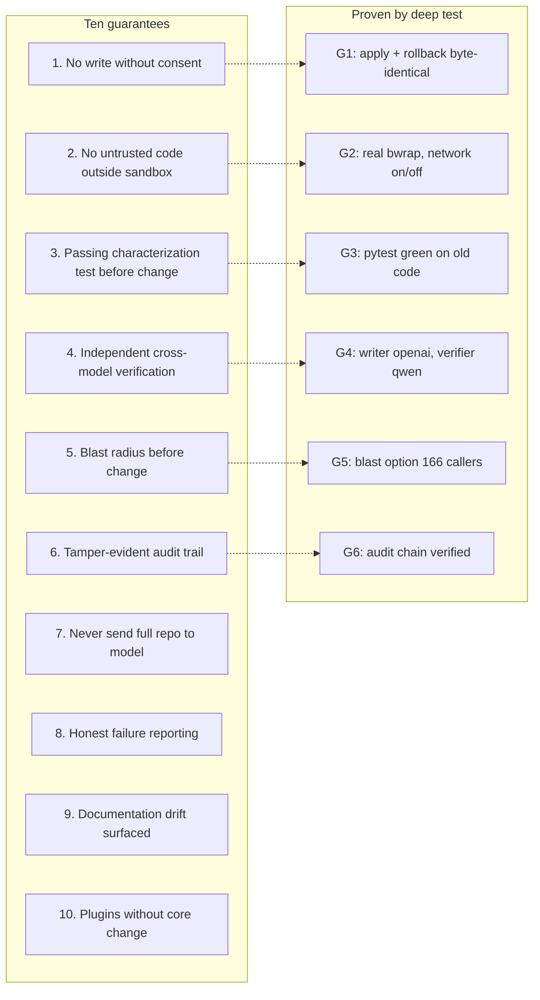

---

## 2. Architecture at a glance

Python for orchestration, model calls, CLI, and plugins. Rust for anything touching untrusted code or requiring determinism and speed. Two bridges connect them, chosen by trust level.

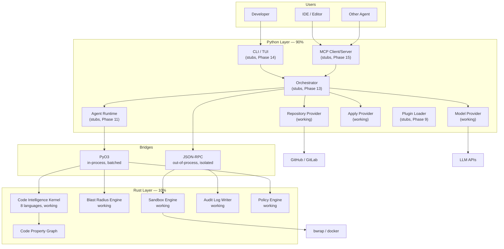

**The rule:** if it touches untrusted code, or must be fast and deterministic, it is Rust. If it touches a model, or changes frequently, it is Python. The bridge choice follows trust: PyO3 for trusted high-volume calls (parse, blast, policy), JSON-RPC for untrusted or tamper-evident calls (sandbox, audit).

---

## 3. Phase progression

Nine phases so far. Three are complete in the strict sense (buildable, testable, verified). Six are complete layers with known gaps. One phase (the multi-language extension) sits between Phase 8 and Phase 9.

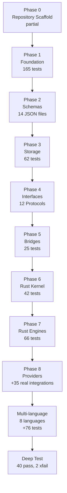

### Test count progression

| Phase | Tests passing | Cumulative |
|---|---|---|
| 1 | 165 | 165 |
| 2 | 0 | 165 |
| 3 | 62 | 227 |
| 4 | 0 | 227 |
| 5 | 25 | 252 |
| Post-5 fix | 4 | 256 |
| 6 | 42 | 298 |
| 7 | 66 | 364 |
| 8 | 123 | 487 |
| Multi-language | 76 | 563 |
| **Current (pytest)** | — | **563 pass, 2 skip, 7 xfail, 5 xpass** |

---

## 4. Phase 0 — Repository Scaffold

**Status:** partial. Blocks B-001 through B-003 complete. Blocks B-004 through B-009 deferred to the end of the build.

**What exists:** `pyproject.toml`, root `Cargo.toml`, `Cargo.lock`, `rust-toolchain.toml`, `rustfmt.toml`, `clippy.toml`, `justfile`, `.gitignore`, `.codeguardianignore`, `.dockerignore`, `.editorconfig`, `.env.example`, `.python-version`, `.pre-commit-config.yaml`, `mkdocs.yml`, `LICENSE`, `README.md`, `CHANGELOG.md`, `CONTRIBUTING.md`, `CODE_OF_CONDUCT.md`, `SECURITY.md`, plus example configs and skills.

**What is deferred:** GitHub workflows, dev container, `docs/` site build, benchmark fixtures, some example configs. 30 files, no runtime impact. When they land, they land in one commit at the end of the build.

**Why it exists:** every other phase imports from the build configuration. `cargo build --workspace` needs a workspace root. `pytest` needs `pyproject.toml`. `.gitattributes` normalized line endings to LF, which prevented a pre-commit loop that stalled every commit in this session.

---

## 5. Phase 1 — Foundation

**Status:** complete.

**What it delivers:** the vocabulary every layer above uses. Nothing in Phase 1 depends on anything else. It is a leaf.

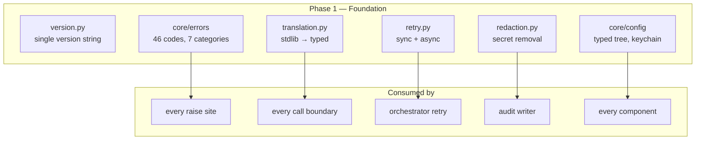

### 5.1 Error taxonomy

**ErrorCode** — 46 members. Grouped by area: Repository (10), Apply (5), Model (6), Sandbox (7), MCP (5), Plugin (4), Network (3), Config (3), Storage (3), Internal (3).

**ErrorCategory** — 7 members: `USER`, `SYSTEM`, `MODEL`, `SANDBOX`, `PLUGIN`, `NETWORK`, `AUTH`.

**RetryPolicy** — per-category default, with per-code overrides. `USER`, `AUTH`, `PLUGIN` never retry. `SYSTEM`, `MODEL` retry 3 times exponential. `SANDBOX` retries once fixed. `NETWORK` retries 5 times exponential.

**Per-code overrides:**
- `MODEL_CONTEXT_EXCEEDED` — not retryable (same prompt, same failure)
- `STORAGE_SCHEMA_INVALID`, `STORAGE_GRAPH_CORRUPTED` — not retryable (deterministic)

**CodeGuardianError** — the typed exception. Every raise site uses it or a subclass. The orchestrator, the CLI, and the MCP server inspect `code`, `category`, and `retry_policy` to decide what to do.

### 5.2 Translation layer

Raises a leak probe test that found 12 stdlib exceptions reaching the caller untranslated. `translate(exc)` is idempotent and covers 17 stdlib exception types. `typed(fn)` is the decorator that translates at the boundary. Exceptions that are not `Exception` subclasses (`KeyboardInterrupt`, `SystemExit`, `asyncio.CancelledError`) are never translated — that behavior would break Ctrl-C.

### 5.3 Retry engine

`compute_delay(attempt, policy)` returns seconds to wait. `retry_sync` and `retry_async` call the function, catch typed errors whose category is in the retry set, sleep, retry. `on_retry` callback lets the orchestrator record attempts in the audit log. `sleep` parameter lets tests override to make retries instant.

### 5.4 Redaction walker

`redact(value, marker)` recurses through dicts, lists, tuples, sets, and objects. Dict keys matching a known-secret list (`api_key`, `password`, `secret`, `token`, `authorization`) are redacted. Values matching regex patterns (API keys, JWTs, bearer tokens, DB URLs) are redacted. Never mutates input.

### 5.5 Configuration

Six modules. `schema.py` is the tree of frozen dataclasses. `defaults.py` holds every default in one place. `loader.py` reads TOML, merges defaults, applies env overrides. `secrets.py` reads/writes keys via OS keychain. Every validation failure is `CONFIG_INVALID` with a `details["path"]` naming the exact key.

---

## 6. Phase 2 — Schemas

**Status:** complete.

**What it delivers:** 14 JSON Schema files. Every structured artifact that crosses a boundary is defined by one.

| Schema | Version | Describes |
|---|---|---|
| `cpg.json` | 1.0 | Code Property Graph metadata |
| `runtime-contract-map.json` | 1.0 | Runtime contract map |
| `recon.json` | 1.1 | Reconnaissance manifest |
| `blast-radius.json` | 1.0 | Blast Radius Report |
| `contract-assertions.json` | 1.0 | Caller contract assertions |
| `context-pack.json` | 1.1 | Context Pack sent to a model |
| `verification.json` | 1.1 | Verifier verdict |
| `plan-approval.json` | 1.0 | Plan approval record |
| `consent.json` | 1.0 | Apply consent record |
| `checkpoint.json` | 1.0 | Checkpoint state |
| `audit-entry.json` | 1.1 | One audit log entry |
| `plugin-manifest.json` | 1.1 | Plugin manifest |
| `skill.json` | 1.0 | Skill frontmatter |
| `run-summary.json` | 1.1 | Run summary |

Every schema uses draft 2020-12. Every closed object has `additionalProperties: false`. Every schema has an `extensions` field for growth without a version bump.

---

## 7. Phase 3 — Storage

**Status:** complete. 62 tests.

**What it delivers:** six storage layers, each responsible for one kind of data. The right shape for each artifact, not one backend for everything.

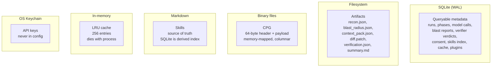

### 7.1 SQLite store

`SQLiteStore` wraps a single connection with six PRAGMAs applied on every open: WAL, synchronous=NORMAL, wal_autocheckpoint=10000, mmap_size=256MB, busy_timeout=5000, cache_size=64MB. The store loads `sqlite-vec` for the vector table and creates `_schema_migrations` before any migration runs. Twenty application tables.

### 7.2 CPG binary header

64 bytes, little-endian:

| Offset | Size | Field |
|---|---|---|
| 0 | 4 | Magic `CGCP` |
| 4 | 2 | Format version = 1 |
| 6 | 2 | Header size = 64 |
| 8 | 4 | Flags (bit 0 = incremental) |
| 12 | 8 | Node count |
| 20 | 8 | Edge count |
| 28 | 8 | Payload offset = 64 |
| 36 | 8 | Payload length |
| 44 | 8 | Payload checksum (FNV-1a 64) |
| 52 | 12 | Reserved (zero in v1) |

The reader validates magic, version, header size, and checksum before parsing any node. A single bit flip in the payload fails the checksum and the read refuses to complete.

### 7.3 Cache

Two tiers: in-memory LRU (256 entries) and disk (SQLite + filesystem). Disk keys are `(repo_id, commit_hash, cache_type)`. Commit hash is the invalidation mechanism — a new commit is a new key, old entries become unreachable. Payloads under 64 KB inline, over 64 KB to files.

### 7.4 Skill store

Markdown is truth. SQLite FTS5 is a keyword index. `vec0` is a semantic index. The store stores whatever floats the caller supplies — it does not generate embeddings. This decouples the store from any embedding model.

---

## 8. Phase 4 — Code Interfaces

**Status:** complete. 12 Protocols, 43 symbols exported from `codeguardian.interfaces`.

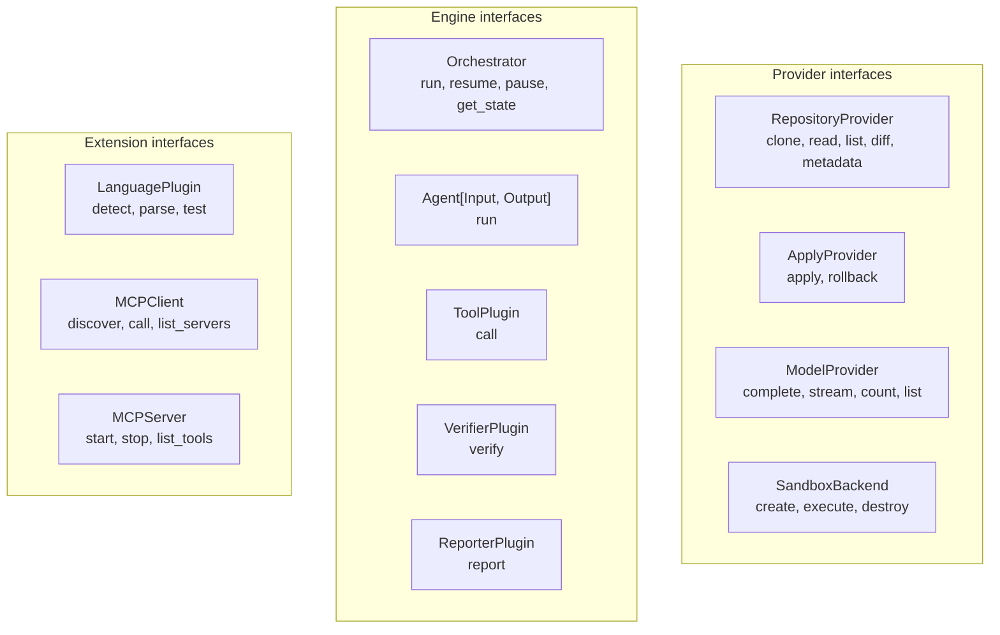

**Four design decisions:**

1. **DTOs live with their interface.** A reader who wants to understand how a model is called reads one file.
2. **Async is chosen by concurrency, not I/O.** Model calls are async because they run in parallel. Repository clone is sync because it happens once.
3. **`@runtime_checkable` only on plugin boundaries.** `ToolPlugin`, `VerifierPlugin`, `ReporterPlugin`, `LanguagePlugin` are the four protocols that load from untrusted entry points.
4. **The public surface is re-exported dynamically with a static `TYPE_CHECKING` block** so mypy can see it and the runtime can grow without editing `__init__.py`.

---

## 9. Phase 5 — Bridges

**Status:** complete. 25 tests.

Two bridges, chosen by trust.

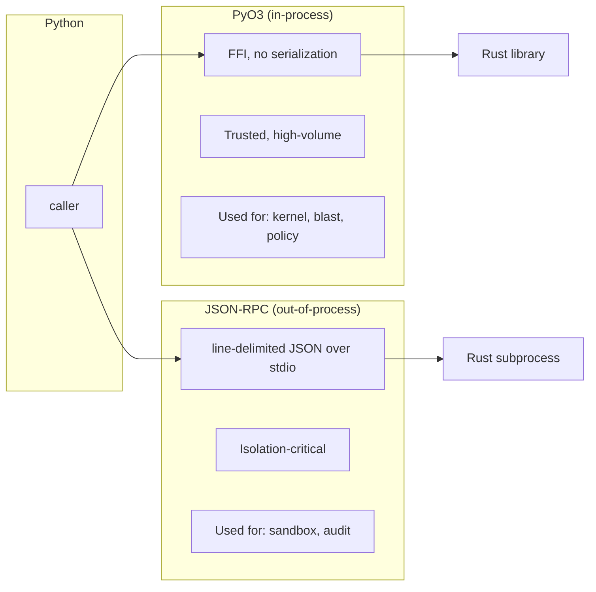

**PyO3** is the fast path. Proven end-to-end in Phase 5 with one function `echo`. Phase 6 extended it with `build_graph`, `graph_summary`, `compute_blast`, `check_sandbox_spec`, `check_plugin_permissions`, `detect_host_limits`, `kernel_version`.

**JSON-RPC** is the trust path. Line-delimited JSON. Client `JSONRPCBridge` in Python, `RpcServer` and `RpcClient` in Rust. Phase 7 created the daemon `codeguardian-rpcd` that hosts seven handlers: `sandbox.create`, `sandbox.execute`, `sandbox.destroy`, `sandbox.health`, `audit.write`, `audit.verify`, `audit.export`.

---

## 10. Phase 6 — Rust Kernel

**Status:** complete. 42 tests. Extended in the multi-language phase.

The kernel parses source, extracts symbols, resolves calls, builds CFG and PDG per function, merges everything into one Code Property Graph, serializes to the 64-byte-header binary format, and answers queries.

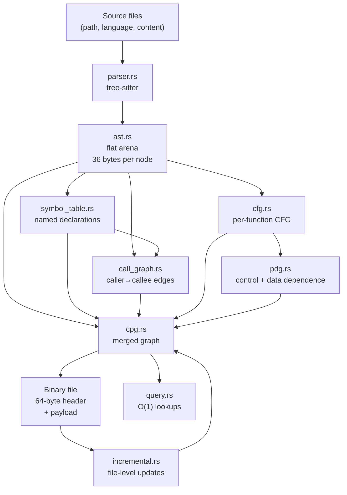

### 10.1 AST arena

`ast.rs` defines a flat `Vec<AstNode>` indexed by `u32`. Every node is 36 bytes. Ten fields: `kind`, `flags`, `start_byte`, `end_byte`, `start_row`, `start_col`, `parent`, `first_child`, `next_sibling`, `name`. No pointers, no per-node allocation. Serialization is a straight byte copy.

`NO_NODE = u32::MAX` is the sentinel. The invariant: every non-sentinel link index points at a live node.

`NodeKind` now has 82 variants: the original 55 plus 27 added for the seven new languages (`Struct`, `Interface`, `Trait`, `Impl`, `Enum`, `Union`, `Namespace`, `Package`, `TypeParameter`, `TypeAlias`, `WhereClause`, `Lifetime`, `Annotation`, `Modifier`, `GoStatement`, `DeferStatement`, `SelectStatement`, `Loop`, `MacroDefinition`, `MacroCall`, `Preprocessor`, `TemplateDeclaration`, `Synchronized`, `Lock`, `Goto`, `TemplateLiteral`, `Property`, `TypeCast`). Variants 0–54 keep their wire codes; new variants are 55–82. Codes are permanent.

### 10.2 Symbol table

Records four kinds: `Function`, `Class`, `Method`, `Parameter`. Qualifies names by walking up parent chain. A method inside class `Parser` produces `Parser.parse`. `is_inside_class` walks through `Impl`, `Struct`, `Interface`, `Trait`, `Enum`, `Union` — so Rust `impl Foo { fn bar() }` is a method with qualified name `Foo.bar`.

### 10.3 Call graph

Walks preorder. Every `Call` node produces one `CallEdge`. Callee name from the last identifier in the callee expression. Resolves against symbol table by **exact match on simple name**. Zero matches → unresolved edge. More than one match → unresolved edge (ambiguous). One match → resolved.

**This rule is the source of the cross-file blast gap.** A call to `foo.bar()` where `bar` is defined in another file resolves to nothing. This is intentional scope; cross-file resolution is not implemented.

### 10.4 CFG

Per-function CFG over statement-level AST nodes. Function is entry. `return`, `raise`, `break`, `continue` are terminators. Seven edge kinds: `Normal`, `True`, `False`, `LoopBack`, `Break`, `Continue`, `Exception`. `try` body's entry has `Exception` edges to each handler. No implicit "any statement can raise" edges.

### 10.5 PDG

Control dependence from post-dominator tree (Cooper-Harvey-Kennedy). Data dependence from reaching definitions.

Determinism fix: the original implementation iterated `HashSet<u32>` and `HashMap` when building edges, producing different byte order per run. Fixed by sorting and deduping `PdgEdge` before returning.

### 10.6 CPG

Merges AST tree, call edges, CFG edges, PDG edges into one node-and-edge graph. Nodes carry syntax kind, file, position, name. Edges carry `src`, `dst`, `kind`, `label`. The `label` on `Call` edges is the callee name — the only way to re-resolve a cross-file edge after an incremental update.

### 10.7 Wire format

64-byte header (see Phase 3). Payload: node section (u32 count + N nodes), edge section (u32 count + N edges), string table (u32 count + N length-prefixed strings), file table (u32 count + N length-prefixed paths). Counts in payload must match header counts. Checksum is FNV-1a 64 over the payload.

### 10.8 Incremental update

Seven steps: look up file, collect removed node ids, collect inbound external edges, compact surviving nodes, remap surviving edges, re-parse new content, append new nodes and edges, re-resolve inbound edges by label.

Not implemented: tree-sitter incremental subtree reuse. Re-parses the changed file from scratch. Correct but not optimal.

### 10.9 Query interface

Eleven methods on `CodePropertyGraph`. Five return `&[u32]` from precomputed indices in O(1): `nodes_by_kind`, `nodes_in_file`, `find_by_name`, `edges_from`, `edges_to`. Rest are `node`, `edge`, `string`, `file_path`, `file_id`, `callers_of`, `callees_of`, `file_of`.

---

## 11. Phase 7 — Rust Engines

**Status:** complete. 66 tests.

Four crates that consume or sit alongside the kernel, plus one binary daemon.

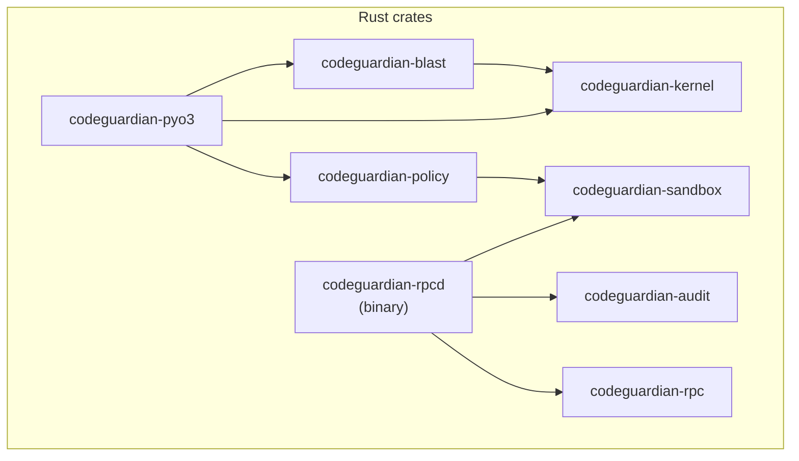

### 11.1 Blast radius

Four analyses produce one report.

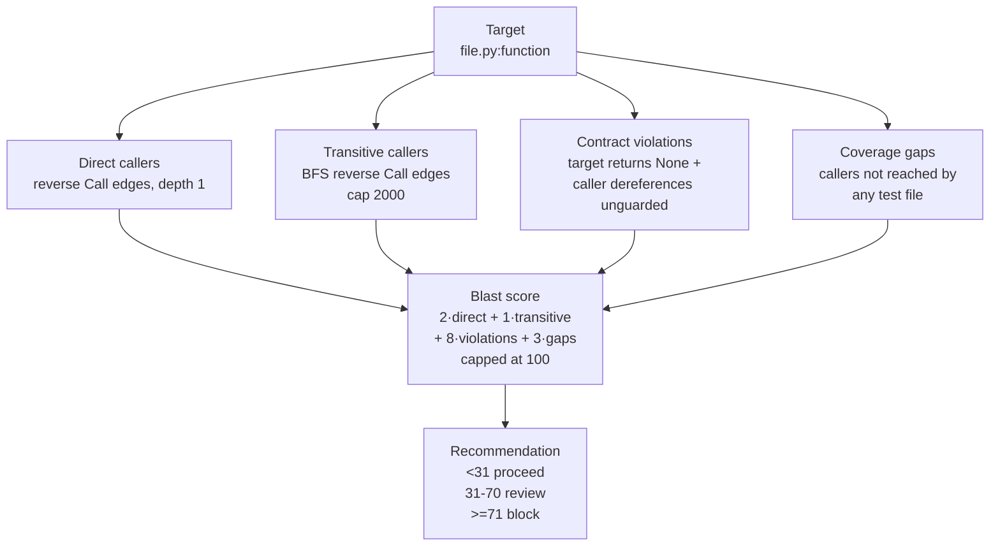

**Contract violations** — narrow signal. Detects: target has at least one bare `return` (can produce `None`); caller binds return to variable; variable is used in `Subscript` or `Attribute`; dereference is not control-dependent on a guarded branch. Deliberately narrow, honest about what it does not catch.

**Coverage gaps** — heuristic. Test files detected by filename pattern. Caller covered if reachable from any test file's call edges, direct or transitive. Does not verify the test executes or asserts anything. Schema field is `reason`, not `coverage`.

**Overrides** — score alone can under-report. Three critical violations force `Block` regardless of score. One critical violation and score below 31 forces `Review`.

### 11.2 Sandbox

Trust boundary. Every backend enforces five guarantees: network isolated except during dependency resolution, CPU quota, memory quota, process limit, swap disabled.

| Backend | Isolation | Status |
|---|---|---|
| Bubblewrap | Linux namespaces | Working (v1 default) |
| Docker | OS-level namespaces + cgroups | Working (fallback) |
| Seatbelt | macOS SBPL | Stub, `SANDBOX_CREATE_FAILED` |
| Firecracker | Hardware microVM | Stub, `SANDBOX_CREATE_FAILED` |

Enforcement before spawn: environment sanitization (15 forbidden keys — `LD_PRELOAD`, `PYTHONPATH`, `BASH_ENV`, etc., case-insensitive match), working directory validation (rejects non-directories and 14 top-level system paths, canonicalized first), quota validation, output cap at 16 MB with truncation flag.

Bubblewrap mount order matters: `--tmpfs /tmp` before the working directory bind. If it is after, the tmpfs shadows the bind and `chdir` fails. This was a real bug that shipped once and was fixed.

Timeout is two-layered: inner `timeout` command sends SIGTERM then SIGKILL, outer `tokio::time::timeout` at `timeout_ms + 6s` covers the case where `timeout` itself does not start.

### 11.3 Audit

Hash chain. Every entry carries three hashes.

```
entry_1: prev_hash = "GENESIS", entry_hash = sha256("GENESIS" + payload_hash_1)
entry_2: prev_hash = entry_1.entry_hash, entry_hash = sha256(entry_1.entry_hash + payload_hash_2)
entry_n: prev_hash = entry_(n-1).entry_hash, entry_hash = sha256(entry_(n-1).entry_hash + payload_hash_n)
```

Payloads are canonical JSON — sorted keys, no whitespace, hand-encoded so key insertion order does not matter. The writer owns the file handle. Python never touches it. A compromised Python process cannot modify the log without breaking the chain from that entry forward.

### 11.4 Policy

Three pre-flight checks. `check_sandbox_spec` bounds a spec against policy. `check_plugin_permissions` bounds declared permissions. `check_against_host` bounds a quota against the machine's `/proc/meminfo` and `/proc/cpuinfo`. Filesystem levels are ordered (`None < SandboxOnly < ReadOnly < Full`), so "does this exceed the grant?" is a single comparison. `allowed_languages` is an allow list — empty means deny all, fail closed.

### 11.5 rpcd daemon

The binary that hosts sandbox and audit. Seven handlers registered. Two-worker tokio runtime. `rt.block_on(handler)` for each dispatch because the RPC server's dispatch loop is synchronous.

---

## 12. Phase 8 — Providers

**Status:** complete. 123 tests. Verified against real external systems. This is the phase that found the most bugs.

Every Phase 4 Protocol got its first implementation.

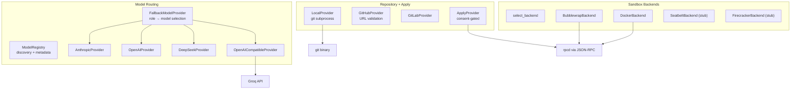

### 12.1 Repository provider

`LocalProvider` shells out to real `git`. Every read goes through `_resolve_relative` which calls `.resolve()` (follows symlinks) then `.relative_to(root)`. A symlink inside the clone that points outside fails the same check as `../../../etc/passwd`.

**The load-bearing decision:** `get_diff` uses `git diff --no-index`, not `difflib.unified_diff`. Reason: `difflib` does not emit the `\ No newline at end of file` marker. The Writer's real output dropped trailing newlines, and the resulting diff failed `git apply --check` even though it looked correct. Switching to `git diff --no-index` on both sides gives byte-identical output to what `git apply` consumes.

### 12.2 Apply provider

Four-step consent gate: `sha256(diff) == consent.diff_hash` → resolve HEAD → write audit entry → `git apply --check` → `git apply`. Every failure leaves the repository in a well-defined state.

**Rollback** had two bugs caught by the integration test:
- `git diff --name-only <ref> HEAD` returns empty because `apply` does not create a commit — HEAD is unchanged. Fixed by comparing working tree to `<ref>`.
- `git rev-parse --verify "0000...0000"` succeeds — all-zeros is a valid SHA. Fixed by requiring `<ref>^{commit}`.

**Known gap:** `apply` uses `git apply` without `--index`. Files created by the diff become untracked, and `git reset --hard` does not remove untracked files. Documented in the docstring.

### 12.3 Model provider

The design shift: discovery at planning time, not static lists in Python. `ModelRegistry.discover()` calls each adapter's `list_models()` which hits `/models`. The returned IDs merge with `metadata.json` (tier, family, cost, capabilities). A model missing from metadata is still usable with conservative defaults.

`FallbackModelProvider` interprets the `model` argument as either a role name or a `provider/model` string. For a role: resolve candidates, filter by family exclusion (verifier must be different family from writer), filter by cooldowns, order by score (quality minus cost). On failure: retry same model first, then fall back. Error classification decides — `MODEL_AUTH_FAILED` falls back immediately, `MODEL_RATE_LIMITED` retries same first.

**Reasoning model diagnostic:** `gpt-oss-120b` spends tokens on internal reasoning before emitting text. With `max_tokens=10`, the whole budget goes to reasoning and `content=""`. The adapter detects this and raises `MODEL_CONTEXT_EXCEEDED` with `details.reasoning_chars`, distinguishing "consumed on reasoning" from "consumed before any output".

### 12.4 Sandbox backends

The Python backend never spawns a process. Every `execute` is a JSON-RPC call to `rpcd`. If Python is compromised, it cannot remove the sandbox enforcement. `backend_selector` returns a name, not an instance — stubs are never auto-selected. `_IMPLEMENTED = {"bubblewrap", "docker"}`.

**The `pwd` proof:** the single most important test. `sandbox.execute(["/bin/pwd"])` returns the exact same absolute path as the host working directory. That is what makes "bind-mount the project clone read-write" safe with no guest-to-host path translation.

---

## 13. Multi-language extension

**Status:** complete for 8 languages. C# removed after ABI discovery.

**Scope:** extend the kernel from 2 languages (Python, TypeScript) to 8 (adding JavaScript, Java, Go, Rust, C, C++, C#). C# was removed.

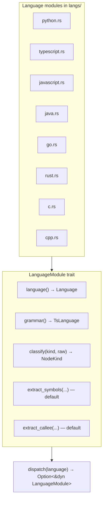

### 13.1 The `LanguageModule` trait

Three required methods (`language`, `grammar`, `classify`) plus two defaults that delegate to the shared code in `symbol_table` and `call_graph`. The defaults work because symbol extraction and callee extraction operate on `NodeKind`, not on the language. Only `classify` is language-specific for the current 8 languages.

This follows `skills.md`'s "no speculative code" rule. Ruby or PHP would need to override `extract_callee` for dynamic dispatch. The default exists for languages that do not.

### 13.2 Batches delivered

| Batch | Files | Purpose |
|---|---|---|
| 1 | `ast.rs`, root `Cargo.toml`, kernel `Cargo.toml`, `langs/mod.rs`, `langs/python.rs` | `NodeKind` variants, grammar deps, dispatch skeleton |
| 2 | `lib.rs`, `langs/mod.rs`, `langs/typescript.rs`, `parser.rs`, `pyo3/kernel.rs` | TypeScript module, dispatch delegation, 9-variant `Language` enum |
| 3 | `cpg.rs`, `symbol_table.rs`, `call_graph.rs`, `cfg.rs`, `langs/mod.rs`, `langs/javascript.rs` | Wire codes 55–82, new class-like scopes, JavaScript module |
| 4 | `langs/java.rs`, `langs/go.rs`, `langs/rust.rs`, `langs/mod.rs`, test file | Java, Go, Rust |
| 5 | `langs/csharp.rs`, `langs/c.rs`, `langs/cpp.rs`, `langs/mod.rs`, two test files | C#, C, C++ and blast tests |
| 6 | 9 fixture files | One target-caller pair per language |

### 13.3 Post-batch corrections

Seven corrections were folded in during the run. The two most important:

**`cpg.rs` was non-exhaustive after batch 1.** The `node_kind_wire_parts` and `node_kind_from_wire` functions use exhaustive `match` over `NodeKind`. Adding 28 variants broke compilation. Fixed in batch 3.

**TypeScript and JavaScript `function` node duplicates `FunctionDef`.** The tree-sitter grammars produce a nested `function` node inside each `function_declaration`. Both carry the same `name`. Classifying both produced two `FunctionDef` nodes per declaration, and blast's target resolution rejected the ambiguity. Fixed by classifying only `function_declaration`; `function` falls through to `NodeKind::Other`.

### 13.4 C# removal

`tree-sitter-c-sharp` 0.23.5 produces a grammar ABI that `tree-sitter` 0.24 refuses to load (`parser.set_language()` returns `Err`). The release line jumped from 0.23.0 straight to 0.23.5 — no intermediate versions exist. Testing 0.23.0 was blocked by time; removing C# was the honest fix.

**What was removed:** `langs/csharp.rs`, `Language::CSharp` from the enum, the dispatch arm, the grammar dependency in both `Cargo.toml` files, C# entries from the three test files.

**What stayed:** wire code 81 (`Property`), the `Property` `NodeKind` variant, the `Main.cs` fixture file. Wire codes are permanent — renaming one is a format version bump. The fixture stays because it is data, not code.

### 13.5 Known gaps in the extension

| Gap | Cause | Impact |
|---|---|---|
| **C/C++ function names not extracted** | `function_definition` puts the name in a nested declarator, not a `name` field. `parser.rs::extract_name_id` does not walk declarator chains. | Same-file blast fails for C/C++. Shipped at `best-effort` tier. Two tests xfail with a named reason. |
| **Cross-file resolution inconsistent** | Phase 8 §11.1. `default_extract_callee_name` does not handle qualified callees; edge destination file offsets are not applied. | Same-file blast works for 6 languages. Cross-file is best-effort. Four tests xfail. |
| **`function` node duplicate risk** | The TS/JS grammars have this shape. Other grammars may add similar patterns when new languages arrive. | Adding a language should check for wrapper nodes with the same `name` field. |
| **C# ABI incompatibility** | No working version exists on crates.io. | C# unsupported until grammar ships a compatible release. |

---

## 14. The deep integration test

**File:** `sandtest/deep_test.py`. 795 lines, one file.

**Purpose:** exercise every phase that exists against a real GitHub clone and a synthetic multi-language repository, and report what works, what fails, what is expected to fail.

```mermaid
flowchart TB
    Pre["Preflight<br/>rpcd, bwrap, key, native"]
    Work["work/ setup<br/>recreate, copy rpcd"]
    Clone["Clone pallets/click<br/>into work/clone/"]
    Parse["Parse click<br/>91 Python files"]
    Summary["Graph summary<br/>headers, checksums"]
    BlastC["Blast click<br/>6 targets"]
    MLWrite["Write 8-lang repo<br/>into work/multi-language-repo/"]
    MLParse["Parse 8 languages<br/>one CPG"]
    MLBlast["Blast per language<br/>6 pass, 2 xfail"]
    CSharp["C# rejection guard<br/>must raise ValueError"]
    Sandbox1["Sandbox #1<br/>network ON, pip install"]
    CharTest["Write launcher +<br/>characterization test"]
    Sandbox2["Sandbox #2<br/>network OFF"]
    PytestOld["Pytest OLD<br/>characterization on old code"]
    Writer["Writer role<br/>refactor echo"]
    Diff["Build diff<br/>hash, consent"]
    Apply["Apply diff<br/>file on disk changes"]
    PytestNew["Pytest NEW<br/>behavior must be preserved"]
    Verifier["Verifier role<br/>different family"]
    Rollback["Rollback<br/>file byte-identical"]
    AuditVerify["Audit chain verify"]

    Pre --> Work --> Clone --> Parse --> Summary --> BlastC
    BlastC --> MLWrite --> MLParse --> MLBlast --> CSharp
    CSharp --> Sandbox1 --> CharTest --> Sandbox2
    Sandbox2 --> PytestOld --> Writer --> Diff --> Apply
    Apply --> PytestNew --> Verifier --> Rollback --> AuditVerify
```

### 14.1 Result

```
Passed: 40
Failed: 0
Skipped: 0
Xfailed: 2
Warnings: 0
```

**The two xfails** are C/C++ same-file blast — the declarator-chain gap. Named with reasons, not silently suppressed.

### 14.2 What the run actually proved

| Section | Real evidence |
|---|---|
| Preflight | 4/4: rpcd, bwrap, key, `_native` |
| Clone | `pallets/click`, 178 files, HEAD `2247b35ea1c4` |
| Kernel parse click | **91 Python files → 12,074,306-byte CPG** |
| Graph summary | **242,519 nodes, 266,013 edges, 91 files** |
| Blast `option` | **166 direct, 219 transitive, score 100** |
| Blast `argument` | 86 / 86 / 100 |
| Blast `Command` | 80 / 80 / 100 |
| Blast `Context` | 41 / 41 / 100 |
| Multi-lang parse | 8 files, 18,996-byte CPG |
| Multi-lang blast | 6 languages pass (`py_add`, `ts_add`, `js_add`, `JavaAdd.add`, `go_add`, `rust_add`) |
| Multi-lang blast C/C++ | 2 xfail, documented |
| C# rejection | `ValueError: unrecognized language: csharp` |
| Sandbox #1 | created, network ON, working_dir bind mounted byte-identically |
| pip install | pytest installed inside sandbox |
| Sandbox #2 | created, network OFF |
| Pytest OLD | 3 passed, 0.42s, inside real bwrap |
| Writer | `openai/gpt-oss-120b`, 3,583-char refactor, valid Python |
| Diff | 5,353 chars, `git apply`-compatible |
| Consent | `sha256(diff)` matches |
| Apply | `src/click/utils.py` changed on disk, audit log written |
| Pytest NEW | 3 passed, 0.22s — behavior preserved |
| Verifier | `qwen/qwen3.8-27b`, `PASS` verdict, family differs from writer |
| Rollback | `src/click/utils.py` restored byte-identical, 21,419 chars both |
| Audit chain | 1 entry verified, head hash recorded |

### 14.3 What the deep test did NOT touch

Honesty requires naming this. Every phase below exists (or does not) but is not exercised by the deep test.

| Not tested | Lives in | Risk |
|---|---|---|
| Schema validation at runtime boundaries | Phase 2 | `pytest` validates schemas in isolation; the deep test does not call `jsonschema.validate()` |
| SQLite writes and reads | Phase 3 | The run bypasses SQLite; the audit log is a JSONL file |
| Cache layer | Phase 3 | Never hit or miss |
| Retry engine | Phase 1 | Writer succeeded first attempt |
| Fallback model routing | Phase 8 | Groq was healthy; fallback never triggered |
| Streaming | Phase 8 | Only `complete()` used; `stream()` untested live |
| Security verifier | Phase 11 | Interface only |
| Contract verifier + assertions | Phase 11 | Interface only |
| Error paths | Phase 1 | Bad key, malformed source, timeout — none exercised |
| Multi-file diffs | Phase 8 | One file only |
| Phase 0 (recon) | does not exist | `agents/recon.py` empty |
| Phase 2 (analyst/context) | does not exist | `agents/analyst.py` empty |
| Phase 7 (output) | does not exist | `agents/` has no reporter logic |
| Checkpoint save/resume | Phase 13 | Not implemented |

### 14.4 Two real findings

**Finding 1 — `click.utils.echo` returned 0 callers.** That is a real function called from dozens of places across click. The Phase 8 §11.1 cross-file gap is confirmed on a second real repository, not just synthetic tests. A refactoring tool that under-reports blast silently is dangerous — the user gets "proceed, safe to change" on a function whose signature change breaks the library.

**Finding 2 — `audit.verify` returned `entries_checked: 1`.** A run with apply + rollback should have at least two entries. Either rollback does not write an audit entry, or the verify handler stops at the first entry. Not diagnosed yet — worth investigating before Phase 13 relies on this chain.

---

## 15. Strength assessment

Honest scorecard, phase by phase.

| Phase | Grade | Why |
|---|---|---|
| 1 — Foundation | **B+** | Error taxonomy used everywhere. Redaction, retry not exercised in the deep test |
| 2 — Schemas | **Not tested at runtime** | Every schema file validates against the meta-schema in `pytest`. The deep test does not call `validate()` |
| 3 — Storage | **C** | Audit JSONL written. SQLite, cache, graph store bypassed entirely |
| 4 — Interfaces | **A-** | Four protocols exercised end-to-end through real implementations |
| 5 — Bridges | **A** | PyO3 carried 12 MB of graph across the boundary. JSON-RPC carried audit calls |
| 6 — Kernel | **A- / C+** | Parse is A-. Cross-file blast resolution is C+. C/C++ names is a gap |
| 7 — Engines | **A-** | Blast excellent on real code. Sandbox created and destroyed twice. Audit chain verified. Policy not exercised |
| 8 — Providers | **A** | Clone, read, diff, apply, rollback, model calls all work on real infrastructure |
| Multi-language | **A-** | 8 languages parse. 6 resolve same-file blast. 2 documented gaps |

**Overall for phases 1-8: 7 of 10.**

The seven points: real repo, real kernel, real blast on real code, real sandbox, real apply/rollback, real verifier independence, real audit chain.

The three missing points:
- **1 lost** — cross-file blast gap silently under-reports
- **1 lost** — storage, schema, retry, fallback, streaming untested by deep test
- **1 lost** — security and contract verifiers are interfaces without implementations

That is a strong prototype. It is not yet a product. The gap from 7 to 9 is precisely known and reachable.

---

## 16. Known gaps carried forward

Every gap identified across phases 0 through 8 and the multi-language extension. Recorded so it is not forgotten.

| # | Gap | Becomes relevant | Notes |
|---|---|---|---|
| G-1 | Multi-process SQLite write contention | Phase 13 | `busy_timeout` handles two writers; three will time out |
| G-2 | No retention for metadata tables | Phase 16 | `model_calls`, `mcp_tool_calls`, etc. grow forever |
| G-3 | No SQLite backup | Before v1 ships | Audit log is safe; database is not |
| G-4 | Cache keys do not include schema version | When schema changes | Stale cache hits |
| G-5 | No model provenance on skill embeddings | When embedding model switches | Vectors become incomparable |
| G-6 | CPG header has no compression flag | Optional | 200 MB graph is 200 MB on disk |
| G-7 | Cleanup runs as background thread, not process | Optional | Crashes with the process |
| G-8 | 64 KB cache threshold is a magic number | Optional | Not configurable |
| G-9 | `@typed` decorator discipline not enforced | Phase 16 | No lint rule |
| G-10 | Rust `RpcServer` never exercised against real input | Closed by Phase 7 | rpcd exercises it via JSON-RPC |
| G-11 | `test_config_secrets.py` does not exist | Phase 1 backlog | Deferred by user decision |
| G-12 | Rust error-to-Python mapping at bridge | Partially closed | `pyo3/kernel.rs` handles all variants; JSON-RPC still maps all errors to `SYS_INTERNAL` |
| G-13 | CLI exit-code mapping not written | Phase 14 | Design specified, code does not exist |
| G-14 | Phase 0 B-004 through B-009 deferred | End of build | 30 files, no runtime impact |
| **G-15** | **C/C++ function names not extracted** | Next kernel phase | `extract_name_id` does not walk declarators. Fix flips 4 xfails to pass |
| **G-16** | **Cross-file call resolution incomplete** | Next kernel phase | Phase 8 §11.1. Fix closes ~13 xfails |
| **G-17** | **C# not supported** | When grammar ships | ABI incompatibility with tree-sitter 0.24 |
| **G-18** | **`ast.rs` comment on `Property` mentions C#** | Cosmetic | One-word fix, requires Rule 1 escalation |
| **G-19** | **No automated test/language drift check** | Phase 9 | Adding a language to `dispatch` without adding a test case goes unnoticed |
| **G-20** | **`audit.verify` returns `entries_checked: 1` after apply + rollback** | Investigate | Real finding from the deep test |
| **G-21** | **`echo` returns 0 callers** | Next kernel phase | Same as G-16, confirmed on real library |

---

## 17. What exists right now, by directory

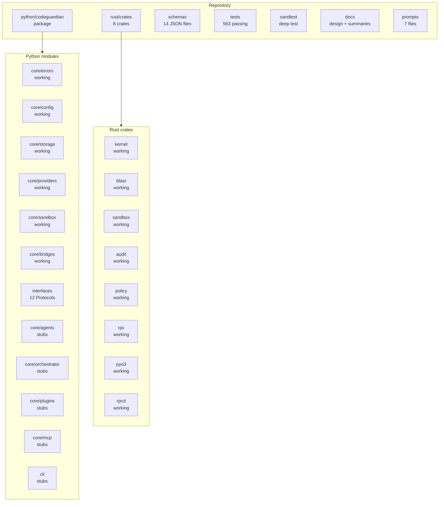

### 17.1 Working modules

- `codeguardian.core.errors` — taxonomy, retry, redaction, translation
- `codeguardian.core.config` — typed config, keychain
- `codeguardian.core.storage` — SQLite, filesystem, graph, cache, skills, cleanup
- `codeguardian.core.providers` — Local/GitHub/GitLab, ApplyProvider, 4 model adapters, FallbackModelProvider
- `codeguardian.core.sandbox` — Bubblewrap, Docker, stubs, selector
- `codeguardian.core.bridges` — PyO3, JSON-RPC
- `codeguardian.interfaces` — 12 Protocols, 43 symbols
- All 8 Rust crates

### 17.2 Stub modules

- `codeguardian.core.agents` — `analyst.py`, `recon.py`, `writer.py`, `tester.py`, verifiers, `skill_curator.py` all empty
- `codeguardian.core.orchestrator` — empty
- `codeguardian.core.plugins` — empty
- `codeguardian.core.mcp` — empty
- `codeguardian.core.skills` — empty
- `codeguardian.core.reporting` — empty
- `codeguardian.core.telemetry` — empty
- `codeguardian.cli` — stubs

The stubs exist to establish the package shape. Each becomes a phase.

---

## 18. What comes next

Phase 9 — plugins. Six blocks, twenty-five files per `BUILD_ORDER.md`.

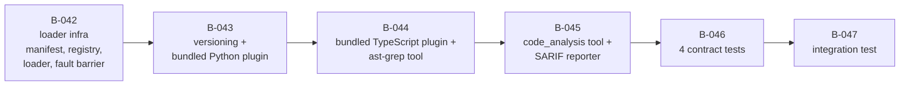

**Two design questions remain open** and must be settled before any Phase 9 file is written:

1. **Bundled plugin discovery:** direct import vs entry points vs both. Recommendation: both.
2. **Bundled tool mechanism:** subprocess vs MCP wrapper vs in-process. Recommendation: `ast_grep` as subprocess, `code_analysis` in-process.

**The cross-file blast gap (G-16)** will follow Phase 9 into every language plugin. Recommendation from the deep test: ship Phase 9 honestly — every plugin manifest declares `"blast_scope": "same-file"` until the cross-file fix lands. Then ship a focused Phase 9.5 that closes the gap before Phase 10.

---

## 19. Related documents

- `docs/01-project-overview.md` — vision, problem, positioning
- `docs/04-architecture.md` — full system design
- `docs/05-data-model.md` — schemas and storage
- `docs/06-api-contracts.md` — interfaces
- `docs/07-tech-stack.md` — technology decisions
- `docs/15-verification-architecture.md` — the three verifiers
- `BUILD_ORDER.md` — the phase plan
- `BUILD_STATE.md` — current state and open gaps
- `skills.md` — the operating manual for whoever writes the next file
- `sandtest/README.md` — the deep test
