# CodeGuardian — Build History, Phases 1 through 5

**Snapshot date:** 2026-10-14
**Purpose:** A single record of what was built in Phases 1 through 5 of
CodeGuardian, why each piece exists, what it hands forward to later
phases, and how the completed layers fit together. This document is
written to be read by someone who has not seen the project before and
needs to understand the state of the code without re-deriving it from
source.

---

## How to read this document

The build is organized into phases. Each phase delivers one layer of
the system and is tested before the next begins. A phase is not a
sprint, and it is not measured in time. It is measured by what it
leaves behind.

The five phases covered here are:

| Phase | Layer | Purpose |
|---|---|---|
| 1 | Foundation | Error taxonomy, retry engine, redaction, configuration |
| 2 | Schemas | Every structured artifact defined as JSON Schema |
| 3 | Storage | SQLite, filesystem, graph files, cache, skills |
| 4 | Code Interfaces | The Protocol layer that binds every component |
| 5 | Bridges | Python-to-Rust communication, in-process and out-of-process |

Phase 0, the repository scaffold, is partially complete. Blocks B-004
through B-009 were deferred to the end of the build. The scaffold files
that do exist are the ones required to run tests: `pyproject.toml`,
`Cargo.toml`, `rust-toolchain.toml`, the `.gitignore`, and the CI
workflow definitions. Phase 0 is not described in this document beyond
that note because it produced no runtime behavior.

Every later section in this document refers to what the code does, not
to how it was written. A reader who wants the code should read the
source. A reader who wants the shape of the system should read this.

---

## Phase 1 — Foundation

### What the phase delivers

Phase 1 establishes the vocabulary and the small set of utilities that
every other phase uses. It is the only phase whose modules are imported
by every layer above it. Nothing in Phase 1 depends on anything else
in the system. It is a leaf.

The phase delivers five distinct capabilities:

1. A package identity with a single version string.
2. A typed error vocabulary.
3. A translation layer that converts standard library exceptions into
   typed errors.
4. A retry engine that consults the error taxonomy.
5. A redaction walker that removes secrets before they reach any log.
6. A configuration system with a typed schema and an OS keychain
   wrapper for API keys.

Each of these is small. Together they define the boundaries that every
later phase respects.

### Package identity

The package exposes its version at two import paths. `codeguardian.version`
is the canonical module. `codeguardian.__version__` is a convenience
alias so callers do not need to know the submodule name. Both resolve
to the same string, `"1.0.0"`.

This is a single source of truth. Every later module that reports or
checks the version imports from `codeguardian.version`. There is no
second place where the version string is written.

### The error taxonomy

CodeGuardian does not use bare `except` clauses, and it does not raise
`Exception`. Every raise site in the codebase uses a typed error from
`codeguardian.core.errors`. That typed error carries a code, a
category, and a retry policy.

The taxonomy has three levels:

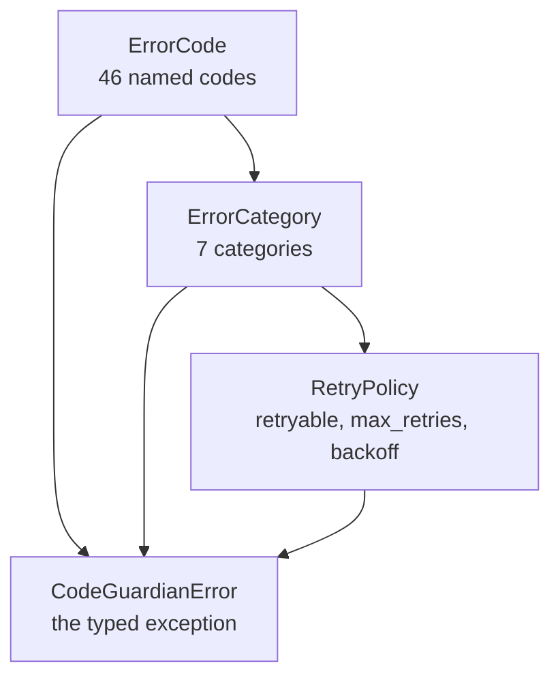

**ErrorCode** is an enum with 46 members. Each member's name and value
are the same string. A code is not classified by its prefix, but by
its cause. `REPO_AUTH_FAILED` and `MODEL_AUTH_FAILED` share a prefix
with other codes but belong to the same category because the correct
response is the same.

The 46 codes are grouped by area:

| Area | Codes |
|---|---|
| Repository | `REPO_CLONE_FAILED`, `REPO_AUTH_FAILED`, `REPO_NOT_FOUND`, `PATTERN_INVALID`, `DIFF_COMPUTE_FAILED`, `METADATA_UNAVAILABLE`, `FILE_NOT_FOUND`, `FILE_TOO_LARGE`, `FILE_BINARY`, `FILE_PERMISSION_DENIED` |
| Apply | `APPLY_CONFLICT`, `APPLY_AUTH_FAILED`, `APPLY_PARTIAL`, `ROLLBACK_FAILED`, `ROLLBACK_REF_NOT_FOUND` |
| Model | `MODEL_UNAVAILABLE`, `MODEL_RATE_LIMITED`, `MODEL_CONTEXT_EXCEEDED`, `MODEL_AUTH_FAILED`, `MODEL_UNKNOWN`, `PROVIDER_UNAVAILABLE` |
| Sandbox | `SANDBOX_CREATE_FAILED`, `SANDBOX_IMAGE_UNAVAILABLE`, `SANDBOX_QUOTA_EXCEEDED`, `SANDBOX_TIMEOUT`, `SANDBOX_OOM`, `SANDBOX_EXEC_FAILED`, `SANDBOX_NOT_FOUND` |
| MCP | `MCP_SERVER_UNAVAILABLE`, `MCP_PROTOCOL_ERROR`, `MCP_TOOL_NOT_FOUND`, `MCP_TOOL_TIMEOUT`, `MCP_TOOL_ERROR` |
| Plugin | `PLUGIN_LOAD_FAILED`, `PLUGIN_MANIFEST_INVALID`, `PLUGIN_PERMISSION_DENIED`, `PLUGIN_DISABLED` |
| Network | `NET_TIMEOUT`, `NET_UNREACHABLE`, `NET_DNS_FAILED` |
| Config | `CONFIG_INVALID`, `CONFIG_PARSE_ERROR`, `SECRET_KEYCHAIN_ERROR` |
| Storage | `STORAGE_MIGRATION_FAILED`, `STORAGE_SCHEMA_INVALID`, `STORAGE_GRAPH_CORRUPTED` |
| Internal | `SYS_INTERNAL`, `SYS_NOT_IMPLEMENTED`, `SYS_INVARIANT_VIOLATED` |

**ErrorCategory** is an enum with seven members: `USER`, `SYSTEM`,
`MODEL`, `SANDBOX`, `PLUGIN`, `NETWORK`, `AUTH`. The category is the
unit of retry policy. A code belongs to exactly one category. The
mapping is frozen at import time and cannot be edited at runtime.

**RetryPolicy** is a frozen dataclass with three fields: `retryable`,
`max_retries`, and `backoff`. `backoff` is one of `NONE`, `FIXED`, or
`EXPONENTIAL`. The policy describes how many times a failure should be
retried before being escalated. A policy of `max_retries=3` means one
initial attempt plus up to three retries, for four attempts total.

**CodeGuardianError** is the typed exception. Every raise site uses it
or a subclass. It carries the code, the message, the details dictionary,
the category, and the retry policy. The orchestrator, the CLI, and the
MCP server inspect these attributes to decide whether to retry, to
escalate, or to map the failure to an exit code.

The category-to-policy mapping is:

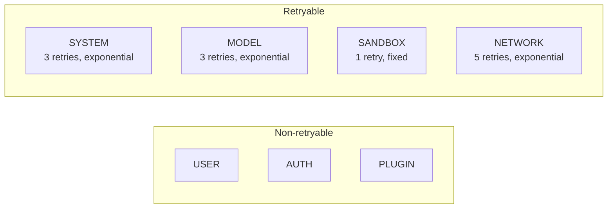

Three codes carry per-code policy overrides that differ from their
category default. `MODEL_CONTEXT_EXCEEDED` is a model error but is not
retryable, because a prompt that exceeded the model's context window
will exceed it again. `STORAGE_SCHEMA_INVALID` and
`STORAGE_GRAPH_CORRUPTED` are system errors but are not retryable,
because schema validation and corruption detection are deterministic:
the same bytes produce the same failure on every attempt.

### The translation layer

A leak probe run during Phase 1 found that every standard library
exception passed through the pipeline untyped. A `ValueError` from
`json.loads` reached the caller as a `ValueError`. A `FileNotFoundError`
reached the caller as a `FileNotFoundError`. This meant that handlers
that expected typed errors could not distinguish a malformed JSON
response from a missing file from a network timeout.

The translation layer is the single chokepoint that converts standard
library exceptions into typed errors. It exposes two functions:

- `translate(exc)` converts a standard library exception into a
  `CodeGuardianError`. It is idempotent: passing a `CodeGuardianError`
  through it returns the same object unchanged.
- `typed(fn)` is a decorator that wraps a function so that any standard
  library exception it raises is translated before it propagates.

Every call boundary in the system passes standard library exceptions
through `translate`. The result is that a caller at the top of the
stack sees only `CodeGuardianError`. The category and retry policy are
attached. The orchestrator can decide what to do without inspecting
exception types.

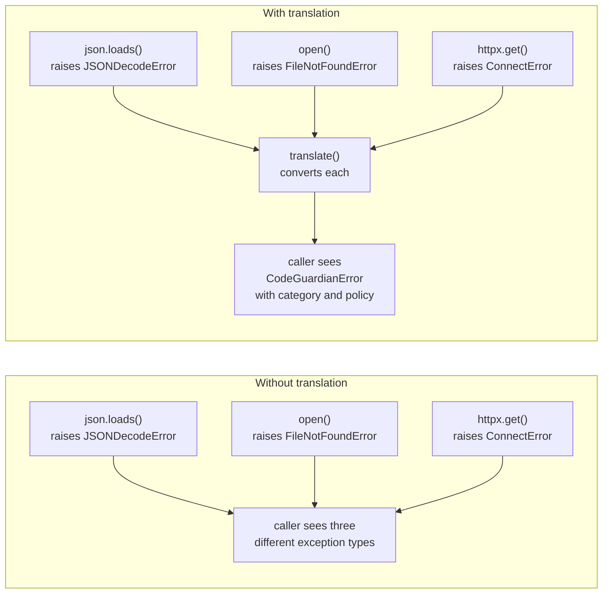

### The retry engine

The retry engine is what turns the taxonomy into behavior. It exposes
three functions:

- `compute_delay(attempt, policy, rng)` returns the number of seconds
  to wait before the next attempt, based on the policy's backoff
  strategy. `FIXED` returns a constant. `EXPONENTIAL` doubles each
  attempt, capped, with optional jitter.
- `retry_sync(fn, ...)` calls a synchronous function, catches typed
  errors whose category is in the retry set, sleeps the computed delay,
  and retries up to `max_retries`.
- `retry_async(fn, ...)` does the same for async functions.

The engine also accepts an `on_retry` callback, which the orchestrator
uses to record retry attempts in the audit log, and a `sleep` parameter
that tests override to make retries instant.

The retry engine never catches a `CodeGuardianError` whose category is
not in the retry set. A user error propagates on the first attempt. An
auth error propagates on the first attempt. A plugin error propagates
on the first attempt. Only system, model, sandbox, and network errors
are retried, and only up to the policy's limit.

### The redaction walker

The redaction walker removes secrets from structured data before it
reaches any log or any audit entry. It exposes one function,
`redact(value, marker)`, and one constant, `DEFAULT_MARKER`, which is
`"[REDACTED]"`.

The walker recurses through dictionaries, lists, tuples, sets, and
arbitrary objects. For dictionaries, it checks each key against a
known-secret list (`api_key`, `password`, `secret`, `token`,
`authorization`, and so on). If the key matches, the value is replaced
with the marker. For values, it applies a set of regex patterns for
API keys, JWTs, bearer tokens, database URLs with embedded credentials,
and other known formats.

The walker never mutates its input. It always returns a new structure.
This is important because the same object may be referenced by multiple
consumers, and redaction must not remove information from a structure
that another consumer needs in full.

### The configuration system

The configuration system has five modules:

- `schema.py` defines the shape of `config.toml` as a tree of frozen
  dataclasses. Every class uses `slots=True` so instances are compact
  and typos on attribute assignment fail immediately.
- `defaults.py` holds every default value in one place. This means the
  defaults can be reviewed as a set, not scattered across loader logic.
- `loader.py` reads the TOML file, merges it with environment variable
  overrides, and returns a typed `Config`. It raises `CONFIG_PARSE_ERROR`
  for TOML syntax failures and `CONFIG_INVALID` for schema violations.
- `secrets.py` reads and writes API keys through the operating system's
  keychain. On Linux it uses `libsecret`. On macOS it uses Keychain.
  On Windows it uses Credential Manager. Keys are never written to the
  config file.
- `__init__.py` re-exports the public surface.

The configuration tree mirrors the `config.toml` structure:

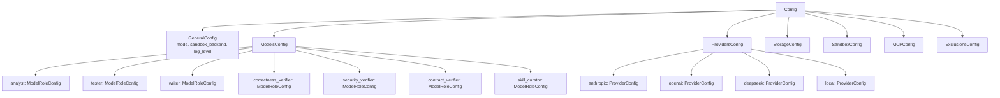

Every configuration value is optional at the file level. The loader
merges defaults, then file values, then environment variables. The
result is a fully populated tree with no `None` at the top level.

### What Phase 1 hands forward

Phase 1 hands forward three things that later phases depend on:

1. The error taxonomy. Every later module imports from
   `codeguardian.core.errors`.
2. The configuration tree. Every later module that reads config goes
   through `load_config()`.
3. The redaction walker. The audit writer calls it before writing
   every entry.

Nothing in Phase 1 depends on a later phase. It is the true leaf.

### What Phase 1 deliberately does not do

Phase 1 does not define interfaces. That is Phase 4. It does not
define schemas. That is Phase 2. It does not persist anything. That is
Phase 3. It does not communicate with Rust. That is Phase 5.

The distinction matters because it means Phase 1 can be read and
understood in isolation. A reader who wants to understand the error
vocabulary does not need to understand the storage layer.

---

## Phase 2 — Schemas

### What the phase delivers

Phase 2 defines fourteen JSON Schema files in the `schemas/` directory.
Each describes one structured artifact that moves through the pipeline.
The schemas are the contract between the components that produce an
artifact and the components that consume it.

The fourteen schemas are:

| Schema | Version | Describes |
|---|---|---|
| `cpg.json` | 1.0 | Code Property Graph metadata |
| `runtime-contract-map.json` | 1.0 | Runtime contract map |
| `recon.json` | 1.1 | Reconnaissance manifest |
| `blast-radius.json` | 1.0 | Blast Radius Report |
| `contract-assertions.json` | 1.0 | Caller contract assertions |
| `context-pack.json` | 1.1 | Context Pack sent to a model |
| `verification.json` | 1.1 | Verifier verdict |
| `plan-approval.json` | 1.0 | Plan approval record |
| `consent.json` | 1.0 | Apply consent record |
| `checkpoint.json` | 1.0 | Checkpoint state |
| `audit-entry.json` | 1.1 | One audit log entry |
| `plugin-manifest.json` | 1.1 | Plugin manifest |
| `skill.json` | 1.0 | Skill frontmatter |
| `run-summary.json` | 1.1 | Run summary |

Each schema uses JSON Schema draft 2020-12. Each has a stable `$id`
under `codeguardian.dev/schemas/<name>/v<version>.json`. The version
is independent of the application version and independent of every
other schema.

### Structure of every schema

Every schema follows the same structure:

- A `$schema` field set to the draft 2020-12 URL.
- A `$id` field set to the stable URL for this schema.
- A `title` describing the artifact.
- A `type` of `"object"`.
- A `required` array listing the fields that must be present.
- `additionalProperties: false` on every closed object. A closed object
  is one whose keys are all known. This catches typos and field drift
  at validation time rather than at use time.
- A top-level `extensions` property of type object with
  `additionalProperties: true`. Every schema has a place to grow
  without a version bump.
- `properties` listing every field, its type, and any constraints.

The `additionalProperties: false` rule is a deviation from the design
document, which left it off. The deviation was authorized before the
schemas were written. The reason is that without it, a misspelled field
name is silently accepted, and the consumer of the artifact will fail
much later with a less clear error.

The `extensions` field is also a deviation. It gives every schema a
growth point that does not require a version bump. The design review
identified specific nested objects that would exercise this field
first: `recon.structural`, `verification.model`,
`verification.findings[]`, several sections of `audit-entry`,
several sections of `plugin-manifest`, and the finding and proposal
entries in `run-summary`.

### How the schemas relate to each other

The schemas form a chain. Each artifact refers to another by name or
by path, and the shape of the reference is defined in the referring
schema. The chain is:

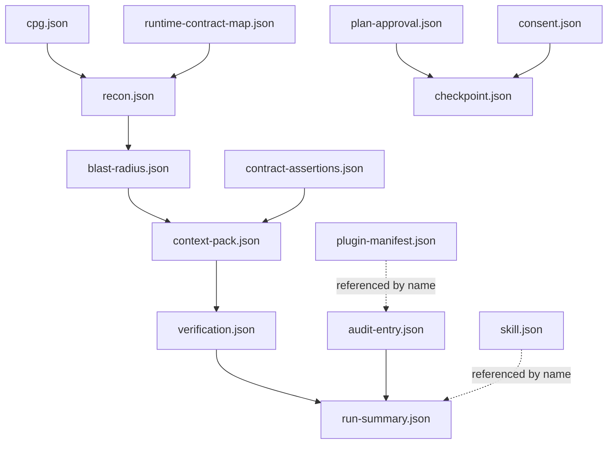

Reconnaissance reads the Code Property Graph and the runtime contract
map. The Blast Radius Report reads the reconnaissance manifest. The
Context Pack reads the Blast Radius Report and the contract assertions.
The verifier verdict reads the Context Pack. The run summary reads
everything.

The schemas do not enforce this order. That is the orchestrator's
job. The schemas only describe the shape of each artifact.

### Validation

Every schema is checked against the draft 2020-12 meta-schema. The
check runs with `Draft202012Validator.check_schema()`, which validates
the schema document itself, not an instance against it. This catches
a malformed schema before any code attempts to use it.

The check runs at every phase boundary. If a schema is edited and the
edit produces a document that does not conform to the meta-schema,
the phase boundary test fails.

### What Phase 2 hands forward

Phase 2 hands forward the shape of every artifact that later phases
produce. Phase 3 uses the schemas to validate artifacts on write.
Phase 8 uses them to validate provider outputs. Phase 11 uses them to
validate agent outputs. Phase 15 uses them to generate the final
report.

Because the schemas are versioned independently, a schema can change
without forcing a version bump on the application. The core reads
version N and N-1 of every schema. Older versions are rejected with a
clear error.

### What Phase 2 deliberately does not do

Phase 2 does not implement validation. It does not generate code from
the schemas. It does not wire the schemas into any consumer. It only
defines the schemas themselves. Phase 3 is the first consumer.

The reason for the separation is that the schemas will be read by
different tools. A test suite uses them to validate artifacts. A
documentation generator uses them to produce human-readable reference
pages. A TypeScript client uses them to generate types for the VS Code
extension. Keeping the schemas independent of any specific consumer
means they can serve all of them.

---

## Phase 3 — Storage

### What the phase delivers

Phase 3 delivers six storage layers, each responsible for one kind of
data. The phase does not put everything in one place. It chooses the
right storage shape for each artifact.

The five storage shapes are:

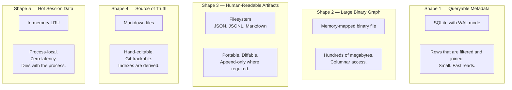

Choosing the right shape for each artifact is what keeps the system
fast. The Code Property Graph, at hundreds of megabytes, does not slow
down queries against the run history, at a few kilobytes. The two are
stored in different places, and access to one does not touch the other.

### The SQLite store

`SQLiteStore` wraps a single SQLite connection with the PRAGMAs that
make it a production-grade local database. The store does not know
about runs or models or skills. It exposes `execute`, `query`, and
`execute_script`, and it manages the connection lifecycle.

The PRAGMAs applied on every open are:

```sql
PRAGMA journal_mode = WAL;
PRAGMA synchronous = NORMAL;
PRAGMA wal_autocheckpoint = 10000;
PRAGMA mmap_size = 268435456;
PRAGMA busy_timeout = 5000;
PRAGMA cache_size = -64000;
```

Each PRAGMA has a specific reason for being present.

`journal_mode = WAL` changes SQLite from rollback journal mode to
write-ahead log mode. In rollback mode, a writer takes an exclusive
lock on the database file, blocking readers. In WAL mode, writers
append to a separate log file, and readers read from the last
committed snapshot. Readers and writers do not block each other.

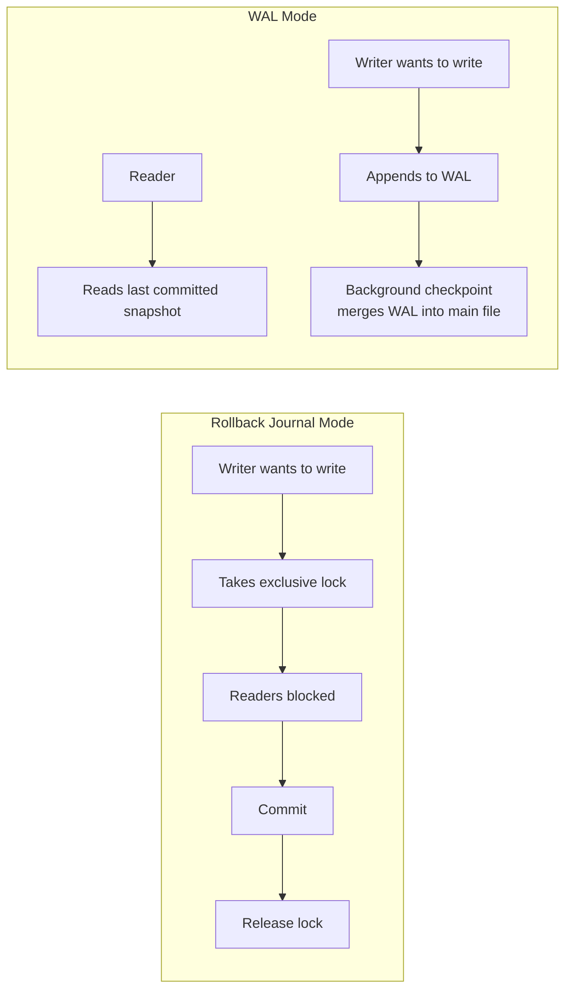

`synchronous = NORMAL` tells SQLite how aggressively to flush to disk.
`FULL` flushes after every commit. `NORMAL` flushes periodically. In
WAL mode, `NORMAL` is safe against process crashes. Only a power loss
can lose the most recent commit. The trade-off is that a commit costs
half the fsyncs of `FULL`.

`wal_autocheckpoint = 10000` sets how often SQLite merges the WAL back
into the main database file. The default is 1000 pages, about 4 MB.
Raising it to 10000 pages, about 40 MB, reduces the frequency of the
merge by a factor of ten. Each merge is a series of fsyncs, so reducing
frequency reduces I/O.

`mmap_size = 268435456` tells SQLite to memory-map 256 MB of the
database file. Repeated queries against the same pages do not go
through the `read()` syscall. The operating system manages the pages.
On a machine with enough RAM, most of a small database is already in
the page cache, but mmap avoids the syscall overhead for each access.

`busy_timeout = 5000` tells SQLite to wait up to five seconds when
the database is locked by another connection, rather than failing
immediately. This eliminates the "database is locked" class of error
under normal concurrent access.

`cache_size = -64000` sets the SQLite page cache to 64 MB. The
negative sign means the value is in kilobytes, not pages. A 64 MB page
cache holds a large number of hot rows.

The store also loads the `sqlite-vec` extension on open, so the `vec0`
virtual table can be created for the skill embedding index. And it
creates the `_schema_migrations` table before any migration runs. The
migration runner needs a place to record which migrations have been
applied, and that place must exist before the runner runs.

### The filesystem store

`FilesystemStore` manages every artifact that lands in a run directory.
It writes JSON, writes text, reads them back, and deletes a run
directory. The interesting property is that every JSON write is
validated against a schema before it hits disk.

The choice to validate on write, rather than on read, is deliberate.
If validation happens on read, a bad artifact is written to disk and
then rejected later. The bad data has to be cleaned up manually. If
validation happens on write, the bad artifact never exists. The
consumer that would have read it fails immediately, at the source,
with a clear error.

Writes are deterministic. Two-space indent, sorted keys, UTF-8. Two
runs writing the same data produce byte-identical files. This matters
for three reasons. Git diffs are stable. Content hashes are
reproducible. Tests can assert byte-for-byte equality.

Artifact paths follow the layout:

```
<root>/repos/<repo_id>/runs/<run_id>/<filename>
```

`repo_id` is the first 16 characters of the SHA-256 hash of the
repository URL. Hashing produces a short, filesystem-safe directory
name. URLs contain characters that are illegal on some filesystems,
and a hash avoids the problem entirely.

### The graph store and the Code Property Graph header

`GraphStore` reads and writes Code Property Graph binary files. The
graph itself is written by the Rust kernel in Phase 6. What Phase 3
defines is the header format that Phase 6 must match byte for byte.

The header is 64 bytes, little-endian:

| Offset | Size | Field |
|---|---|---|
| 0 | 4 | Magic, `b"CGCP"` |
| 4 | 2 | Format version, uint16, currently 1 |
| 6 | 2 | Header size, uint16, currently 64 |
| 8 | 4 | Flags, uint32, bit 0 = incremental build |
| 12 | 8 | Node count, uint64 |
| 20 | 8 | Edge count, uint64 |
| 28 | 8 | Payload offset, uint64 |
| 36 | 8 | Payload length, uint64 |
| 44 | 8 | Payload checksum, uint64 |
| 52 | 12 | Reserved, zero in v1 |

Three properties of the header matter.

The magic bytes identify the file type. A file that does not start
with `CGCP` is not a Code Property Graph. The reader checks this
before doing anything else.

The reserved bytes give the format room to grow. If version 2 needs a
compression flag, or a larger checksum, it can steal from the reserved
region without moving any existing field. An older reader keeps
working on a newer file.

The checksum detects corruption. It is computed over the payload. If
bit rot or a partial write corrupts the file, the checksum catches it
and the reader refuses to load the graph rather than producing wrong
answers.

The metadata for each graph file is stored in SQLite in the
`cpg_metadata` table. This table records the repository, the commit,
the node and edge counts, the build duration, the timestamp, and a
path to the binary file. The counts are also in the header, but
keeping them in SQLite means a query for the graph's size does not
have to open the binary file.

### The cache

The cache has two tiers, one in memory and one on disk.

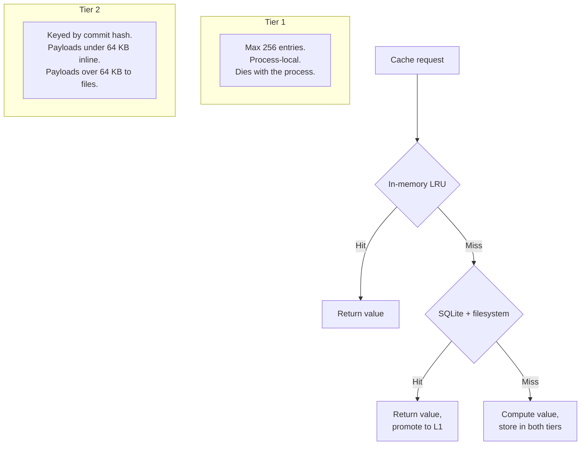

The in-memory tier is an LRU holding 256 entries. It exists to avoid
recomputing the same value within a single run. Values are evicted by
least-recent-use.

The disk tier is keyed by `(commit_hash, cache_type)`. The commit hash
is the cache's invalidation mechanism. When a file changes and a new
commit is made, the new commit's cache misses and the old commit's
entries are unreachable. There is no explicit invalidation logic. The
key changes.

Disk payloads under 64 KB are stored inline as SQLite blobs. Payloads
of 64 KB or more are written to files, and the SQLite row stores the
path. The threshold is roughly where SQLite blob handling becomes less
efficient than file handling.

### The migration runner

`MigrationRunner` reads `.sql` files from the migrations directory,
sorts them by filename, and applies the ones not recorded in
`_schema_migrations`. Sorting by filename gives deterministic order.
Filenames are zero-padded (`001_initial.sql`, `002_foo.sql`) so
lexicographic sorting equals numeric sorting.

The runner reports both the applied and the skipped migrations in a
`MigrationResult`. This means a caller always knows what ran and what
did not.

### The cleanup layer

Cleanup runs as a background thread and enforces retention. It deletes
run artifacts older than 30 days, graph and cache files older than 90
days, and forces a WAL checkpoint if the WAL exceeds 100 MB.

Three retention tiers reflect three classes of data. Intermediate run
artifacts are useful for debugging a recent run. After a month, they
are disk space. Graph and cache files are rebuildable. After three
months, the system rebuilds them. The audit log, run summary, plan
approvals, consent records, and skills are kept forever, because their
value is that they persist.

The cleanup layer never touches the audit log, the run summary, the
plan approvals, or the consent records. Those are compliance artifacts.

### The skill store

The skill store is the most layered part of Phase 3. It has three
layers stacked on top of each other.

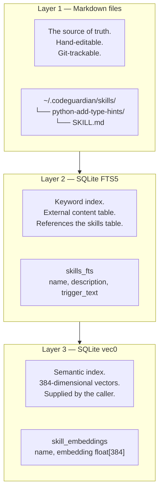

Markdown files are the source of truth. Every skill is a `SKILL.md`
file inside a directory named after the skill. The file has YAML
frontmatter delimited by `---`, followed by a Markdown body. The
frontmatter is validated against the skill schema on every write and
every read.

The FTS5 index provides keyword search. It is an external content
table, meaning it references the `skills` table's rowid rather than
duplicating the text. FTS5 external content tables do not auto-update
when the base table changes, so each `add` and each `rebuild_index`
performs a manual delete-then-insert against the FTS index.

The vec0 index provides semantic search. It stores 384-dimensional
vectors, one per skill. The store does not generate embeddings. That
is the caller's job. The store stores whatever floats it is given, at
whatever dimension. This decouples the store from any embedding model
and lets the caller switch models without changing the store.

Skill metadata is stored in the `skills` table, which has columns for
name, path, description, trigger, type, language, effectiveness, total
uses, total successes, state, and timestamps. Effectiveness is the
ratio of successes to total uses. It starts at 0.5 and is adjusted as
feedback accumulates.

### The twenty tables in the initial migration

The `001_initial.sql` migration creates twenty application tables plus
the `_schema_migrations` bookkeeping table:

```
repos                    cpg_metadata
runs                     plan_approvals
phase_executions         checkpoints
model_calls              mcp_tool_calls
blast_radius_reports     contract_violations
coverage_gaps            verifier_verdicts
consent_records          skills
skills_fts               skill_embeddings
skill_feedback           cache_entries
plugin_registry          cleanup_log
```

The `skills_fts` and `skill_embeddings` tables are virtual tables
provided by FTS5 and sqlite-vec respectively. The other eighteen are
ordinary tables.

### What Phase 3 hands forward

Phase 3 hands forward three contracts that later phases must respect:

1. The Code Property Graph header format. Phase 6 writes files that
   match this byte for byte, or Phase 3's reader refuses to open them.
2. The `_schema_migrations` table and the migration runner. Every
   later phase that adds a migration goes through the runner, and the
   table records it.
3. The Markdown-as-truth rule for skills. Phase 12 adds retrieval and
   indexing on top of the skill store, but the storage decision is
   already made.

### What Phase 3 deliberately does not do

Phase 3 does not implement schema versioning for the cache. The cache
key is `(repo_id, commit_hash, cache_type)`. If a schema changes
without a commit change, the cache will serve stale entries that no
longer match the new schema. This is a known gap. It becomes relevant
when a later phase changes a schema.

Phase 3 does not coordinate multiple writers. The `busy_timeout` PRAGMA
handles two writers taking turns. Three writers would eventually time
out. The orchestrator, the cleanup thread, and a future MCP server
process all write. This is a known gap. It becomes relevant when the
second writer appears.

Phase 3 does not back up the SQLite database. The audit log is safe
because it is a separate process. The database is not. This is a known
gap. It becomes relevant before the first release.

Phase 3 does not store a model identifier alongside skill embeddings.
If the caller switches embedding models, the vectors in the index
become incomparable. This is a known gap. It becomes relevant when the
caller changes models.

---

## Phase 4 — Code Interfaces

### What the phase delivers

Phase 4 defines fourteen files. Twelve of them declare a Protocol.
One declares the bridge message format. One is a package initializer.
No implementation is written. No logic. The interfaces are the
contract.

The twelve Protocols are:

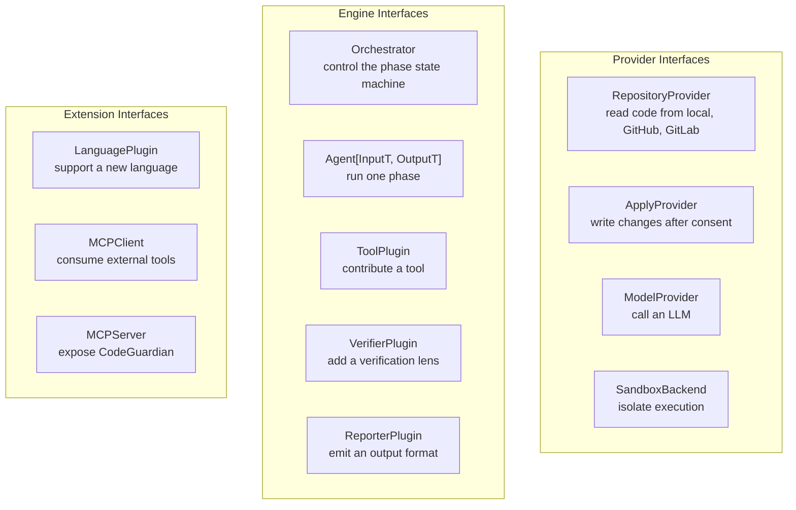

Each Protocol is a `typing.Protocol`. A class does not inherit from
a Protocol. It conforms to the Protocol if it has all the methods and
attributes the Protocol declares. This is structural typing, sometimes
called duck typing with type checking.

The choice to use Protocol rather than an abstract base class means
implementations do not need to import the interface they implement.
A `GitHubProvider` does not need `RepositoryProvider` in its imports.
It just has to have the right methods. This makes the plugin system
work. A plugin author writes a class. If the class conforms, it works.
No registration, no inheritance.

### The design decisions behind Phase 4

Four decisions shape what Phase 4 produces.

**DTOs live with their interface.** Every Protocol's file also
contains the data transfer objects that Protocol's methods take and
return. The `ModelProvider` file contains `ModelOptions`,
`ModelResponse`, `ModelChunk`, and `ModelInfo`. This keeps the story
in one place. A reader who wants to understand how a model is called
reads one file.

**Async is chosen by concurrency, not by I/O.** A method is `async`
if it is invoked concurrently inside the pipeline. It is synchronous
if it is invoked once. `ModelProvider.complete` is async because the
pipeline issues model calls concurrently. `RepositoryProvider.clone`
is sync because it happens once at the start of a run. This rule
keeps the CLI's top level simple.

**Runtime checks are limited to plugin boundaries.** Only the four
plugin Protocols (`ToolPlugin`, `VerifierPlugin`, `ReporterPlugin`,
`LanguagePlugin`) are decorated with `@runtime_checkable`. Only those
Protocols need runtime `isinstance` checks, because only those are
loaded from untrusted entry points. Everything else is validated by
static type checking.

**The public surface is re-exported.** Every Protocol and every DTO
is re-exported from `codeguardian.interfaces`. A consumer writes
`from codeguardian.interfaces import ModelProvider` and does not need
to know the module layout. The re-export is done dynamically at
import time, with a `TYPE_CHECKING` block that declares the same names
statically so type checkers can see them.

### The repository and apply protocols

The `RepositoryProvider` has five methods: `clone`, `read_file`,
`list_files`, `get_diff`, and `get_metadata`. It has no write method.
This is not an oversight. Applying changes is a separate, consent-gated
operation.

The `ApplyProvider` has two methods: `apply` and `rollback`. Every call
to `apply` carries a `ConsentRecord` that the implementation writes to
the audit log before touching the repository. The `ApplyProvider` is
never instantiated during agent execution. It runs only after the user
approves a diff.

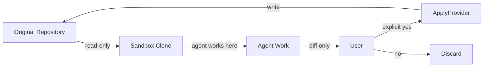

The separation is enforced by the interface. A caller that has a
`RepositoryProvider` cannot write to the repository, because the
interface has no write method.

### The model protocol

The `ModelProvider` has four methods. `complete` returns a full
response. `stream` returns an async iterator of chunks. `count_tokens`
returns an estimate. `get_available_models` returns the list of models
the provider can serve.

The Protocol is provider-agnostic. A cloud provider and a local
runtime both implement the same four methods. The pipeline does not
know which one it is talking to.

### The sandbox protocol

The `SandboxBackend` has five methods. `create` returns a handle.
`execute` runs a command. `destroy` releases the resources.
`supports_language` reports whether the backend can run a given
language. `get_resource_limits` returns the active limits.

The Protocol is backend-agnostic. Bubblewrap, Seatbelt, Firecracker,
and Docker all implement the same five methods. The pipeline does not
know which isolation technology is in use.

### The orchestrator protocol

The `Orchestrator` has four methods. `run` starts a run.
`resume` continues from the last checkpoint. `pause` requests a pause.
`get_state` returns the current state.

The Protocol is implementation-agnostic. LangGraph is the v1
implementation, but the interface does not mention it. A different
orchestrator would implement the same four methods.

### The agent protocol

The `Agent` protocol is generic over its input and its output. This is
required because every pipeline phase has a different input and a
different output. The Analyst takes a reconnaissance manifest and a
blast radius report and produces a context pack. The Writer takes a
context pack and a directive and produces a diff. The verifiers take a
context and produce a verdict.

A single non-generic protocol would force every agent to accept a
generic bag of arguments and return an untyped result. The generic
form preserves type safety.

### The plugin protocols

The `ToolPlugin`, `VerifierPlugin`, `ReporterPlugin`, and
`LanguagePlugin` protocols are decorated with `@runtime_checkable`.
This lets the plugin loader check at runtime that an entry-point object
has the methods the protocol declares.

The runtime check is not a full conformance check. It verifies that
the methods exist, not that their signatures match. A full check would
require calling the methods, which the loader cannot do safely. The
runtime check catches the common failure of a plugin missing a method.
Signature mismatches are caught by the contract tests, which run
against every plugin before it is loaded.

### The bridge protocol

`core/bridges/protocol.py` defines the JSON-RPC envelope that crosses
the Python-to-Rust boundary for out-of-process calls. It has four
dataclasses: `RpcRequest`, `RpcResponse`, `RpcError`, and
`RpcNotification`. It also declares the method names as `Final[str]`
constants: `audit.write`, `audit.verify`, `audit.export`,
`sandbox.create`, `sandbox.execute`, `sandbox.destroy`, `sandbox.health`.

The bridge protocol is a contract in the same sense as the Protocols.
Both sides of the bridge agree on the envelope. A change to the
envelope is a change to the contract, and both sides must be updated.

### What Phase 4 hands forward

Phase 4 hands forward the shape of every plugin boundary. Phase 9's
plugin loader needs the plugin protocols. Phase 11's agents need the
Agent protocol. Phase 13's orchestrator implements the Orchestrator
protocol. Phase 15's MCP server implements the MCPServer protocol.

It also hands forward a contract-test target. Every Protocol has a
contract test in Phase 8 or Phase 9. "Passes its contract test" is the
gate for any implementation.

### What Phase 4 deliberately does not do

Phase 4 does not implement anything. It does not validate signatures
at runtime. It does not check that a class conforms until a type
checker or a contract test does. It does not read from storage. It
does not execute anything. It is declaration only.

The `interfaces/__init__.py` file declares its exports statically in
a `TYPE_CHECKING` block and assigns them dynamically at import time.
This is a compromise between a hand-maintained import list and
dynamic discovery. The static block gives mypy the information it
needs. The dynamic loop gives the runtime the ability to pick up new
interface files without editing the initializer.

---

## Phase 5 — Bridges

### What the phase delivers

Phase 5 makes Python and Rust talk to each other. It delivers two
bridges, one in-process and one out-of-process, and proves both with
tests that exercise real subprocesses and real compiled code.

The two bridges are different on purpose.

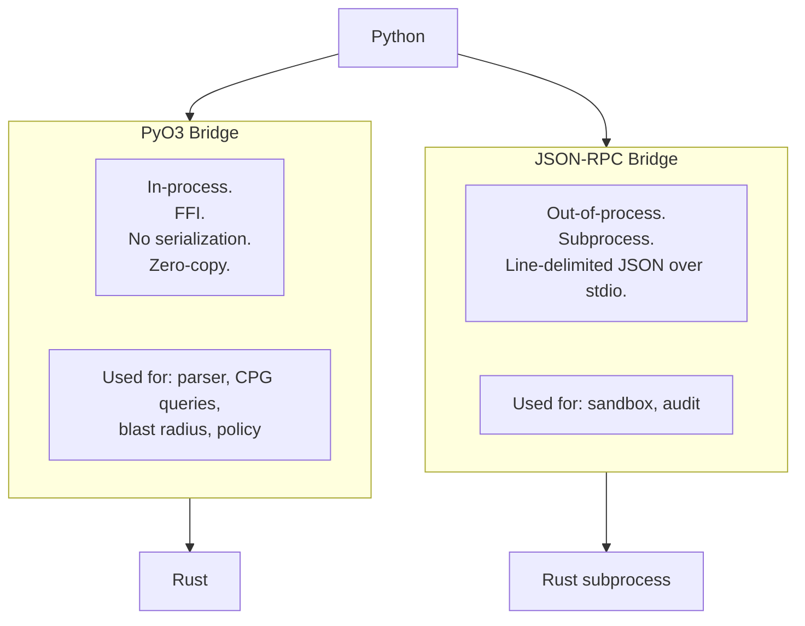

The PyO3 bridge is fast because there is no serialization. It is
in-process, so a Rust panic can crash the Python interpreter. The
JSON-RPC bridge is slower because every call is serialized and sent
over a pipe. It is out-of-process, so a Rust panic is contained. The
two bridges are chosen by what the caller needs: speed or isolation.

### The PyO3 bridge

`pyo3_bridge.PyO3Bridge` is a thin Python wrapper around the compiled
native extension. The extension is imported lazily. If the extension
is not built, the import fails silently, and the bridge's methods
raise a typed `SYS_NOT_IMPLEMENTED` when called.

This lazy load matters because the extension is platform-specific. It
is built on Linux, macOS, and Windows by different build processes.
A developer who has not built the extension can still run the test
suite. The tests that require the extension are skipped.

The bridge proves itself in Phase 5 with one function: `echo`. The
function takes a string and returns it unchanged. The test suite
exercises `echo` with empty strings, Unicode strings, strings with
embedded newlines, strings with null bytes, and 100 KB strings. Every
case round-trips correctly. This proves that the FFI boundary handles
the full range of what Python and Rust can pass between each other.

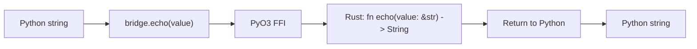

The module is compiled as `libcodeguardian_native.so` and copied to
`python/codeguardian/_native.so` after the build. Python imports it as
`codeguardian._native`. The leading underscore marks it as private.

### The JSON-RPC bridge

`jsonrpc_bridge.JSONRPCBridge` spawns a subprocess, writes JSON-RPC
2.0 requests to its stdin, and reads responses from its stdout.

The wire format is line-delimited JSON. Each message is a single JSON
object followed by a newline. This works because JSON serializers do
not emit literal newlines inside string values. They escape them as
`\n`. A message is always exactly one line. The reader reads one line,
parses it, and dispatches it.

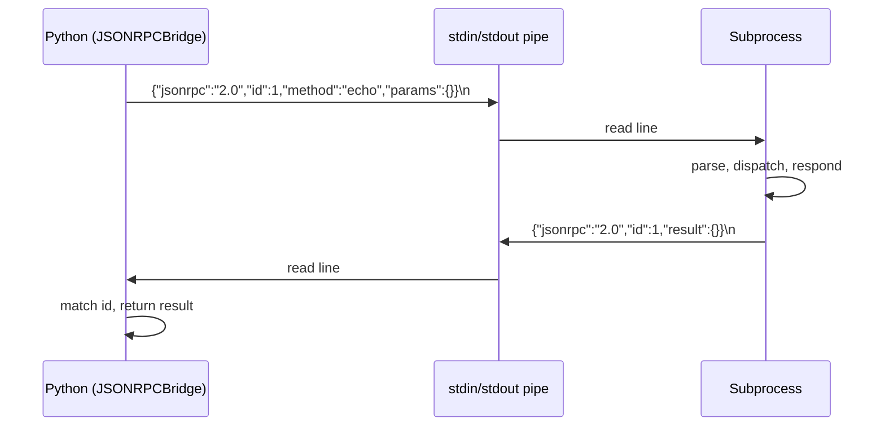

Requests carry an integer id. Responses carry the same id. The client
matches responses to requests by id. Notifications carry no id and
produce no response.

Error handling in the bridge is deliberate. A response with an `error`
field raises a typed `CodeGuardianError` with the category `SYS_INTERNAL`
and the error's code and message in the details. A response that is
not valid JSON raises `MCP_PROTOCOL_ERROR`. A subprocess that closes
its stdout before responding raises `SYS_INTERNAL`. A call made before
the bridge is started raises `SYS_INVARIANT_VIOLATED`.

The bridge uses `subprocess.Popen` with `text=True` and `bufsize=1`
to get line-buffered text mode. The `__enter__` and `__exit__` methods
start and stop the subprocess, so the bridge can be used as a context
manager.

### The Rust RPC crate

The `codeguardian-rpc` crate provides the Rust side of the wire format.
It has four modules.

`protocol.rs` defines the four serde-derived structs that match the
Python dataclasses: `RpcRequest`, `RpcResponse`, `RpcError`, and
`RpcNotification`. Field names match the Python side. The `params`
field is `serde_json::Value` because the methods that use it are not
defined yet.

`server.rs` defines `RpcServer`. The server reads line-delimited JSON
from a reader, dispatches each request to a handler registered for its
method name, and writes the response to a writer.

The server has a handler registry. A handler is
`Arc<dyn Fn(Value) -> Result<Value, RpcError> + Send + Sync>`. The
registry is a `HashMap<String, Handler>`. Callers register handlers
before calling `serve`. This means later phases can add method
handlers without editing `server.rs`.

```rust
let mut server = RpcServer::new();
server.register("audit.write", |params| {
    // handle the call
    Ok(json!({"written": true}))
});
server.serve(stdin, stdout)?;
```

The `serve` method is generic over its reader and writer. This means
tests can pass an in-memory buffer and exercise the server without a
subprocess.

`client.rs` defines `RpcClient`. The client has a reader and a writer
and a monotonic id counter. `call` sends a request and reads until it
finds a response with the matching id. `notify` sends a notification
without waiting.

`lib.rs` declares the three modules and re-exports the public types.

### The Rust PyO3 crate

The `codeguardian-pyo3` crate compiles into a Python extension module.
It has one function in Phase 5:

```rust
#[pyfunction]
fn echo(value: &str) -> String {
    value.to_owned()
}
```

The `#[pymodule]` function registers `echo` as a member of the module.
The module is named `_native`, so Python imports it as
`codeguardian._native`.

The crate is configured with `crate-type = ["cdylib"]` and depends on
`pyo3` with the `extension-module` and `abi3-py312` features. The
`extension-module` feature tells pyo3 not to link against libpython,
which is required for extension modules. The `abi3-py312` feature
produces an ABI-stable module that works with Python 3.12 and later.

### The Rust kernel crate

The `codeguardian-kernel` crate is a placeholder in Phase 5. It has a
`Cargo.toml` with the dependencies Phase 6 will need, and a `lib.rs`
with a docstring and nothing else. The crate exists so the workspace
metadata is complete and so Phase 6 has a place to start.

### The integration tests

Three test files prove the bridges work.

`test_pyo3_bridge.py` exercises the compiled extension. It skips
entirely if the extension is not built. The tests cover the round trip
of different string types, multiple independent bridge instances, and
the graceful degradation when the extension is absent.

`test_jsonrpc_bridge.py` spawns real Python subprocesses and drives
them through the bridge. Each subprocess is a small script that reads
a request and writes a response. The tests cover successful calls,
multiple sequential calls, error responses, unknown methods,
malformed JSON, subprocess EOF, calling before start, double start,
stop, spawn failure, and context-manager cleanup.

`test_phase_pipeline.py` is a skeleton for cross-phase tests. In Phase
5 it verifies that both bridge modules are importable and that the
bridges can be constructed.

The test suite runs in about 4 seconds. It spawns twelve subprocesses
and calls the native extension nine times. It does not use mocks. Every
call crosses a real boundary.

### What Phase 5 hands forward

Phase 5 hands forward two working bridges that later phases use.

Phase 6 uses the PyO3 bridge to expose the kernel's parsing and graph
functions to Python. The `codeguardian-pyo3` crate's `lib.rs` is
extended to register those functions. This is a Rule 1 escalation, and
it was approved before Phase 5 started.

Phase 7 uses the JSON-RPC bridge to talk to the sandbox engine and the
audit writer. The Rust side of those services implements the handler
registry that `server.rs` provides. The Python side uses
`JSONRPCBridge` to call them.

Phase 5 also hands forward the pattern for what a bridge test looks
like. Every future bridge is tested the same way: a real subprocess,
real data, no mocks.

### What Phase 5 deliberately does not do

Phase 5 does not implement any RPC method handlers. The server has a
registry, and the registry is empty. Phase 7 registers the methods.

Phase 5 does not implement any kernel functions. The PyO3 module has
`echo`. Phase 6 adds the rest.

Phase 5 does not exercise the Rust `RpcServer` from Python. The
Python tests spawn Python subprocesses. The Rust server compiles and
passes `cargo test --workspace` with zero tests. It has not been run
against real input. This is a known gap. It closes when Phase 6 wires
a Rust binary that the Python bridge can spawn.

---

## The state at the end of Phase 5

### Test totals

| Phase | Tests added | Cumulative |
|---|---|---|
| 1 | 165 | 165 |
| 2 | 0 | 165 |
| 3 | 62 | 227 |
| 4 | 0 | 227 |
| 5 | 25 | 252 |

The chain test runs 252 tests in about 13 seconds. The phase-5
isolation test runs 25 tests in about 4 seconds.

### Files by phase

Phase 1 produced 19 files. Phase 2 produced 14 schemas. Phase 3
produced 12 files. Phase 4 produced 14 files. Phase 5 produced 13
files. The total is 72 files across the five phases, plus the 45
scaffold files from Phase 0 (nine of which are deferred).

### What runs and what does not

At the end of Phase 5, the following Python modules are importable and
tested:

- `codeguardian.version` — the version string
- `codeguardian.core.errors` — the error taxonomy and utilities
- `codeguardian.core.config` — the configuration system
- `codeguardian.core.storage` — the storage layer
- `codeguardian.interfaces` — the Protocol layer
- `codeguardian.core.bridges` — the two bridges

The following Python modules exist but are not implemented:

- `codeguardian.cli` — commands exist as stubs
- `codeguardian.core.agents` — modules exist as stubs
- `codeguardian.core.providers` — modules exist as stubs
- `codeguardian.core.sandbox` — modules exist as stubs
- `codeguardian.core.mcp` — modules exist as stubs
- `codeguardian.core.plugins` — modules exist as stubs
- `codeguardian.core.reporting` — modules exist as stubs
- `codeguardian.core.skills` — modules exist as stubs

The Rust crates `codeguardian-rpc`, `codeguardian-pyo3`, and
`codeguardian-kernel` compile. The other four Rust crates compile as
empty stubs.

### The build pipeline

The current build steps on Linux are:

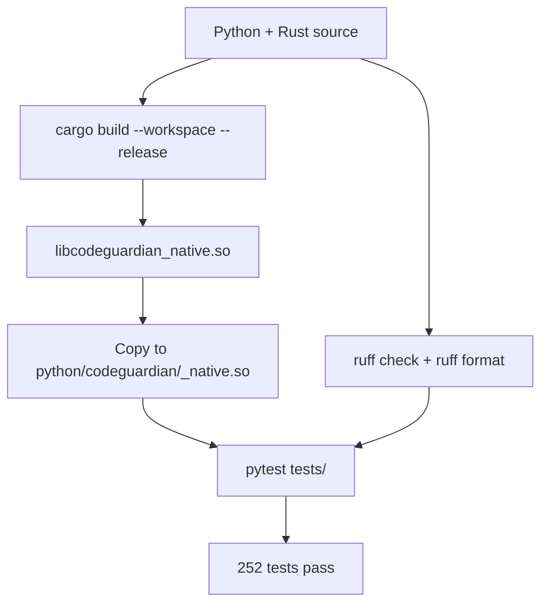

The `CARGO_TARGET_DIR` environment variable redirects cargo's build
output to `~/.cache/codeguardian-target`. This avoids writing build
artifacts to the WSL2 slow filesystem at `/mnt/c/`. Source files stay
in the repository. Build artifacts go to the Linux filesystem.

### Escalations recorded

Three Rule 1 escalations occurred across Phases 4 and 5:

| # | File | Phase | Reason |
|---|---|---|---|
| 1 | `interfaces/__init__.py` | 4 | Added a `TYPE_CHECKING` block so mypy can see the exports |
| 2 | `rust/crates/codeguardian-pyo3/src/lib.rs` | 5 | PyO3 proven end-to-end with one function; Phase 6 will extend it |
| 3 | `rust/crates/codeguardian-rpc/src/lib.rs` | 5 | B-024 added `pub mod client; pub mod server;` to the B-023 version |

Escalation 1 was necessary because the dynamic import loop in
`interfaces/__init__.py` is invisible to static type checkers. The
`TYPE_CHECKING` block declares the same names statically without
changing runtime behavior.

Escalation 2 was approved before Phase 5 started. It is the direct
consequence of choosing to prove the PyO3 bridge end-to-end in Phase
5 rather than deferring it to Phase 6.

Escalation 3 is the expected pattern for a Rust crate. `lib.rs` is
the module registry and grows as modules land. It is documented here
so the pattern is on the record.

### Deviations from BUILD_ORDER

Phase 1 added three files not in BUILD_ORDER:
`errors/translation.py` and its test, and
`errors/codes.py` gained three codes (`FILE_PERMISSION_DENIED`,
`CONFIG_PARSE_ERROR`, `SECRET_KEYCHAIN_ERROR`).

Phase 3 added three codes (`STORAGE_MIGRATION_FAILED`,
`STORAGE_SCHEMA_INVALID`, `STORAGE_GRAPH_CORRUPTED`), added the
`_schema_migrations` table, defined the CPG header format, and renamed
`migrations.py` to `migration_runner.py` to avoid a module-package
name collision.

Phase 5 wrote two files that BUILD_ORDER placed in Phase 6:
`codeguardian-pyo3/Cargo.toml` and `codeguardian-pyo3/src/lib.rs`.

All deviations are recorded in `BUILD_STATE.md` with their reasons.

---

## What each later phase inherits

The five completed phases form the foundation for everything above
them. Each later phase inherits specific contracts.

### Phase 6 — Rust Kernel inherits

From Phase 3: the Code Property Graph header format. Phase 6 writes
graph files whose first 64 bytes match the format Phase 3 defined.

From Phase 5: the PyO3 bridge. Phase 6 extends
`codeguardian-pyo3/src/lib.rs` to register `parse_files`, `build_graph`,
`query_graph`, and the other kernel functions.

### Phase 7 — Rust Engines inherits

From Phase 3: the storage layer for audit metadata and the schema
headers for blast radius reports.

From Phase 4: the `SandboxBackend` Protocol, which the Python sandbox
backends will implement.

From Phase 5: the JSON-RPC bridge and the `RpcServer` registry. The
audit writer and sandbox engine register their methods with the
registry.

### Phase 8 — Providers inherits

From Phase 1: the error taxonomy, used by every provider.

From Phase 4: the `RepositoryProvider`, `ApplyProvider`,
`ModelProvider`, and `SandboxBackend` Protocols. Every provider
implements one of these.

From Phase 5: nothing directly. Providers are Python-native.

### Phase 9 — Plugins inherits

From Phase 4: the four plugin Protocols and the `@runtime_checkable`
decoration.

From Phase 5: nothing directly. The plugin loader is Python-native.

### Phase 11 — Agents inherits

From Phase 4: the `Agent` Protocol.

From Phase 1: the error taxonomy for typed agent failures.

From Phase 8: the `ModelProvider` for LLM calls.

### Phase 12 — Skills inherits

From Phase 3: the skill store, with its Markdown source, FTS5 index,
and vec0 index.

### Phase 13 — Orchestrator inherits

From Phase 4: the `Orchestrator` Protocol.

From Phase 3: the SQLite store for checkpoints, the filesystem store
for artifacts, and the cleanup layer.

From Phase 5: nothing directly.

### Phase 14 — CLI inherits

From Phase 1: the error taxonomy for exit codes.

From Phase 3: read access to the run history.

From Phase 5: nothing directly.

### Phase 15 — MCP and Reporters inherits

From Phase 4: the `MCPClient`, `MCPServer`, and `ReporterPlugin`
Protocols.

From Phase 3: the artifact store for report inputs.

From Phase 5: the `JSONRPCBridge` if the MCP server needs to talk to
Rust.

### Phase 16 — Full Assembly inherits

From every prior phase: the integration script that exercises every
phase's public API in one process. This is the file that
`BUILD_ORDER.md` places at `scripts/integration_phase.py` and that
Phase 16 writes for the first time.

---

## Summary

The five completed phases establish the vocabulary, the artifact
shapes, the storage layer, the interface contracts, and the two
bridges that connect Python and Rust. Each phase delivers one layer
and hands forward specific contracts to the phase that needs it.

The project now has a working error taxonomy, a complete configuration
system, a fourteen-schema artifact contract, a six-layer storage
system, twelve interface protocols, and two tested bridges. The Rust
crate graph compiles. The Python package imports cleanly. 252 tests
pass in about 13 seconds.

The heavy phases are ahead. Phase 6 writes the Rust kernel, Phase 7
writes the Rust engines, Phase 11 writes the real agents, Phase 13
writes the orchestrator, and Phase 14 writes the CLI. Those five
phases contain roughly eighty percent of the project's code. What has
been built so far is the foundation those phases stand on.
