# CodeGuardian — Build History, Phases 6 and 7

**Snapshot date:** 2026-10-16
**Purpose:** A single record of what was built in Phases 6 and 7 of CodeGuardian, why each piece exists, what it hands forward to later phases, and how the completed layers fit together. This document is written to be read by someone who has not seen the project before and needs to understand the state of the code without re-deriving it from source.

---

## How to read this document

The build is organized into phases. Each phase delivers one layer of the system and is tested before the next begins. A phase is not a sprint, and it is not measured in time. It is measured by what it leaves behind.

The two phases covered here are:

| Phase | Layer | Purpose |
|---|---|---|
| 6 | Rust Kernel | Parse source, build a Code Property Graph, expose it to Python |
| 7 | Rust Engines | Consume the CPG for blast radius, isolate execution, log every action, enforce policy |

Phases 1 through 5 are covered in a separate document (`phases-1-to-5.md`). That document establishes the error taxonomy, the schema vocabulary, the storage layer, the interface protocols, and the two bridges between Python and Rust. This document assumes that foundation and describes what was built on top of it.

Every section here refers to what the code does, not to how it was written. A reader who wants the code should read the source. A reader who wants the shape of the system should read this.

---

## Phase 6 — Rust Kernel

### What the phase delivers

Phase 6 is where CodeGuardian stops treating source code as text and starts treating it as a graph. The kernel is the component that makes the rest of the pipeline possible. Without it, reconnaissance has nothing to read, blast radius has nothing to traverse, and the Code Property Graph file is an empty promise.

The phase delivers ten Rust modules across one crate, plus two PyO3 binding files that expose the crate to Python, plus one Python test file:

| Module | Purpose |
|---|---|
| `ast.rs` | The AST arena and the syntax kind vocabulary |
| `parser.rs` | The Tree-sitter wrapper |
| `symbol_table.rs` | Symbol extraction and lookup |
| `call_graph.rs` | Caller-to-callee edges |
| `cfg.rs` | Per-function Control Flow Graph |
| `pdg.rs` | Program Dependence Graph |
| `cpg.rs` | The merged, serializable Code Property Graph |
| `incremental.rs` | File-level incremental updates |
| `query.rs` | The O(1) query interface |
| `pyo3/kernel.rs` | PyO3 bindings for `build_graph` and `graph_summary` |
| `pyo3/lib.rs` | The extension module's entry point |

The kernel parses Python and TypeScript source with Tree-sitter, extracts symbols, resolves calls, builds a CFG and PDG per function, merges everything into a single node-and-edge graph, serializes that graph to the 64-byte-header binary format Phase 3 defined, and exposes query methods that Phase 7's blast engine consumes.

### Why it is Rust, not Python

Three reasons, all from `docs/07-tech-stack.md`:

1. **Memory safety.** The kernel parses untrusted source. A parser bug in Python produces a bad graph. A parser bug in Rust, with a well-chosen node type, produces a compile error.
2. **Determinism.** The same input bytes must produce the same graph bytes. Two runs on the same commit must produce byte-identical CPG files. Rust gives that for free; Python's dict ordering and garbage collection make it a fight.
3. **Speed.** Parsing a large repository and building its graph is the hot path. The docs quote 1–2 ms per 1000 lines for a full parse and 0.1–0.2 ms for an incremental parse after an edit. Tree-sitter inside Rust reaches that number. Tree-sitter inside Python does not.

### The architecture

```mermaid
flowchart TB
    subgraph Input["Input"]
        Source["Source files<br/>(path, language, content)"]
    end

    subgraph Parse["Parse Layer"]
        Parser["parser.rs<br/>Tree-sitter wrapper"]
        AST["ast.rs<br/>Flat AST arena"]
    end

    subgraph Extract["Extraction Layer"]
        SymTab["symbol_table.rs<br/>Symbol extraction"]
        CallGraph["call_graph.rs<br/>Call resolution"]
    end

    subgraph Analyze["Analysis Layer"]
        CFG["cfg.rs<br/>Control Flow Graph"]
        PDG["pdg.rs<br/>Program Dependence Graph"]
    end

    subgraph Merge["Merge Layer"]
        CPG["cpg.rs<br/>Code Property Graph"]
        Binary["Serialized bytes<br/>(64-byte header + payload)"]
    end

    subgraph Query["Query Layer"]
        Query["query.rs<br/>O(1) lookups"]
    end

    subgraph Incremental["Incremental Layer"]
        Incr["incremental.rs<br/>File-level updates"]
    end

    Source --> Parser
    Parser --> AST
    AST --> SymTab
    AST --> CallGraph
    SymTab --> CallGraph
    AST --> CFG
    CFG --> PDG
    AST --> CPG
    SymTab --> CPG
    CallGraph --> CPG
    CFG --> CPG
    PDG --> CPG
    CPG --> Binary
    CPG --> Query
    Binary --> Incr
    Incr --> CPG
```

The flow is one-directional. Every layer consumes the layer above it and produces something the layer below uses. Nothing crosses a boundary back upward.

### The AST arena

`ast.rs` defines the data structure that everything else in the kernel is built on. It is a **flat arena of fixed-size records, indexed by `u32`**.

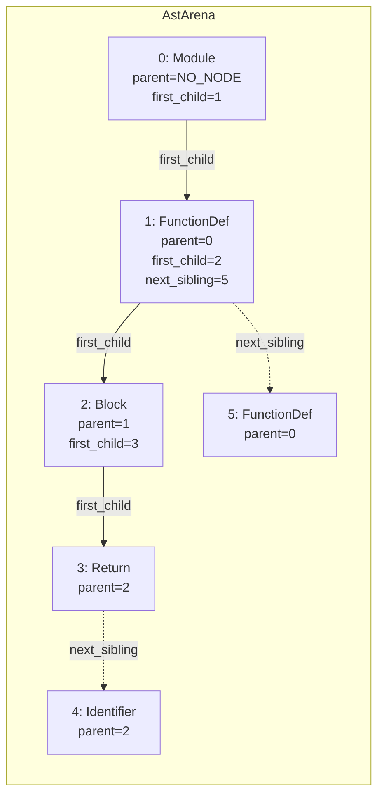

Every node is a 36-byte record with ten fields:

| Field | Type | Purpose |
|---|---|---|
| `kind` | `NodeKind` (2 bytes) | The syntax kind, from a typed enum |
| `flags` | `u16` | Named, error, missing, extra bits |
| `start_byte` | `u32` | Byte offset of the node's start |
| `end_byte` | `u32` | Byte offset one past the node |
| `start_row` | `u32` | Zero-based line |
| `start_col` | `u32` | Zero-based column |
| `parent` | `u32` | Parent node index, or `NO_NODE` |
| `first_child` | `u32` | First child index, or `NO_NODE` |
| `next_sibling` | `u32` | Next sibling index, or `NO_NODE` |
| `name` | `u32` | String-table index, or `NO_NODE` |

The design has three properties that matter:

1. **No pointers.** Nodes reference each other by index, not by pointer. This makes the arena trivially serializable — a straight byte copy of the vector is a valid on-disk representation.
2. **No allocation per node.** The arena is a single `Vec<AstNode>`. Pushing a node grows the vector once and copies 36 bytes.
3. **Fixed size.** Every node is exactly 36 bytes. Serialization is a direct memory copy, not a per-node walk.

`NO_NODE` is `u32::MAX`. It is the sentinel for "no link." The invariant the module protects is that every non-sentinel link index points at a live node. An accessor that returns a dangling index is a bug; an accessor that returns `None` for a dangling index is correct defensive behavior.

`NodeKind` is a **typed lens, not an exhaustive enum**. It names roughly 55 syntax kinds that the kernel distinguishes — `FunctionDef`, `Call`, `If`, `Assignment`, and so on. Everything else is `Other(raw_tree_sitter_kind_id)`. The graph is lossless; the enum is stable across Tree-sitter grammar upgrades.

The `StringTable` interns every name once. Two calls to `intern("greet")` return the same `u32` id. The table is append-only; no string is ever removed.

Two iterators live in the module. `ChildrenIter` walks direct children through `next_sibling` links. `PreorderIter` walks a subtree in preorder, using an explicit stack to avoid recursion depth limits. A deeply nested parse tree — 10,000 levels of nested parentheses — does not blow the stack.

### The parser

`parser.rs` is the only module that knows Tree-sitter exists. It exposes:

- `parse_file(language, source) -> Result<ParseResult, KernelError>`
- `parse_files(&[(Language, &str)]) -> Result<Vec<ParseResult>, KernelError>`
- `Language` enum with `Python` and `TypeScript` variants
- `KernelError` enum with four variants

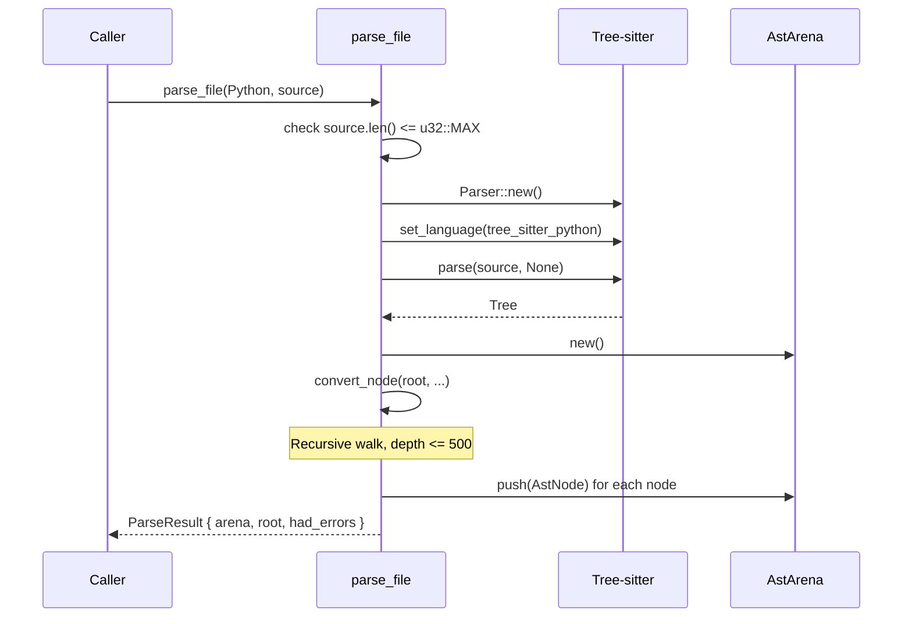

The conversion walk is recursive with a depth cap of 500. A tree deeper than 500 returns `KernelError::TreeTooDeep` rather than overflowing the stack.

A malformed source file is **not** an error. Tree-sitter inserts ERROR and MISSING nodes to repair the parse, and those nodes are preserved in the arena with the corresponding flags set. `ParseResult::had_errors` reports whether any repair happened. This means a batch of 500 files where 3 are syntactically broken still produces a graph; the 3 broken files just have ERROR nodes in them.

`classify` maps Tree-sitter's kind string to a `NodeKind`. Kinds shared across grammars — `identifier`, `comment` — are matched first. Language-specific kinds are matched in per-language helpers. Anything unmatched becomes `NodeKind::Other(raw_id)`.

### The symbol table

`symbol_table.rs` walks the AST once and extracts the named declarations a caller needs to resolve a call site.

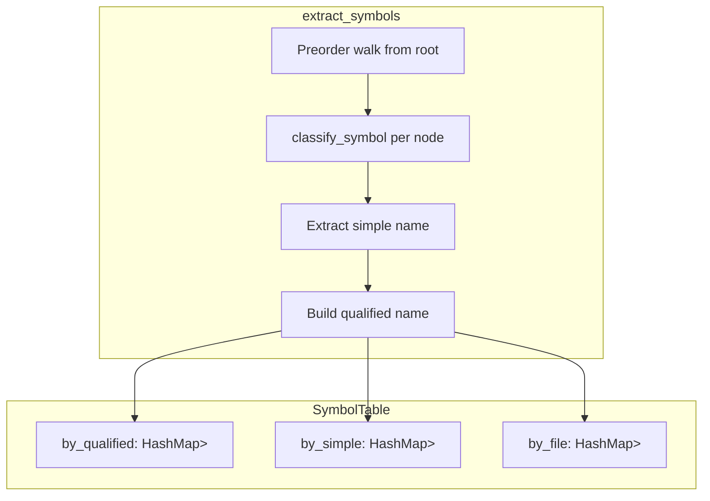

It records four symbol kinds: `Function`, `Class`, `Method`, `Parameter`. It does **not** record imports, local variables, or references. A call to `foo.bar()` where `foo` is an imported module resolves to nothing in this file; cross-file resolution is deferred.

A Python function nested inside a class body is classified as a `Method`. Tree-sitter Python does not distinguish this in the node kind; the classification walks the parent chain and stops at the first function boundary. A function nested inside a method inside a class is a `Function`, not a `Method`.

The qualified name is built by walking up the parent chain and joining enclosing declarations with dots. A top-level function `parse_config` returns `parse_config`. A method `parse` inside class `Parser` returns `Parser.parse`.

### The call graph

`call_graph.rs` walks the AST looking for `Call` nodes. For each one, it:

1. Extracts the callee name by finding the last identifier in the callee expression. For `foo()`, the name is `foo`. For `foo.bar.baz()`, the name is `baz`.
2. Finds the enclosing function by walking up the parent chain.
3. Resolves the name against the symbol table.

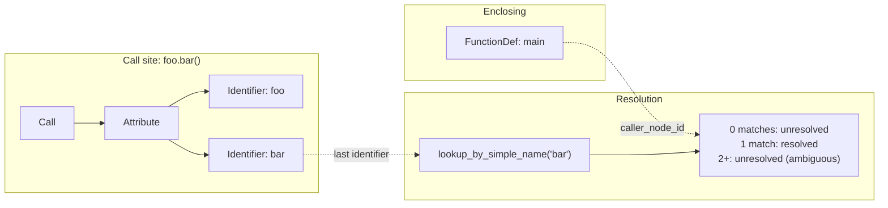

Resolution is deliberately conservative. A callee resolves only if **exactly one** symbol matches by simple name. Zero matches means the callee is external (imported, dynamically dispatched, or defined in another file). More than one match means the name is ambiguous. Both cases produce an unresolved edge with `callee_node_id = NO_NODE`. The edge is still emitted: the graph must show that a call happened even if the target is unknown.

### The Control Flow Graph

`cfg.rs` builds a per-function CFG over **statement-level AST nodes**. There are no synthetic basic blocks. The function node is the entry. Every `return` and `raise` is a terminator — a node with no outgoing CFG edge.

The builder models Tree-sitter's structure directly. A block is a sequence of statements. Control-flow statements (`If`, `While`, `For`, `Try`, `With`) each produce their own sub-CFG, and their exits are threaded into the enclosing sequence.

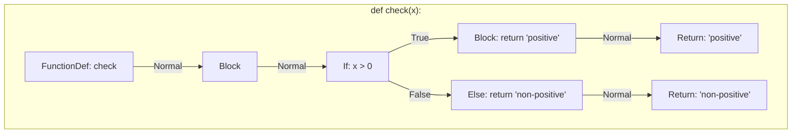

Seven edge kinds exist:

| Kind | Meaning |
|---|---|
| `Normal` | Sequential flow |
| `True` | The conditional's true branch |
| `False` | The conditional's false branch |
| `LoopBack` | A loop body returned to its header |
| `Break` | A break transfer out of the innermost loop |
| `Continue` | A continue transfer to the loop header |
| `Exception` | A try region's syntactic entry into an except handler |

Break and continue are the two exits that thread through sequences. A break inside a nested block bubbles up until it reaches the enclosing loop's `build_loop`, which connects it to the after-loop point. This is the mechanism that makes `break` inside an `if` inside a `while` terminate the loop rather than falling through to the next statement.

Exception flow is modeled syntactically. The try body's entry has `Exception` edges to each handler entry. The module does **not** add an implicit "any statement can raise" edge from every node inside the try. That would require semantic analysis the CPG does not have and would make the CFG unusably dense.

### The Program Dependence Graph

`pdg.rs` computes two dependences over the CFG.

**Control dependence** is derived from the post-dominator tree of the CFG.

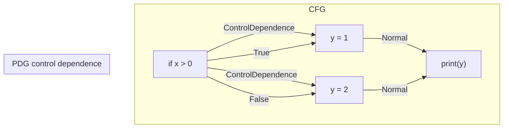

The algorithm is Cooper-Harvey-Kennedy. Post-dominators are computed against a **virtual exit node** that is not a real arena node and never appears in any emitted edge. The virtual exit exists so the post-dominator lattice has a single bottom.

For an edge `a -> b` where `b` is not the immediate post-dominator of `a`, every node on the path from `b` up to `ipdom[a]` in the post-dominator tree is control-dependent on `a`. `a` itself is excluded from the walk so a loop header is never marked control-dependent on itself.

**Data dependence** is derived from intra-function reaching definitions. A definition reaches a use if some CFG path from the definition to the use does not pass through another definition of the same variable.

The dataflow is the classical one:

```
IN[B]  = ∪ OUT[p] for p in predecessors(B)
OUT[B] = GEN[B] ∪ (IN[B] \ KILL[B])
```

The module iterates to a fixed point, then walks backward from each use and emits an edge from every reaching definition to the use.

Definition sites recognized:

- Assignment LHS identifiers
- Augmented assignment LHS identifiers
- Function and method parameters
- `for` loop target identifiers

Use sites recognized: any identifier in an expression position that is not itself a definition target.

**Cross-function data flow is not attempted.** Reaching definitions are computed per function. Inter-procedural flow requires points-to and aliasing analysis, neither of which exists.

### Determinism

This was a late fix. The original `pdg.rs` built a node list from a `HashSet<u32>` and iterated a `HashMap` when emitting data-dependence edges. HashSet and HashMap iteration order varies per process. Two builds of the same source produced different byte orders in the payload.

The fix was three lines: derive `PartialOrd, Ord` on `PdgEdgeKind` and `PdgEdge`, then call `edges.sort(); edges.dedup();` before returning from `build_pdg`. This gives byte-stable output regardless of internal iteration order.

This matters because the cache is keyed by commit hash, which assumes the bytes are stable.

### The Code Property Graph

`cpg.rs` merges four layers into one graph. Nodes are `CpgNode` records; edges are `CpgEdge` records. All structure, including the tree structure, lives in edges.

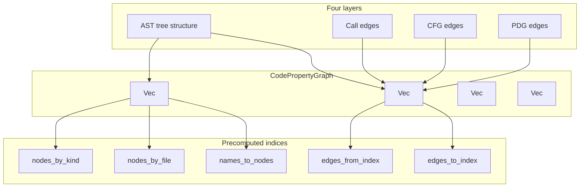

A `CpgNode` carries only what is intrinsic to a node:

```rust
pub struct CpgNode {
    pub kind: NodeKind,   // wire-coded to u16
    pub flags: u16,
    pub file_id: u32,
    pub start_byte: u32,
    pub end_byte: u32,
    pub start_row: u32,
    pub start_col: u32,
    pub name: u32,        // string table index
}
```

A `CpgEdge` carries the semantic content of a relationship:

```rust
pub struct CpgEdge {
    pub src: u32,
    pub dst: u32,
    pub kind: EdgeKind,   // wire-coded to u8
    pub label: u32,       // string table index or NO_NODE
}
```

The `label` field is what makes incremental updates possible. On a `Call` edge, the label is the callee's name. When a file changes, the incremental updater re-resolves cross-file call edges by re-running resolution with the label. Without the label, an edge whose target was removed could not be rebuilt.

Eleven edge kinds exist, each with a fixed wire code from 0 to 10:

| Code | Kind | Meaning |
|---|---|---|
| 0 | `Ast` | Parent-to-child tree edge |
| 1 | `Call` | Enclosing function to resolved callee |
| 2–8 | `Cfg*` | The seven CFG kinds |
| 9 | `ControlDependence` | PDG control dependence |
| 10 | `DataDependence` | PDG data dependence |

### The wire format

The graph serializes to a byte layout that matches the 64-byte header Phase 3 fixed in `graph_store.py`. This is the single most important constraint the phase inherits.

```mermaid
flowchart TB
    subgraph File["CPG file layout"]
        Header["Header: 64 bytes"]
        Payload["Payload: variable"]
    end

    subgraph HeaderFields["Header (little-endian)"]
        H1["0: magic = b'CGCP'"]
        H2["4: format_version = u16 (1)"]
        H3["6: header_size = u16 (64)"]
        H4["8: flags = u32"]
        H5["12: node_count = u64"]
        H6["20: edge_count = u64"]
        H7["28: payload_offset = u64 (64)"]
        H8["36: payload_length = u64"]
        H9["44: payload_checksum = u64 (FNV-1a)"]
        H10["52: reserved = 12 zeros"]
    end

    subgraph PayloadSections["Payload sections"]
        S1["u32 node_section_len<br/>CpgNode[node_section_len]"]
        S2["u32 edge_section_len<br/>CpgEdge[edge_section_len]"]
        S3["u32 string_count<br/>length-prefixed strings"]
        S4["u32 file_count<br/>length-prefixed paths"]
    end

    Header --> H1
    Header --> H2
    Header --> H3
    Header --> H4
    Header --> H5
    Header --> H6
    Header --> H7
    Header --> H8
    Header --> H9
    Header --> H10

    Payload --> S1
    Payload --> S2
    Payload --> S3
    Payload --> S4
```

Every section is preceded by a `u32` count that is redundant with the header's counts. The reader validates that they agree. A mismatch raises `CpgError::Corrupt` before any interpretation.

`CpgNode` on the wire is 32 bytes: `kind_code u16`, `kind_payload u16`, `flags u16`, `_pad u16`, `file_id u32`, `start_byte u32`, `end_byte u32`, `start_row u32`, `start_col u32`, `name u32`.

`CpgEdge` on the wire is 16 bytes: `src u32`, `dst u32`, `kind_code u8`, `_pad [u8; 3]`, `label u32`.

The payload checksum is FNV-1a 64-bit. Ten lines of code, no dependency, adequate for corruption detection. The reader recomputes the checksum before parsing anything past the header. A single flipped bit in the payload fails the checksum and the read refuses to complete.

### Incremental updates

`incremental.rs` implements file-level incremental updates. The algorithm has seven steps.

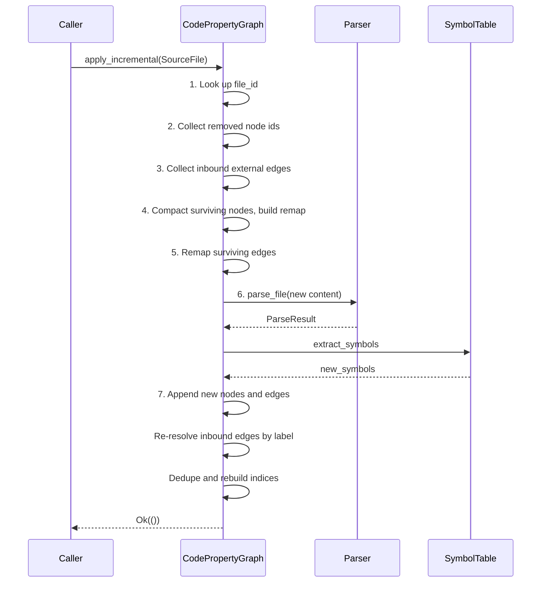

The critical step is **7**: for every preserved inbound edge whose label is not `NO_NODE`, re-attempt resolution against the new file's symbols. On success, emit a new edge from the external endpoint to the new callee. On failure, drop the edge. An inbound edge whose target could not be re-resolved is dropped, not left dangling.

**Not implemented:** tree-sitter incremental subtree reuse. The algorithm re-parses the changed file from scratch. This is correct but not optimal — a 10,000-line file with a one-line change re-parses all 10,000 lines. When a profile shows this is the bottleneck, tree-sitter's incremental parse can be layered in without changing the public API.

### The query interface

`query.rs` exposes eleven methods on `CodePropertyGraph`. Five of them return a `&[u32]` directly from a precomputed index; the rest either return a single value or filter by kind.

| Method | Returns | Cost |
|---|---|---|
| `node_count`, `edge_count`, `file_count` | `usize` | O(1) |
| `node(id)`, `edge(id)` | `Option<&CpgNode>`, `Option<&CpgEdge>` | O(1) |
| `string(id)`, `file_path(file_id)` | `Option<&str>` | O(1) |
| `file_id(path)` | `Option<u32>` | O(1) |
| `nodes_by_kind(kind)` | `&[u32]` | O(1) |
| `nodes_in_file(file_id)` | `&[u32]` | O(1) |
| `find_by_name(name)` | `&[u32]` | O(1) |
| `edges_from(node_id)`, `edges_to(node_id)` | `&[u32]` | O(1) |
| `callers_of(node_id)` | `Vec<u32>` | O(edges incident) |
| `callees_of(node_id)` | `Vec<u32>` | O(edges incident) |
| `file_of(node_id)` | `Option<u32>` | O(1) |

The precomputed indices are built at graph finalization time and rebuilt after every incremental update. They are:

| Index | Type | Purpose |
|---|---|---|
| `nodes_by_kind` | `HashMap<u16, Vec<u32>>` | Kind lookup |
| `nodes_by_file` | `HashMap<u32, Vec<u32>>` | File lookup |
| `names_to_nodes` | `HashMap<u32, Vec<u32>>` | Name lookup |
| `edges_from_index` | `HashMap<u32, Vec<u32>>` | Outgoing edge lookup |
| `edges_to_index` | `HashMap<u32, Vec<u32>>` | Incoming edge lookup |
| `paths_to_file` | `HashMap<String, u32>` | Path lookup |
| `string_ids` | `HashMap<String, u32>` | Reverse string lookup |

Phase 7's blast engine calls `callers_of` in a loop over every transitively reachable node. A linear scan there would be O(nodes × edges) per query. The precomputed index makes it O(edges incident to the node).

### PyO3 bindings

`pyo3/kernel.rs` exposes three functions to Python:

- `kernel_version() -> str`
- `build_graph(sources) -> bytes`
- `graph_summary(data: bytes) -> dict`

`build_graph` releases the GIL while the Rust kernel does its work. The kernel touches no Python object, so the GIL is not needed.

`graph_summary` reads a serialized graph and returns `{"node_count", "edge_count", "file_count", "incremental"}`. The Rust side is pure: bytes in, dict out. It does not hold Python-visible state.

Every kernel failure surfaces as `_native.KernelError` with three attributes: `code: str`, `message: str`, `details: dict`. The `code` values are Rust-side strings like `"PARSE_FAILED"`, `"CHECKSUM_MISMATCH"`, `"INVALID_MAGIC"`. The Python side owns the translation from these codes onto `CodeGuardianError` codes.

### What Phase 6 hands forward

The kernel hands forward three things:

1. **The CPG binary format.** Phase 7's blast engine reads CPG files. The format is now a constraint, not a promise.
2. **The query interface.** `callers_of`, `callees_of`, `find_by_name`, `nodes_in_file` — these are the methods Phase 7 calls.
3. **The PyO3 extension.** `codeguardian._native` now exports seven functions across kernel, blast, and policy. Phase 8's providers will call them.

### What Phase 6 deliberately does not do

Phase 6 does not compute blast radius. It does not run code in a sandbox. It does not write audit entries. It does not read or write SQLite. It produces a graph and answers questions about it. Everything else is Phase 7 and later.

The kernel does not perform inter-procedural data flow. Reaching definitions are computed per function. Cross-function flow requires points-to and aliasing analysis, neither of which exists.

The kernel does not perform incremental subtree reuse. It re-parses the changed file from scratch.

The kernel does not validate that a serialized file's edges point at in-range nodes. A file whose edges point at out-of-range nodes deserializes without error and produces an inconsistent graph. The writer never produces such a file; if a future phase reads CPG files from untrusted sources, this is the place to add a `validate` method.

---

## Phase 7 — Rust Engines

### What the phase delivers

Phase 6 built one crate that produces the CPG. Phase 7 fills four crates that consume it or sit alongside it, plus one binary crate that hosts them over JSON-RPC, plus two PyO3 binding files.

| Crate | Purpose |
|---|---|
| `codeguardian-blast` | Blast radius computation |
| `codeguardian-sandbox` | Isolated execution |
| `codeguardian-audit` | Tamper-evident audit log |
| `codeguardian-policy` | Pre-flight policy enforcement |
| `codeguardian-rpcd` | JSON-RPC daemon |
| `codeguardian-pyo3` | Extended with blast and policy bindings |

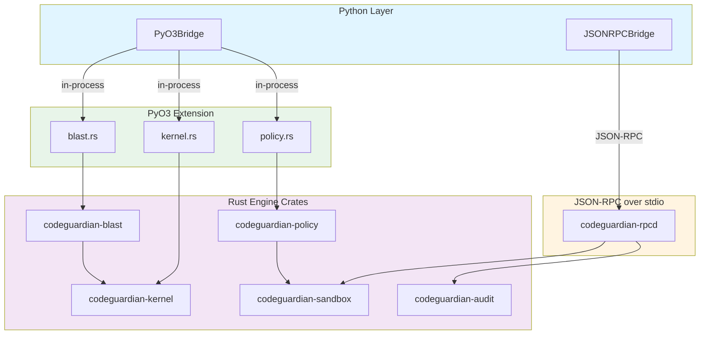

The choice of bridge is by trust. Kernel, blast, and policy cross in-process via PyO3 because they are trusted and latency-sensitive. Sandbox and audit cross out-of-process via JSON-RPC because they sit on the wrong side of the trust boundary — the sandbox runs untrusted code, and the audit writer owns the log file.

### Blast radius — `codeguardian-blast`

The blast crate is the first real consumer of the CPG's query interface. It answers one question: **what breaks if this function changes, and how dangerous is that?**

Four modules:

| Module | Purpose |
|---|---|
| `lib.rs` | `BlastTarget`, `BlastError`, `resolve_target`, shared helpers |
| `callers.rs` | Direct and transitive caller resolution |
| `contracts.rs` | Contract violation detection |
| `coverage.rs` | Coverage gap detection |
| `score.rs` | Blast score computation |
| `recommendation.rs` | Proceed / review / block decision |

#### Target resolution

A `BlastTarget` is `{ file_path: String, qualified_name: String }`. This matches the `blast-radius.json` schema exactly.

`resolve_target` looks up the file id from the path, then walks every node in that file whose kind is a declaration and reconstructs its qualified name from the CPG's AST edges. A name that matches exactly one declaration is returned. Zero matches and multiple matches are errors.

The qualified name reconstruction mirrors `symbol_table.rs`: it walks the CPG's `Ast` edges upward, collecting names from enclosing declarations, and joins them with dots.

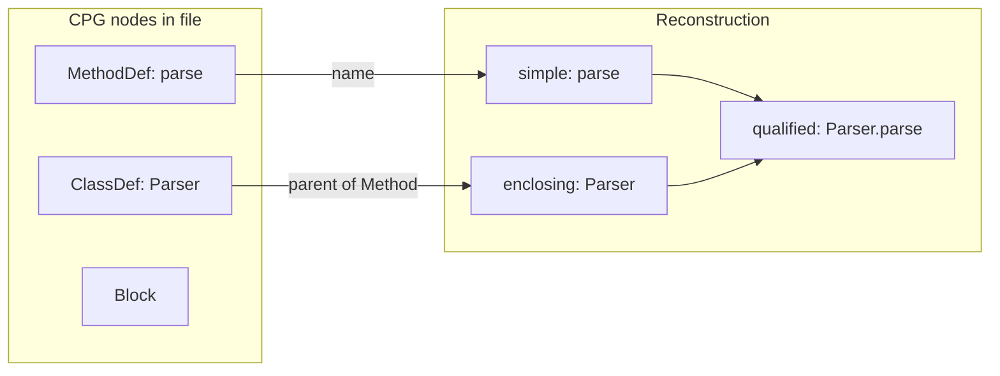

#### Direct callers

`compute_direct_callers` returns every function with a `Call` edge into the target. For each edge, it builds a `Caller` record with the node id, qualified name, file path, line, depth (always 1), and call kind (`Direct`).

Duplicates are collapsed. The result is sorted by node id so the output is deterministic.

#### Transitive callers

`compute_transitive_callers` performs BFS through reverse `Call` edges from the direct callers, up to a cap.

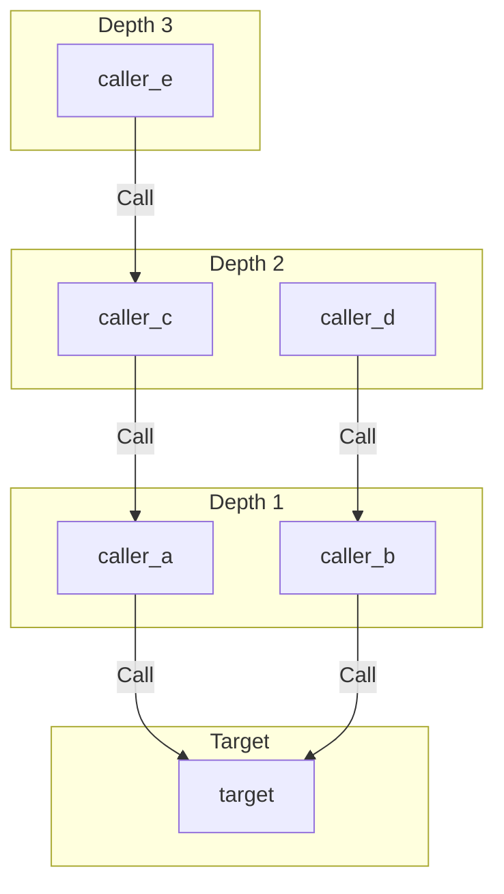

The cap is `MAX_TRANSITIVE_CALLERS`, which is 2000. A utility function called from every corner of a large repository can have tens of thousands of transitive callers; the cap keeps the report renderable. When the cap is reached, the returned bool is true.

A visited set prevents cycles from causing infinite loops. The target itself is never reported as its own caller.

The result is sorted by `(depth, node_id)`.

#### Contract violations

This is the narrowest signal in the crate, and it is deliberately so.

The detector looks for one pattern:

1. The target has at least one bare `return`, so it can produce `None` on some path.
2. A caller binds the target's return value to a variable.
3. That variable is used in a `Subscript` or `Attribute` node, which is a dereference of the value.
4. The dereference is **not** control-dependent on a guarded branch.

Step 4 uses the PDG's `ControlDependence` edges. If the enclosing statement is control-dependent on an `If` whose condition references the bound variable, the caller has performed a check and the dereference is not a violation.

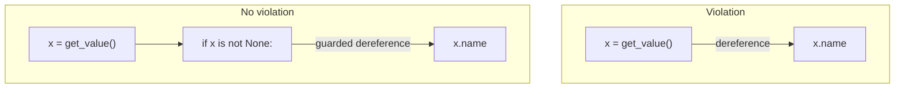

The signal produces false positives and false negatives. A caller that checks `x is not None` and then dereferences `x` in the same branch is not flagged. A caller that checks `x` for truthiness and dereferences it on the else branch is not flagged because the CPG cannot distinguish the condition's polarity. The signal is deliberately narrow and honest about what it does not catch.

Every violation is emitted with `Risk::Warning`. The `Risk::Critical` variant exists in the type but no caller produces it — a future contract signal will.

#### Coverage gaps

`detect_coverage_gaps` reports callers that no test file reaches through the call graph.

A file counts as a test file when its path matches a filename pattern:

- Python: basename starts with `test_`, ends with `_test.py`, or path contains `/tests/`
- TypeScript: basename contains `.test.` or `.spec.`, or path contains `/__tests__/`

A caller counts as covered when a call edge from a test file reaches it, directly or through intermediate functions. The check walks forward through `Call` edges from every function in every test file and marks every reached node.

The signal is a heuristic. It cannot verify that a test executes, that a test asserts anything, or that the code path through the caller is exercised at runtime. The schema field is named `reason` rather than `coverage` because the honest label for the value is "why this caller is not touched by tests", not "this caller is covered".

#### Score

`compute_blast_score` is a single integer from 0 to 100 that summarizes risk.

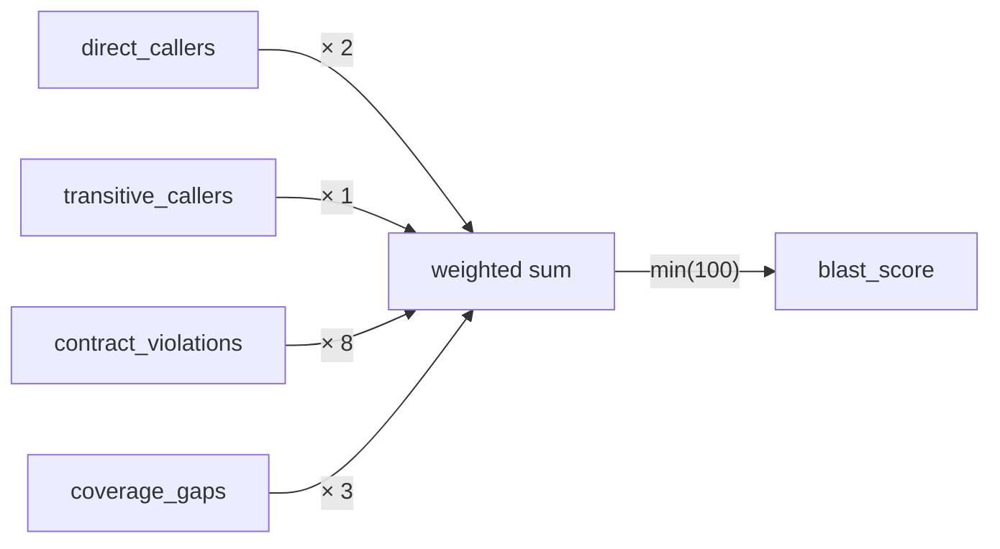

The weights are named constants:

| Constant | Value | Rationale |
|---|---|---|
| `W_DIRECT_CALLER` | 2 | Direct callers are the highest-confidence signal |
| `W_TRANSITIVE_CALLER` | 1 | Transitive callers are weaker evidence |
| `W_CONTRACT_VIOLATION` | 8 | A violation is four times a direct caller |
| `W_COVERAGE_GAP` | 3 | A gap is between a transitive caller and a violation |

The weights are **heuristics, not measurements**. They have not been calibrated against real repository data. The doc comment on each constant states this explicitly. When real data arrives, they change in one place.

Every operation is saturating, so an extreme input cannot overflow.

#### Recommendation

`recommend(score, critical_violation_count) -> Recommendation` maps the score to a base band and applies two overrides.

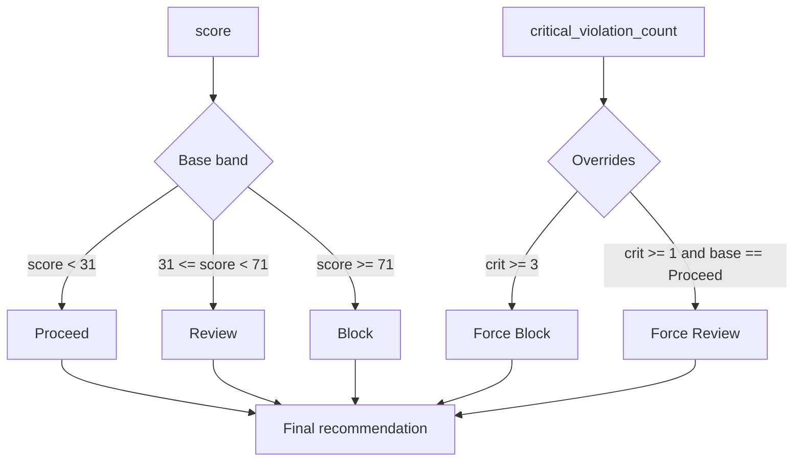

The thresholds are:

| Threshold | Value |
|---|---|
| `REVIEW_THRESHOLD` | 31 |
| `BLOCK_THRESHOLD` | 71 |
| `CRITICAL_FORCES_BLOCK` | 3 |

The overrides matter because score alone can under-report. One critical violation with a small call graph should not read as "proceed."

### Sandbox — `codeguardian-sandbox`

The sandbox crate is the trust boundary. Nothing the pipeline does not control runs outside it.

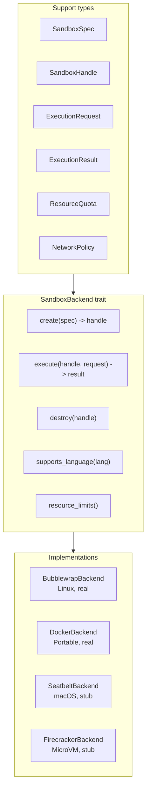

#### The trait

Five methods, matching the Python `SandboxBackend` Protocol from Phase 4:

- `create(&self, spec: &SandboxSpec) -> Result<SandboxHandle, SandboxError>`
- `execute(&self, handle: &SandboxHandle, request: &ExecutionRequest) -> Result<ExecutionResult, SandboxError>`
- `destroy(&self, handle: SandboxHandle) -> Result<(), SandboxError>`
- `supports_language(&self, language: &str) -> bool`
- `resource_limits(&self) -> ResourceQuota`

The trait is async via `#[async_trait]`, which boxes the returned futures and keeps the trait object safe. Callers hold a `Box<dyn SandboxBackend>`.

#### The handle

The handle carries the full sandbox state that `execute` needs:

```rust
pub struct SandboxHandle {
    pub id: SandboxId,
    pub backend: String,
    pub language: String,
    pub working_dir: PathBuf,
    pub network_enabled: bool,
    pub memory_mb: u32,
    pub cpu_cores: u32,
    pub process_limit: u32,
}
```

The quota fields are captured at creation and travel with the handle so `execute` can reconstruct the sandbox's resource state without a side table.

#### Enforcement

Four things are enforced before the child process starts:

**Environment sanitization.** `FORBIDDEN_ENV_KEYS` lists fifteen environment variable names that are code-injection vectors. `LD_PRELOAD` and its macOS equivalent load an arbitrary shared library into the process before `main` runs. `PYTHONPATH`, `NODE_PATH`, and their peers redirect the runtime's module search. `BASH_ENV` and `ENV` are sourced by the shell on startup.

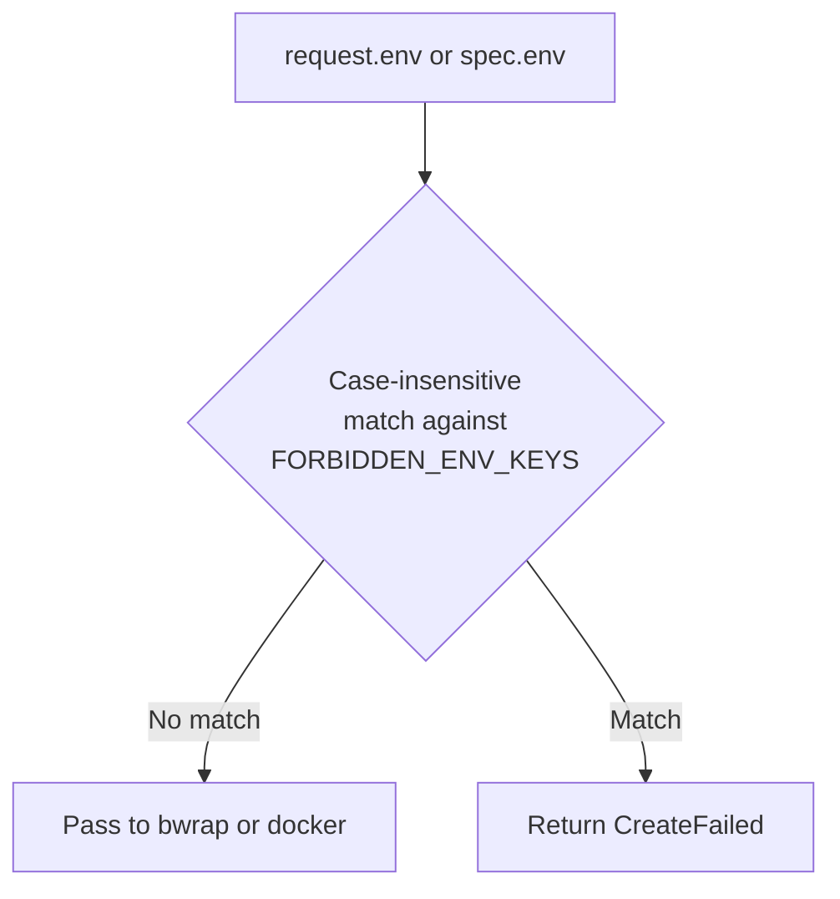

The check is case-insensitive. A caller that sets `ld_preload` instead of `LD_PRELOAD` is still rejected.

**Working directory validation.** `validate_working_dir` rejects a path that does not exist, is not a directory, or resolves to a top-level system directory. The forbidden list is `/`, `/bin`, `/boot`, `/dev`, `/etc`, `/lib`, `/lib64`, `/proc`, `/root`, `/run`, `/sbin`, `/sys`, `/usr`, `/var`.

The check canonicalizes the path first, so a symlink to `/etc` is rejected the same as `/etc`.

**Quota validation.** `ResourceQuota::validate` rejects a quota outside the accepted range: 64 MB to 64 GB of memory, 1 to 64 CPU cores, 1 to 65536 processes.

**Output cap.** `read_child_stream` reads at most 16 MB from a child's stdout or stderr. A process that writes more has its extra output discarded and the `output_truncated` flag set on the result. Without the cap, a runaway process that writes to stdout grows the reader's buffer until the sandbox daemon is killed by the kernel OOM killer.

#### The Bubblewrap backend

Bubblewrap is the v1 Linux default. It is a user-namespace sandbox built on `bwrap`, a small setuid-free launcher.

The command builder produces this invocation:

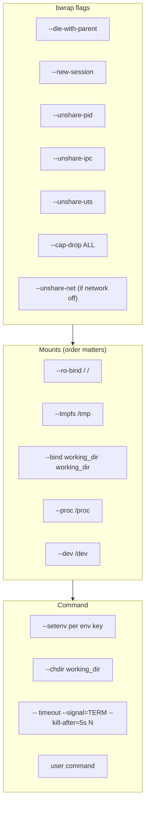

**Mount order matters.** `--tmpfs /tmp` replaces the entire `/tmp` subtree. If it is applied *after* the working directory bind and the working directory is under `/tmp`, the earlier bind is shadowed and the path stops existing. The builder mounts the tmpfs first and the working directory second, so bwrap creates the working directory's parents inside the fresh tmpfs and the bind lands on top.

This is a bug that shipped in the first version of the backend and was caught by the enforcement tests. Every test that used pytest's `tmp_path` as the working directory failed with exit code 1 — bwrap could not `chdir` to a path that no longer existed.

**Timeout is two-layered.** The inner layer is the `timeout` command running inside the sandbox. It sends SIGTERM at `timeout_ms` and SIGKILL five seconds later if the process ignores SIGTERM. The sandboxed process exits with code 124.

The outer layer is a Rust-side `tokio::time::timeout` that fires at `timeout_ms + 6s`. It covers the case where `timeout` itself does not start. When the outer fires, `execute` returns `Err(SandboxError::Timeout)`.

In practice the inner always wins. The outer is a safety net.

**Exit codes.** `124` means the inner `timeout` fired. `137` means SIGKILL, which is either the `timeout` grace period or the OOM killer.

#### The Docker backend

Docker is the v1 fallback. It is used where Bubblewrap is not available — macOS, Windows, CI.

The command builder passes the handle's quota directly to `docker run`:

| Flag | Source |
|---|---|
| `--memory` | `handle.memory_mb` |
| `--cpus` | `handle.cpu_cores` |
| `--pids-limit` | `handle.process_limit` |
| `--cap-drop ALL` | Fixed |
| `--network none` | `handle.network_enabled` |
| `--rm` | Fixed — no container outlives the call |

The `--rm` flag is mandatory. A change that removes it leaks containers and violates the design's "no unbounded growth" rule.

**Timeout** is enforced by the Rust-side `tokio::time::timeout`. When it fires, the backend runs `docker kill <name>` to stop the container and then kills the `docker run` CLI process. The container name is a per-call unique string so two concurrent executions cannot collide.

**Exit codes.** `137` means the container was OOM-killed.

#### The stubs

`SeatbeltBackend` and `FirecrackerBackend` are stubs. Every method returns an error that names the missing implementation. `supports_language` returns false for every language.

They exist so the backend selector can treat Seatbelt and Firecracker uniformly with the implemented backends. A caller that writes `match backend_name { "seatbelt" => ..., _ => ... }` gets a typed error from the stub rather than a "backend not found" surprise.

#### The warm pool

`WarmPool` keeps a small number of idle handles alive so the first execution of a batch does not pay the creation cost twice.

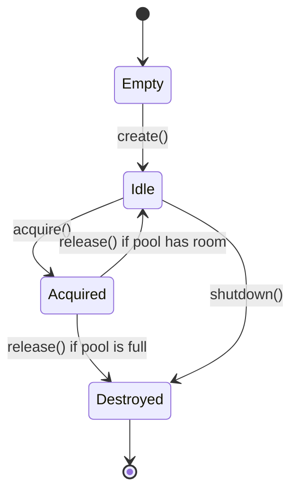

The pool holds handles, not sandboxes. A backend like Bubblewrap where `create` is a no-op has nothing to keep alive; the pool's value is holding the handle itself. A backend like Docker where `create` allocates real resources benefits from the pool holding those resources idle.

The pool is defined but **not used**. The orchestrator (Phase 13) is the phase that batches executions and needs the pool. Building it now would be speculative.

### Audit — `codeguardian-audit`

The audit crate is the tamper-evidence layer. Every entry records what happened, when, and by which component. The chain of entries cannot be modified without breaking every subsequent entry's hash.

```mermaid
flowchart LR
    subgraph Chain["Hash chain"]
        E1["Entry 1<br/>prev_hash = GENESIS<br/>entry_hash = H1"]
        E2["Entry 2<br/>prev_hash = H1<br/>entry_hash = H2"]
        E3["Entry 3<br/>prev_hash = H2<br/>entry_hash = H3"]
    end

    E1 --> E2
    E2 --> E3
```

Each entry carries three hashes:

| Field | Value |
|---|---|
| `payload_hash` | SHA-256 of the payload's canonical bytes |
| `prev_hash` | The preceding entry's `entry_hash`, or `GENESIS` |
| `entry_hash` | SHA-256 of `prev_hash` concatenated with `payload_hash` |

#### Canonical JSON

Hashing a payload requires a byte representation that does not depend on map iteration order. `canonical_json_bytes` produces that representation: JSON with object keys sorted lexicographically, no whitespace, and standard string escaping.

```mermaid
flowchart TB
    Payload["Value::Object<br/>{'b': 2, 'a': 1}"]
    Canonical["canonical_json_bytes"]
    Bytes["b'{\"a\":1,\"b\":2}'"]
    Hash["sha256_hex"]
    Hex["'e8e2...'"]

    Payload --> Canonical
    Canonical --> Bytes
    Bytes --> Hash
    Hash --> Hex
```

The encoder is written by hand. It walks the value once and appends each field's bytes directly to the output buffer. `serde_json::to_string` is used for string escaping, but not for object encoding, because `serde_json`'s default object ordering depends on the map implementation.

Two payloads that are structurally equal produce identical bytes. Two payloads that differ in key insertion order produce identical bytes. This is the property the chain depends on.

#### Writer

`AuditWriter` appends one line to a JSONL file per entry.

On every `append`:
1. Read the file's tail to find the current head hash.
2. Compute the new entry's hashes.
3. Serialize the entry.
4. Append the line.

Re-reading the head on every append is correct under any crash. Audit logs are small enough that a full scan is cheaper than maintaining a side index.

No file locking is performed. The design assumes a single writer. Multi-writer coordination is a known gap.

#### Verifier

`verify_chain` walks the log from the first entry to the last and checks three invariants per line:

1. `payload_hash` equals the SHA-256 of the payload's canonical bytes.
2. `prev_hash` equals the preceding entry's `entry_hash`, or `GENESIS`.
3. `entry_hash` equals the SHA-256 of `prev_hash` concatenated with `payload_hash`.

The walk stops at the first failure. The returned summary counts entries that passed before the failure, not entries in the file.

The error type has a variant for each invariant, each carrying the line number and the expected and actual values.

#### Export

Two formats:

- `export_jsonl(audit_path, writer)` — one serialized entry per line
- `export_json_array(audit_path, writer)` — a single JSON array

Both validate every entry during the read. A line that is not valid JSON fails the export before any output is produced.

### Policy — `codeguardian-policy`

The policy crate enforces pre-flight checks before an action runs.

Three modules:

| Module | Purpose |
|---|---|
| `sandbox_policy.rs` | Bounds a sandbox spec against a policy |
| `plugin_permissions.rs` | Bounds a plugin's declared permissions |
| `resource_limits.rs` | Bounds a quota against the host's capabilities |

#### Sandbox policy

`check_sandbox_spec(spec, policy)` rejects when:

- The spec's `memory_mb` exceeds the policy's
- The spec's `cpu_cores` exceeds the policy's
- The spec's `process_limit` exceeds the policy's
- The spec's language is not in the policy's `allowed_languages`

`allowed_languages` is an **allow list**, not a deny list. An empty vector denies every language. This follows the safety-before-speed principle: a policy with a forgotten allow list fails closed, not open.

#### Plugin permissions

The permission fields mirror `schemas/plugin-manifest.json`'s `permissions` object:

```rust
pub enum FilesystemLevel { None, SandboxOnly, ReadOnly, Full }

pub struct PluginPermissions {
    pub filesystem: FilesystemLevel,
    pub network: bool,
    pub process_spawn: bool,
    pub env_read: Vec<String>,
}
```

The filesystem levels are ordered from least to most permissive:

```mermaid
flowchart LR
    None["None"] --> SandboxOnly["SandboxOnly"]
    SandboxOnly --> ReadOnly["ReadOnly"]
    ReadOnly --> Full["Full"]
```

The derived `Ord` places `None < SandboxOnly < ReadOnly < Full`. The check for "does the request exceed the grant?" is a single comparison:

```rust
if permissions.filesystem > policy.allowed_filesystem { reject }
```

`check_plugin_permissions` checks four things in order, returning the first failure:

1. Filesystem level
2. Network
3. Process spawning
4. Every environment key the plugin declares

#### Host limits

`HostLimits::detect` reads the host's resource capabilities from `/proc`:

| Field | Source |
|---|---|
| `total_memory_mb` | `MemTotal` from `/proc/meminfo`, divided by 1024 |
| `total_cpu_cores` | Count of `processor` entries in `/proc/cpuinfo` |
| `max_processes` | `/proc/sys/kernel/pid_max` |

`check_against_host(quota, limits)` rejects a quota that exceeds the host's total on any field. A request for 128 GB of memory on a 16 GB host cannot be honored, and the check happens before the backend attempts to create the sandbox.

On platforms without `/proc` — macOS, Windows — detection fails and the caller must supply limits explicitly.

### The RPC daemon — `codeguardian-rpcd`

The daemon is a single-purpose binary that speaks JSON-RPC 2.0 over stdio. It is spawned by `JSONRPCBridge` and hosts the handlers for the sandbox and audit crates.

```mermaid
sequenceDiagram
    participant Py as Python (JSONRPCBridge)
    participant Pipe as stdin/stdout
    participant Daemon as codeguardian-rpcd
    participant Handler as handler

    Py->>Pipe: {"jsonrpc":"2.0","id":1,"method":"sandbox.create",...}\n
    Pipe->>Daemon: read line
    Daemon->>Daemon: parse, dispatch to handler
    Daemon->>Handler: rt.block_on(sandbox_create(params))
    Handler-->>Daemon: Value
    Daemon->>Pipe: {"jsonrpc":"2.0","id":1,"result":{...}}\n
    Pipe->>Py: read line
    Py->>Py: match id, return result
```

The daemon registers seven handlers:

| Method | Purpose |
|---|---|
| `sandbox.health` | Report the available backends |
| `sandbox.create` | Create a sandbox handle |
| `sandbox.destroy` | Destroy a sandbox handle |
| `sandbox.execute` | Run a command inside a sandbox |
| `audit.write` | Append an audit entry |
| `audit.verify` | Verify an audit chain |
| `audit.export` | Export an audit log |

The daemon builds a two-worker tokio runtime and blocks the calling thread on each handler. The RPC server's dispatch loop is synchronous, so a handler that returned a `Future` to it would not be awaited.

Every handler that reads from disk or spawns a process runs on the runtime. Policy checks that only compare integers run on the dispatch thread.

### PyO3 blast and policy bindings

`pyo3/blast.rs` exposes one function:

- `compute_blast(cpg_bytes, target_path, target_qualified_name) -> dict`

The returned dict has eight keys: `target_node_id`, `direct_callers`, `transitive_callers`, `transitive_truncated`, `contract_violations`, `coverage_gaps`, `blast_score`, `recommendation`.

Every caller list carries one dict per element. Contract violations carry the caller id, qualified name, file path, line, assumption text, and risk level. Coverage gaps carry the same fields minus the risk.

The function releases the GIL while it reads the CPG. It then resolves the target, computes all four analyses, scores the result, and returns the dict. Failures surface as `KernelError` with codes `FILE_NOT_FOUND`, `BLAST_TARGET_NOT_FOUND`, or `BLAST_TARGET_AMBIGUOUS`.

`pyo3/policy.rs` exposes three functions:

- `check_sandbox_spec(language, memory_mb, cpu_cores, process_limit, max_memory_mb, max_cpu_cores, max_process_limit, allowed_languages)`
- `check_plugin_permissions(plugin_name, filesystem, network, process_spawn, env_read, allowed_filesystem, allow_network, allow_process_spawn, allowed_env_keys)`
- `detect_host_limits() -> dict`

All three use the shared `_native.KernelError` exception class. The policy bindings take primitive arguments rather than DTOs because the DTOs would have to be PyO3 classes, which would duplicate the type definitions.

### What Phase 7 hands forward

- **To Phase 8:** a working blast engine that providers can call, a working sandbox that Python backends can wrap, and the policy checks that pre-flight every action.
- **To Phase 13:** the audit writer and policy engine, both wired into the orchestrator. The warm pool, which becomes useful when the orchestrator batches executions.
- **To Phase 15:** the audit export formats the reporters emit.

### What Phase 7 deliberately does not do

Phase 7 does not implement the Python providers. That is Phase 8. It does not load plugins. That is Phase 9. It does not run agents. That is Phase 11. It does not orchestrate. That is Phase 13. It does not implement the CLI. That is Phase 14. It does not implement the MCP client or server. That is Phase 15.

The sandbox crate does not implement cgroups v2 writing, seccomp filtering, network allow lists, or filesystem quotas. Those need a caller that asks for specific limits, and Phase 13's orchestrator is that caller.

The sandbox crate does not have a from-scratch native backend. Bubblewrap and Docker are wrappers around battle-tested CLIs. This is the correct architecture — every major sandbox in the industry is a wrapper around the same OS primitives — but it means the enforcement strength is bounded by what bwrap and docker enforce. A native backend that writes directly to `/sys/fs/cgroup` and installs a seccomp filter is deferred to v2.

The audit crate does not coordinate multiple writers. No file locking is performed. Two concurrent writers would corrupt the chain silently. Multi-writer coordination is a known gap.

---

## Test counts

| Phase boundary | Passing tests |
|---|---|
| Phase 1 | 165 |
| Phase 2 | 165 (no new tests) |
| Phase 3 | 227 (165 + 62 new) |
| Phase 4 | 227 (no new tests) |
| Phase 5 | 252 (227 + 25 new integration tests) |
| Post-Phase-5 translation fix | 256 (252 + 4 new translation tests) |
| **Phase 6** | **298 (256 + 42 new kernel tests)** |
| **Phase 7** | **364 (298 + 51 blast/policy tests + 15 enforcement tests)** |

The 15 enforcement tests in `test_sandbox_enforcement.py` are the only tests in the entire build that actually run code inside a sandbox and verify the enforcement held. They spawn real `bwrap` processes, verify stdin delivery, verify timeout behavior, verify that the working directory is writable and `/` is read-only, verify that forbidden environment variables are rejected, and verify that the output cap works.

Without these tests, nothing in the build proves that the sandbox enforcement works. Every other sandbox test exercises the control plane — creating a handle, checking a trait — but not the isolation.

The Python tests are skipped when the rpcd binary or `bwrap` is not available. On a system without `bwrap`, the enforcement suite skips cleanly, and the rest of the tests still run.

### Rust workspace

At the end of Phase 7, the workspace has eight crates:

| Crate | Purpose |
|---|---|
| `codeguardian-kernel` | Parsing, CPG, incremental updates, queries |
| `codeguardian-blast` | Blast radius computation |
| `codeguardian-sandbox` | Isolated execution |
| `codeguardian-audit` | Tamper-evident audit log |
| `codeguardian-policy` | Pre-flight policy enforcement |
| `codeguardian-rpc` | JSON-RPC 2.0 envelope and transport |
| `codeguardian-pyo3` | Python extension |
| `codeguardian-rpcd` | JSON-RPC daemon binary |

`cargo test --workspace` runs eight test binaries. All report zero tests. All pass. `cargo clippy --workspace -- -D warnings` passes with no warnings.

---

## Deferred from the original plan

Three items from the BUILD_ORDER for Phases 6 and 7 were deferred or re-scoped. Each is recorded here with its reason and the phase that becomes responsible for it.

### G-15 — The RPC binary

**Status:** Closed in Phase 7.

BUILD_ORDER B-037 listed `tests/unit/rust/test_sandbox.py` and `tests/unit/rust/test_audit.py`, but there was no binary for Python to spawn. The sandbox and audit crates cross via JSON-RPC by design; a JSON-RPC bridge needs a subprocess. Both test files could only be written once the daemon existed.

The daemon was added as a new crate, `codeguardian-rpcd`, in a follow-up commit. The two test files were written with real content — 18 audit tests and 15 sandbox control-plane tests — alongside a third file, `test_sandbox_enforcement.py`, with 15 tests that run code inside the sandbox.

### G-16 through G-21 — Sandbox enforcement gaps

**Status:** Deferred to Phase 13.

Six sandbox capabilities are not implemented. Each needs a caller that asks for specific limits, and Phase 13's orchestrator is that caller.

| Gap | What is missing | Phase |
|---|---|---|
| **G-16** | cgroups v2 writing for memory and CPU enforcement | Phase 13 |
| **G-17** | seccomp BPF filter for syscall restriction | Phase 13 |
| **G-18** | Per-host network allow list | Phase 13 |
| **G-19** | Filesystem quota | Phase 13 |
| **G-20** | Warm pool usage by a scheduler | Phase 13 |
| **G-21** | Audit entries for sandbox operations | Phase 13 |

The current sandbox is a control plane. It enforces what `bwrap` and `docker` enforce out of the box, plus the enforcement layer in `backend.rs` — environment sanitization, working directory validation, quota validation, output caps, timeout handling, capability dropping.

### G-22 — Native sandbox backend

**Status:** Deferred to v2.

The current backends are wrappers. Bubblewrap is 5,000 lines of audited C; Docker is a decade-old container runtime. They enforce the same kernel primitives any from-scratch implementation would use.

A native backend that writes directly to `/sys/fs/cgroup` and installs a seccomp filter is a v2 concern. When it lands, it slots into the same `SandboxBackend` trait with zero changes to callers.

Building it now would violate `skills.md`'s "no speculative code" rule: there is no caller that needs it.

### Six bugs fixed before Phase 8

The sandbox crate had six defects that were fixed before Phase 8 began. They are not deferred; they are corrected.

| Bug | Fix |
|---|---|
| Docker memory used the default, ignored the spec | Handle now carries `memory_mb`; the flag reads from it |
| `request.stdin` was accepted and never used | The bytes are written to the child's stdin |
| Output read unbounded into RAM | Capped at 16 MB with a truncation flag |
| Timeout killed `bwrap` but not the grandchild | Two-layer timeout: inner `timeout` command plus outer Rust timeout |
| Environment variables passed to the child verbatim | `sanitize_env` rejects fifteen forbidden keys |
| Working directory not validated | `validate_working_dir` rejects non-directories and top-level system paths |

---

## Summary

Phase 6 and Phase 7 together deliver the intelligence and enforcement layers of CodeGuardian.

Phase 6 is where source code becomes a graph. The kernel parses Python and TypeScript, extracts symbols, resolves calls, builds a CFG and PDG per function, merges everything into a single Code Property Graph, serializes it to a binary format, and answers queries about it. The CPG's 64-byte header is what Phase 3 defined and what Phase 6 honored byte for byte.

Phase 7 is where the graph is used. The blast engine walks reverse call edges to find what breaks. The sandbox crate isolates execution. The audit crate writes a hash-chained log that cannot be tampered with. The policy crate validates sandbox specs, plugin permissions, and quotas against host limits before anything runs.

The bridge choice is by trust. Kernel, blast, and policy cross in-process via PyO3. Sandbox and audit cross out-of-process via JSON-RPC because they sit on the wrong side of the trust boundary.

364 tests pass. The workspace has eight crates that compile clean under `-D warnings`. The rpcd daemon exposes seven JSON-RPC methods. The native extension exposes seven functions across kernel, blast, and policy.

The heavy phases are still ahead. Phase 8 writes the Python providers. Phase 9 loads plugins. Phase 11 writes the real agents. Phase 13 writes the orchestrator. Phase 14 writes the CLI. Those phases contain roughly seventy percent of the project's remaining code. What has been built is the foundation they stand on.

---

## Related documents

- `docs/summaries/phases-1-to-5.md` — the foundation Phases 6 and 7 build on
- `docs/04-architecture.md` — components described here
- `docs/05-data-model.md` — schemas the CPG and blast reports conform to
- `docs/07-tech-stack.md` — Tree-sitter, Bubblewrap, Docker, and the bridge choices
- `docs/08A-module-relationships.md` — how the crates connect
- `BUILD_STATE.md` — the current state and known gaps
- `BUILD_ORDER.md` — the phase plan
