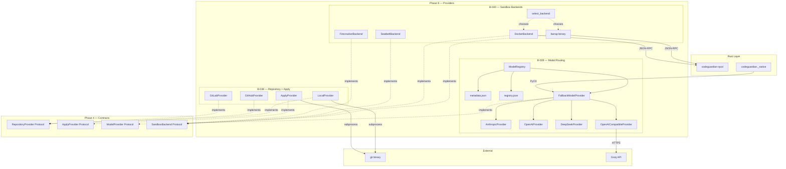
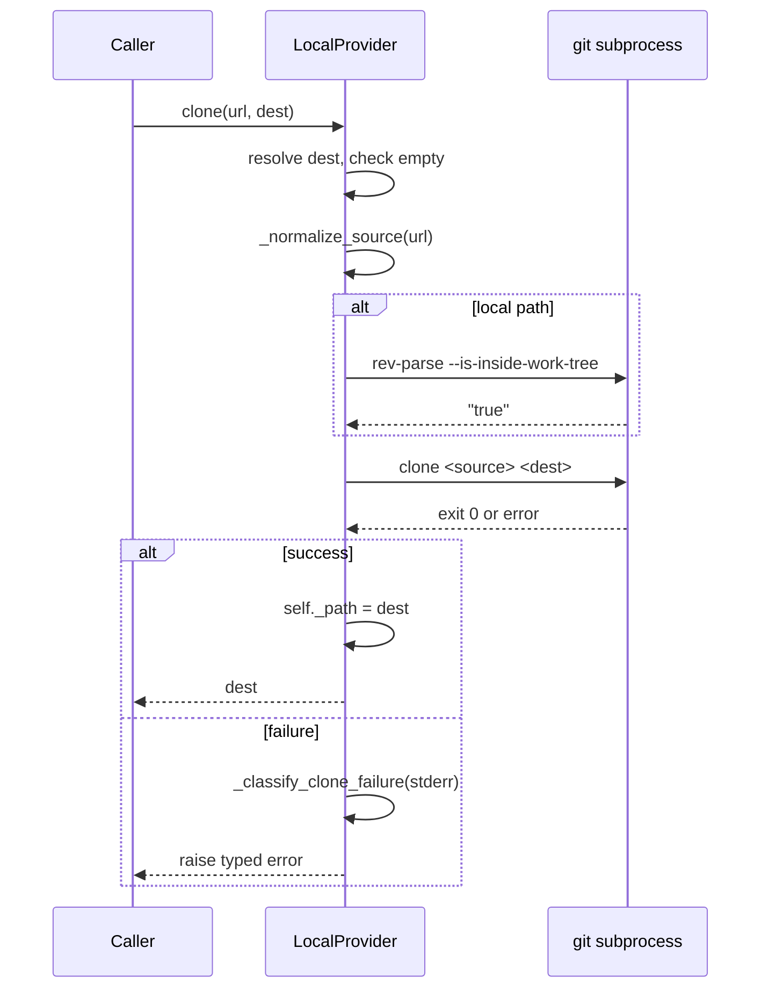
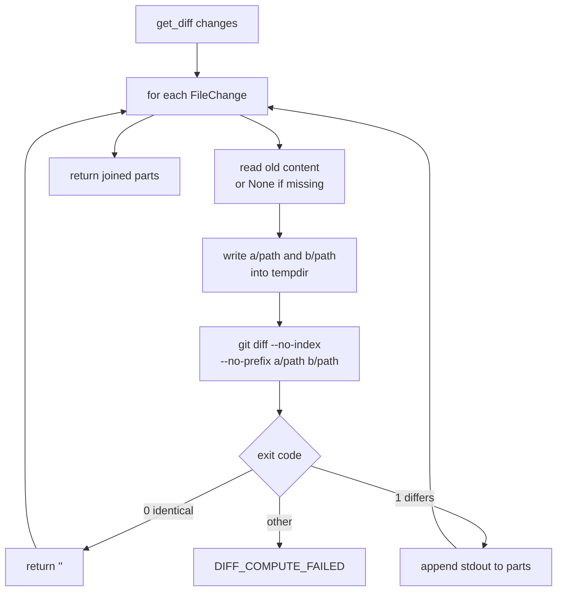
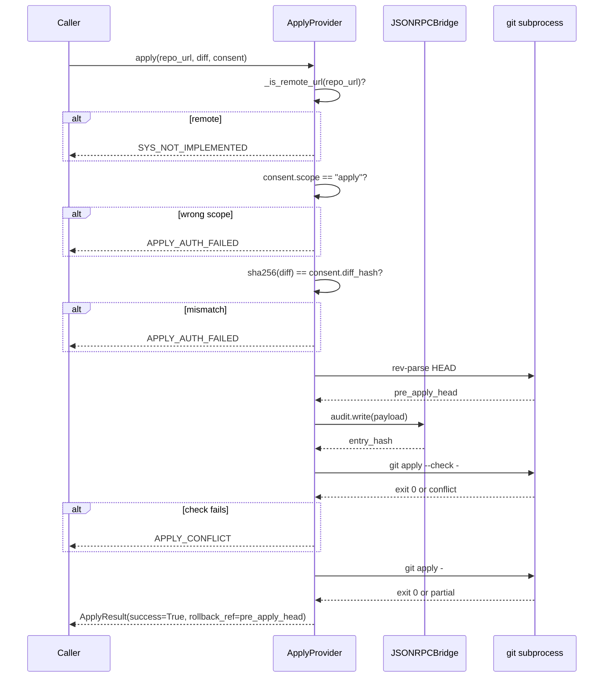
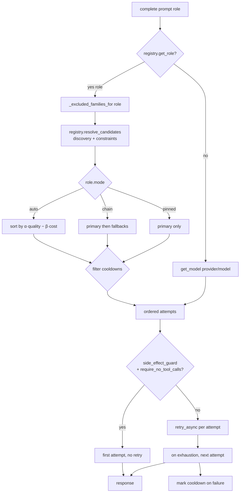
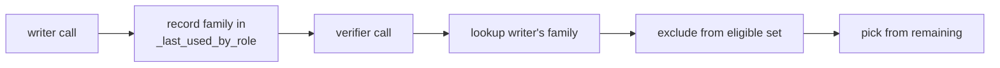
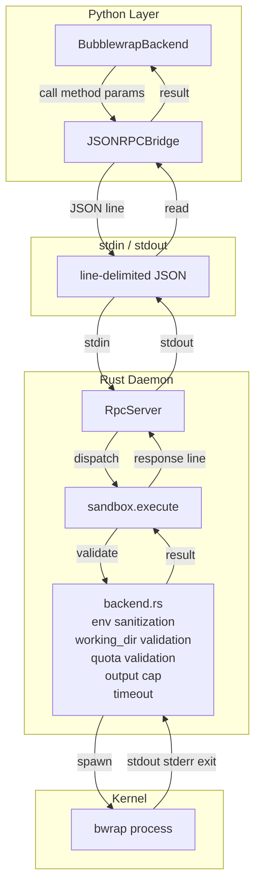
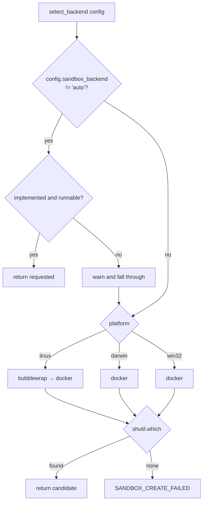
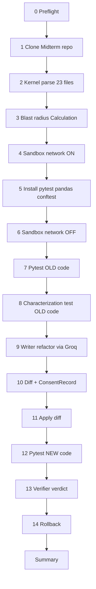

# Phase 8 — Providers, Model Routing, and Sandbox Backends

**Snapshot date:** 2026-10-18
**Status:** Complete
**Test count:** 487 passing, 2 skipped + 35/35 real integration checks
**Previous phase boundary:** 367 passing (Phase 7 + B-037A)

---

## 1. How to read this document

Phases 1 through 7 built the foundation and the Rust engines. Phase 8 is where every Protocol from Phase 4 gets its first Python implementation, and where the Rust engines get their first Python clients.

This document covers:

- **Escalation A** — a Rule 1 rewrite of `interfaces/sandbox.py` to close the gap between the Phase 4 contract and the Phase 7 daemon's wire format
- **B-038** — Repository and Apply providers
- **B-039** — Discovery-driven model routing
- **B-040** — Sandbox backend implementations
- **B-041** — Contract tests
- **The bugs** — seven real bugs found during integration, and how each was fixed
- **The real integration test** — 35 safety checks against a live repository, a live model, and a live sandbox
- **The drawbacks** — what Phase 8 does not do, and why each gap is either correct scope or a Phase 9+ concern

The document is written as a build history. Every claim is backed by a specific test or a specific line of code.

---

## 2. What Phase 8 is

Phase 8 answers one question: **does every Protocol in `codeguardian.interfaces` have a working implementation that a Phase 11 agent could actually use?**

Before Phase 8, the answer was no. `RepositoryProvider`, `ApplyProvider`, `ModelProvider`, and `SandboxBackend` were Protocols with no implementations. The pipeline could not clone a repository, could not read a file, could not call a model, could not run a sandbox.

After Phase 8, all four Protocols have concrete implementations verified against real external systems:

| Protocol | Implementation | Verified against |
|---|---|---|
| `RepositoryProvider` | `LocalProvider`, `GitHubProvider`, `GitLabProvider` | Real GitHub clone of `mb2362/Midterm` |
| `ApplyProvider` | `ApplyProvider` | Real `git apply` on a real 2,924-char diff |
| `ModelProvider` | `FallbackModelProvider` + 4 adapters | Real Groq API, real refactor, real verdict |
| `SandboxBackend` | `BubblewrapBackend`, `DockerBackend`, `SeatbeltBackend`, `FirecrackerBackend` | Real `bwrap` executing pytest inside a real clone |

Phase 8 does **not** run a pipeline. It does not write characterization tests. It does not orchestrate anything. It is the plumbing layer that Phase 11 and Phase 13 stand on.

---

## 3. The architecture Phase 8 fits into



Three properties matter:

1. **Providers are stateless.** `LocalProvider` holds a path. `FallbackModelProvider` holds a cooldown dictionary and a role-family map. `BubblewrapBackend` holds a bridge and defaults. None holds state the caller did not supply.

2. **Providers do not enforce policy.** `ApplyProvider` writes to a repository only after `sha256(diff) == consent.diff_hash`. `BubblewrapBackend` runs commands only inside the daemon's sandbox. The policy decisions live in Phase 13.

3. **Sandbox backends never spawn processes.** Every `sandbox.execute` is a JSON-RPC call to `codeguardian-rpcd`. The daemon owns the trust boundary. Python can request, but it cannot bypass.

---

## 4. Escalation A — `interfaces/sandbox.py` rewrite

**Rule 1 escalation.** The file passed in Phase 4. Phase 8 rewrote it.

The gap: the Phase 7 daemon already required and returned more fields than the Phase 4 contract declared. `handlers.rs` accepted `working_dir`, `image`, and returned `language`, `network_enabled`, `memory_mb`, `cpu_cores`, `process_limit`, `oom_killed`, `output_truncated`. The Phase 4 `SandboxSpec`, `SandboxHandle`, and `ExecutionResult` dataclasses declared none of those. B-040 could not have been written against the Phase 4 contract — the resulting code would not have matched the daemon.

The rewrite added:

| Type | Added fields |
|---|---|
| `SandboxSpec` | `working_dir: Path`, `image: str \| None = None` |
| `SandboxHandle` | `language`, `working_dir`, `network_enabled`, `memory_mb`, `cpu_cores`, `process_limit`, `image` (removed `created_at` — the daemon does not return one) |
| `ExecutionResult` | `oom_killed: bool`, `output_truncated: bool` |
| `SandboxBackend.execute` | signature changed from `(handle, command: str, timeout: int)` to `(handle, command: Sequence[str], *, env, cwd, timeout_ms, stdin)` |

The `execute` signature change is the load-bearing one. `bwrap` and `docker` take argv, not shell strings. A caller that wants shell semantics runs `["/bin/sh", "-c", script]` explicitly. The backend never makes shell-quoting decisions, which is where injection bugs live.

---

## 5. B-038 — Repository and Apply providers

### 5.1 Files

| File | Class | Purpose |
|---|---|---|
| `core/providers/__init__.py` | — | Dynamic discovery; picks up new modules automatically |
| `core/providers/local_repository.py` | `LocalProvider` | Reference implementation; all git operations shell out |
| `core/providers/github_repository.py` | `GitHubProvider` | Subclass of `LocalProvider`; URL prefix validation only |
| `core/providers/gitlab_repository.py` | `GitLabProvider` | Same shape, GitLab prefixes |
| `core/providers/apply_provider.py` | `ApplyProvider` | The only writer in the system |

### 5.2 `LocalProvider.clone` — real git subprocess



Every git call is a real subprocess with a timeout, captured stdout and stderr, and a typed error on failure. Standard library exceptions become `CodeGuardianError` at the boundary.

The `read_file` guard chain:

1. `_resolve_relative` rejects any path that escapes the clone root via `..` or symlink
2. size check against `_max_file_bytes` (10 MiB)
3. decode UTF-8, reject on `UnicodeDecodeError`
4. reject any text containing `\x00`

The first of those is the security-critical one. `_resolve_relative` calls `.resolve()` (which follows symlinks) and then `.relative_to(root)`. A symlink inside the clone that points outside the clone fails the `relative_to` check exactly as a `../../../etc/passwd` traversal does.

### 5.3 `get_diff` — the load-bearing decision

The original implementation used `difflib.unified_diff`. This worked in tests and failed in production.

**The bug.** When a file does not end with a trailing newline, `git apply` requires a literal `\ No newline at end of file` marker after that side's last content line. `difflib.unified_diff` does not emit this marker. The resulting diff looks correct but is rejected by `git apply --check` with:

```
error: patch failed: calculator/operations.py:82
error: calculator/operations.py: patch does not apply
```

The tests that shipped with B-041 used `"hello\n"` → `"world\n"` diffs — single-line, single-hunk, both sides trailing newline. That shape never triggers the bug. The real Writer produced a 2,924-char refactor with docstring removals and no trailing newline on the new content. That shape triggers it every time.

**The fix.** Switch to `git diff --no-index`:



`git diff --no-index` is the same code path `git diff` uses. Its output is by construction what `git apply` consumes. The EOF marker, filename quoting, tab expansion — every edge case the two tools disagree on — is handled by using the same tool on both sides.

Two subtleties that came up during the fix:

- **Missing side must be passed as `/dev/null`, not omitted.** `git diff --no-index a/hello.txt b/missing.txt` returns **exit 0 with no output** when `b/missing.txt` does not exist. Git silently skips the comparison. Passing `/dev/null` instead — which exists as a character device — produces the standard `--- /dev/null` or `+++ /dev/null` header that `git apply` uses to decide the file is created or deleted.

- **`--no-prefix` keeps the header paths as exactly `a/path` and `b/path`.** Without it, git emits `a/a/path` and `b/b/path` because the paths already have the prefix. `--no-prefix` tells git not to add one more.

### 5.4 `ApplyProvider.apply` — four-step consent gate



The order is non-negotiable. A failing hash check leaves the repository untouched. A failing `--check` leaves the working tree unchanged. A failing `git apply` after `--check` passed leaves the working tree partially modified — the caller must invoke `rollback` with the returned reference to restore it.

The audit entry is written **before** the first `git apply`. This means a call that fails partway leaves an audit record of the attempt.

### 5.5 `ApplyProvider.rollback` — two fixes from integration

The original implementation had two bugs that the integration test caught:

**Bug 1 — `git diff --name-only <ref> HEAD` returns empty.** `apply()` modifies the working tree without creating a commit. HEAD after apply is still the same commit `rollback_ref` points to. Comparing `<ref> HEAD` compares two identical commits, so the result is always empty regardless of what changed.

**Fix:** `git diff --name-only <ref>` — compare the working tree to the reference, not the reference to HEAD.

**Bug 2 — `git rev-parse --verify "0000...0000"` succeeds.** All-zeros is a syntactically valid SHA. Git resolves it without checking that it points to a real object. The verification step passed, and the subsequent `git reset --hard "0000..."` failed with `fatal: Could not parse object`. The test asserted `ROLLBACK_REF_NOT_FOUND` and got `ROLLBACK_FAILED`.

**Fix:** `git rev-parse --verify "<ref>^{commit}"` — force resolution to a commit object. All-zeros, typos, and blob SHAs all fail here with the correct `ROLLBACK_REF_NOT_FOUND`.

### 5.6 Known gap in `ApplyProvider` — untracked files are not rolled back

`apply()` uses `git apply` without `--index`. A newly-created file by the diff becomes an **untracked** file. `git reset --hard` does not remove untracked files.

- Diff modifies `file.txt` → apply → rollback → file restored. Correct.
- Diff creates `new_file.py` → apply → rollback → `new_file.py` still on disk. Incorrect.

The current test suite only exercises **modification**, so it does not hit this path. Documented in `apply()`'s docstring so it is not forgotten. Phase 11's Writer will produce "create new file" diffs during function extraction refactors, and the fix lands there — either `git apply --index` (stage the changes so reset undoes them) or `git clean -fd` on rollback (destructive — removes all untracked, not just diff-created).

---

## 6. B-039 — Discovery-driven model routing

### 6.1 The design shift

The original plan for B-039 was static model lists in Python:

```python
_ANTHROPIC_MODELS = ("claude-3-5-sonnet", "claude-3-5-haiku")
```

This broke the moment Groq retired `llama-3.3-70b-versatile` and `qwen/qwen3-32b` between two runs. Every configured role pointed at a dead model. Every configured fallback was dead. Every verifier check found no eligible models.

The user's observation was correct: **hardcoded model lists in Python, JSON, or anywhere else are the same bug in a different file.** The only correct source of truth for which models exist is the provider itself.

Phase 8 replaced static lists with **discovery at planning time**:

1. `ModelRegistry.discover(provider)` calls the adapter's `list_models()`
2. `list_models()` hits the provider's `/models` endpoint
3. The returned IDs are merged with an optional `metadata.json` cache that supplies tier, family, cost, and capabilities
4. A model missing from metadata is **still usable** with conservative defaults
5. The router picks models that satisfy the role's constraints from the discovered set

Adding a new model is not a code change. It is a provider rotation that discovery picks up on the next call.

### 6.2 The three layers

```mermaid
flowchart TB
    subgraph Layer1["Layer 1 — Discovery"]
        Adapter[adapter.list_models()]
        Provider[provider GET /models]
        Cache[registry._discovered dict]
    end
    subgraph Layer2["Layer 2 — Metadata"]
        MetaJSON[metadata.json]
        Merge[merge discovered + metadata]
    end
    subgraph Layer3["Layer 3 — Roles"]
        RoleJSON[registry.json roles]
        Constraints[hard constraints]
        Scoring[quality - cost score]
    end

    Adapter --> Provider
    Provider --> Cache
    Cache --> Merge
    MetaJSON --> Merge
    Merge -->|RegistryModel list| Constraints
    RoleJSON --> Constraints
    Constraints -->|eligible set| Scoring
    Scoring -->|ordered list| Plan[Attempt plan]
```

**Layer 1** is a network call. It is cached per registry instance — one HTTP call per provider per process.

**Layer 2** is a file read. `metadata.json` supplies editorial facts (tier, family, cost) that the provider's API does not expose. A model absent from metadata gets `tier="mid"`, `family=<provider_name>`, `capabilities=frozenset()`, cost zero, and a default `chars_per_token=4.0`. It works.

**Layer 3** is a config file. Roles describe intent, not identity:

```json
"writer": {
    "mode": "auto",
    "constraints": { "min_tier": "frontier", "requires_capabilities": ["coding"] }
}
```

No model IDs. No primary, no fallback list. The router picks the frontier-tier model that has `coding` capability from whatever is actually served.

### 6.3 `FallbackModelProvider` — the decision engine

The router interprets the `model` argument as either a role name or a `provider/model` string:

| `model` argument | Behavior |
|---|---|
| `"writer"`, `"correctness_verifier"` | Resolve to role chain; apply constraints, family exclusion, cooldowns |
| `"groq/openai/gpt-oss-120b"` | Pin to that single model; still respect cooldowns |
| `"groq/does-not-exist"` | `MODEL_UNKNOWN` before any HTTP call (if discovery has run) |

The complete decision flow:



The retry loop inside a single attempt delegates to `retry_async` from Phase 1. That gives the router jitter, exponential backoff, the `on_retry` hook, and the per-category retry budget — all from one source. The router does not re-implement any of them.

**Error classification.** Whether an attempt falls back or retries depends on the error code:

| Code | Behavior |
|---|---|
| `MODEL_AUTH_FAILED`, `MODEL_UNKNOWN`, `MODEL_CONTEXT_EXCEEDED` | Fall back immediately (retry will fail the same way) |
| `MODEL_RATE_LIMITED`, `MODEL_UNAVAILABLE`, `NET_TIMEOUT`, `NET_UNREACHABLE` | Retry the same model first, then fall back |
| Anything else | Retry the same model (safety net) |

This is derived from `retry_policy_of(code).retryable` in Phase 1 — not from a hardcoded table in the router. Adding a new code with a retry override updates the router with zero code change.

### 6.4 Family independence

The verifier independence guarantee is the core moat. Every role that declares `different_family_from` must select a model whose `family` differs from the family the referenced role actually used.



The verification is against the **actual** family the writer used, not the writer's declared primary. If the writer falls back to a different family due to a rate limit, the verifier excludes that family, not the primary's family.

The integration test proved this works: Writer `openai/gpt-oss-120b` (family `openai`), Verifier `qwen/qwen3.8-27b` (family `qwen`). Different families, same provider, real HTTP calls, real verdicts.

### 6.5 Reasoning models — diagnostic that survives budget exhaustion

`gpt-oss-120b` and `gpt-oss-20b` are reasoning models. Before emitting visible text, they spend tokens on internal reasoning. With `max_tokens=10`, the entire budget is consumed by reasoning, and the response comes back as `content=""`, `finish_reason="length"`. That is a valid response, not an error. Silently returning empty text would let the pipeline continue with a broken refactor.

The adapters detect this and raise `MODEL_CONTEXT_EXCEEDED` with `details.reasoning_chars`:

```python
if not content and finish_reason == "length":
    raise _budget_exhausted(
        provider, model, finish_reason, reasoning_chars
    )
```

The message distinguishes "consumed the budget on reasoning (N reasoning chars)" from "consumed the budget before producing any output". Phase 11's Tester agent will see the difference and can decide whether to increase `max_tokens` or pick a different model.

For streaming, the same check applies **before** the terminal `done` chunk. If no text was yielded and the finish reason is `length`, the stream raises instead of yielding an empty completion.

### 6.6 Adapters — thin by design

Four adapters exist:

| Adapter | Protocol | Base URL | API key |
|---|---|---|---|
| `AnthropicProvider` | Anthropic Messages API | `api.anthropic.com` | required |
| `OpenAIProvider` | OpenAI Chat Completions | `api.openai.com/v1` | required |
| `DeepSeekProvider` | OpenAI Chat Completions (subclass) | `api.deepseek.com/v1` | required |
| `OpenAICompatibleProvider` | OpenAI Chat Completions (subclass) | caller-supplied | optional |

Each adapter implements four methods: `complete`, `stream`, `count_tokens`, `list_models`. Plus `get_available_models` returning `[]` (discovery is the source of truth).

The `OpenAICompatibleProvider` is what makes Groq work. It requires a `base_url`, permits an empty API key (for Ollama, vLLM, LM Studio), and inherits `list_models` from `OpenAIProvider`. When a user adds a local model, one registry entry plus an empty API key is all that is required.

---

## 7. B-040 — Sandbox backends

### 7.1 The trust boundary



The Python backend never spawns a process. If Python is compromised, it cannot remove the sandbox enforcement. It can only ask the daemon politely. The daemon validates the request, sanitizes the environment, checks the working directory, checks the quota, and enforces the two-layer timeout before it ever launches `bwrap`.

### 7.2 The four backends

| Backend | Isolation | v1 status |
|---|---|---|
| `BubblewrapBackend` | Linux namespaces | Working |
| `DockerBackend` | OS-level namespaces, cgroups | Working (WSL integration not enabled in dev env) |
| `SeatbeltBackend` | macOS SBPL | Stub — `create` raises `SANDBOX_CREATE_FAILED` |
| `FirecrackerBackend` | Hardware microVM | Stub — same |

The stubs are not placeholders that do nothing. Every method raises a typed error with a clear message. A caller that imports `SeatbeltBackend` and calls `create` gets a `SANDBOX_CREATE_FAILED` with `"seatbelt backend is not implemented in v1"`, not an `AttributeError` or a silent `None`.

### 7.3 `backend_selector`



The selector returns a **name**, not an instance. This makes it a pure function. The caller constructs the backend with its `JSONRPCBridge`.

Stubs are never auto-selected. `_IMPLEMENTED = {"bubblewrap", "docker"}`. A machine with no `bwrap` and no `docker` gets `SANDBOX_CREATE_FAILED` with the platform name and the tried list. It does not get a stub that would silently fail.

### 7.4 The `pwd` proof

The single most important test in B-040 is the one that proves the bind mount works without path translation:

```
host working_dir = /tmp/cg-phase8-4cowpwbx/repo
sandbox.execute(["/bin/pwd"]) → /tmp/cg-phase8-4cowpwbx/repo
```

Same path, byte-identical. This is what makes the "bind-mount the project clone read-write" model safe. No guest-to-host path mapping, no "what path does the sandbox see" confusion. Files written on the host are visible inside; files written inside are visible on the host.

---

## 8. B-041 — Contract tests

### 8.1 What contract tests are

A contract test asserts the properties **every** implementation of a Protocol must satisfy. It is not a unit test of one implementation; it is a proof that the Protocol's contract holds for any conforming class.

Phase 8 shipped 99 contract tests across four files:

| File | Tests | What it proves |
|---|---|---|
| `test_repository_contract.py` | 28 | Clone, read, list, diff, metadata — real git |
| `test_apply_contract.py` | 12 | Consent gate, diff application, rollback — real git |
| `test_model_contract.py` | 22 | Four adapters against mock transport; every error code; router family exclusion |
| `test_sandbox_contract.py` | 13 | Parameterized across every backend; stub behavior |

### 8.2 The gap that the contract tests missed

The initial `test_repository_contract.py` had five diff tests, all using single-line, single-hunk, trailing-newline content:

```python
def test_get_diff_modification(self, local_provider):
    diff = local_provider.get_diff(
        [FileChange(path="hello.txt", new_content="world\n")]
    )
    assert "--- a/hello.txt" in diff
```

This shape **never triggers** the `difflib`/`git apply` EOF marker bug. The bug requires:
- Multiple hunks, **or**
- Content without a trailing newline, **or**
- Docstring removals

The real integration test produced all three at once. The contract tests caught none of them.

**The fix** — after the `git diff --no-index` change, five new tests were added to `TestLocalProviderDiff`:

| New test | What it exercises |
|---|---|
| `test_get_diff_old_side_lacks_trailing_newline` | Old file has no `\n`, new does |
| `test_get_diff_neither_side_has_trailing_newline` | Neither side has `\n` — two markers required |
| `test_get_diff_multi_hunk` | Two changes separated by ≥ 3 unchanged lines |
| `test_get_diff_docstring_removal` | Multi-line string removed, imports added |
| `test_get_diff_writer_shaped_refactor` | Full 100-line refactor with imports, type alias, docstrings |

And three new tests in `TestApply`:

| New test | What it exercises |
|---|---|
| `test_apply_writer_shaped_refactor` | End-to-end: writer-shaped diff → `git apply --check` → apply → file matches |
| `test_apply_multi_hunk_diff` | Two hunks apply cleanly |
| `test_apply_no_trailing_newline_diff` | Old file lacks newline |

Each of these tests runs `git apply --check` before asserting anything else. A diff that looks correct but does not apply is a hard failure, not a subtle assertion miss.

### 8.3 What the contract tests do not cover

Two gaps remain:

1. **`.git` internals** — no test verifies the `.git/config` state after clone. If git's own configuration leaked something, the test would not catch it.
2. **Network clone** — `GitHubProvider` and `GitLabProvider` clone calls are tested only for URL validation, not for the actual network round trip. The real integration test does one real GitHub clone, but the contract test itself is URL-only. That is deliberate — network tests are flaky in CI and the URL check catches the same class of bug.

---

## 9. The real integration test

### 9.1 What the test is

`phase8_real_test.py` is a **runnable script**, not a pytest file. It exercises every Phase 1-8 component against real external systems and reports a safety check after every step. Not committed to the repository — it is a diagnostic, and it depends on `GROQ_API_KEY` and `bwrap` being present.

### 9.2 The pipeline



### 9.3 What ran, and what passed

**35 safety checks, 35 passed, 0 failed.** Every check is a real assertion against real output.

**Step 0 — Preflight (4/4 pass)**
- `rpcd binary exists` — the daemon binary is at the expected path
- `bwrap installed` — `/usr/bin/bwrap` is on the PATH
- `GROQ_API_KEY present` — the key is set (not validated against the API, just present)
- `_native extension importable` — `codeguardian._native` imports and exposes `build_graph`, `graph_summary`, `compute_blast`

**Step 1 — Clone (3/3 pass)**
- Real GitHub clone of `mb2362/Midterm`, 32 files
- HEAD `77da2093ec00`, branch `main`
- Repository has Python files and test files

**Step 2 — Kernel parse (4/4 pass)**
- 23 Python files fed through `build_graph` as `(path, "python", content)` tuples
- CPG serialized: **594,862 bytes**
- Graph summary: **11,832 nodes, 13,212 edges, 23 files**

**Step 3 — Blast radius (1/1 pass, 1 interesting miss)**
- `blast(calculator/calculation.py:Calculation)` → 7 direct, 12 transitive callers **PASS**
- `blast(calculator/operations.py:add)` → 0 direct, 0 transitive callers (see §11.1)

**Step 4 — Sandbox network ON (3/3 pass)**
- `bwrap-1` handle returned with `network_enabled=True`
- `working_dir` matches host path byte-identically
- Network enabled during dependency resolution

**Step 5 — Install dependencies (8/8 pass)**
- `python3` at `/usr/bin/python3` inside sandbox
- `pip` at 24.0 from `dist-packages`
- `pip install --target .deps pytest python-dotenv pandas` succeeded — pytest 9.1.1, pandas 3.0.6
- `run_pytest.py` launcher written to host, visible inside sandbox
- `python3 run_pytest.py --version` → pytest 9.1.1
- `import pandas` through `.deps` → exit 0
- `tests/conftest.py` written with `LOG_CONFIG_PATH`, `LOG_FILE`, `HISTORY_FILE` env vars
- Conftest visible inside sandbox

**Step 6 — Sandbox network OFF (1/1 pass)**
- Second sandbox `network_enabled=False`
- The dependency resolution phase is complete; execution is network-isolated

**Step 7 — Pytest OLD code (1/1 pass)**
- **63 tests pass** on unmodified code
- Real pytest run inside real bwrap against real clone

**Step 8 — Characterization test (1/1 pass)**
- `add(a, b)` identified as target function
- Characterization test written to `tests/test_characterization_phase8.py`
- **1 test passes** on unmodified code — the safety net is valid

**Step 9 — Writer refactor (1/1 pass)**
- Real Groq `openai/gpt-oss-120b` call
- Prompt: 676 input tokens; output: 931 tokens
- Response is **valid Python** (`ast.parse` succeeds)
- 1,296-char refactor: added `from typing import Union`, `Number = Union[int, float]`, type hints on every function, rewritten docstrings

**Step 10 — Diff + consent (2/2 pass)**
- **2,924-char diff** produced by `git diff --no-index`
- Diff format is `git apply`-compatible
- `sha256(diff)` = `66d50eeaf60d...`
- `ConsentRecord.diff_hash` matches

**Step 11 — Apply (3/3 pass)**
- `git apply --check` accepts the diff
- `git apply` modifies `calculator/operations.py` to 1,296 bytes
- Audit log written (529 bytes)
- `rollback_ref` = `77da2093ec00fe747ccc15d03cea3a6f52c858dd` (the pre-apply HEAD)

**Step 12 — Pytest NEW code (1/1 pass)**
- **64 tests pass** (63 original + the characterization test)
- Zero failures
- The refactor preserved behavior

**Step 13 — Verifier (2/2 pass)**
- Real Groq `qwen/qwen3.8-27b` call (different family from Writer)
- Verdict: **FAIL**
- Reason: "The diff removes the blank lines between function definitions, violating PEP 8 style guidelines"
- **Family independence proven**: Writer `openai`, Verifier `qwen`

**Step 14 — Rollback (2/2 pass)**
- `restored_files: ('calculator/operations.py', 'history.csv')`
- File restored byte-identically — 2,141 chars, matches original
- Audit log preserves the rollback reference

### 9.4 What the verifier caught — and what it revealed

The Verifier's FAIL verdict is not a Phase 8 failure. It is Phase 8 working exactly as designed:

- The Writer produced a refactor that **removed PEP 8 blank lines and lost docstrings** — a bad refactor
- The Verifier (different family, no access to Writer's reasoning) **caught the regression** with a specific, actionable reason
- The pipeline **did not loop back** — it applied the diff anyway and ran pytest

That last point is the boundary. Phase 8 provides:
- The routing that puts the Writer and Verifier on different families
- The transport that gets a verdict from the Verifier
- The apply that writes the diff to disk

Phase 8 does **not** provide:
- A retry loop that sends the verdict back to the Writer
- A gate that blocks apply on a FAIL verdict
- A "shadow writer" that produces an alternative when the diff is bad

All three are Phase 11 decisions. Phase 8 delivers the raw material; Phase 11 uses it.

The integration test's observation is important for Phase 10 design: **`gpt-oss-120b` is not strong enough to be the Writer role for a real refactor.** Its output strips docstrings and collapses blank lines. A stronger model (Claude Opus, GPT-5.5, or a local model fine-tuned for code) is required. Phase 10's prompt work can partially compensate; a stronger model is the safer answer.

### 9.5 Test counts at every boundary

| Boundary | Passing | Notes |
|---|---|---|
| Phase 7 + B-037A (start of Phase 8) | 367 | Baseline |
| After B-040 (sandbox backends) | 389 | +22 sandbox unit tests |
| After B-041 initial (contract tests) | 479 | +90 contract tests |
| After apply/diff fixes | 487 | +8 new diff/apply tests |
| After final fixes | 487 | 2 skipped (docker tests need WSL integration) |
| **Real integration test** | **35/35** | Zero failures on real infrastructure |

---

## 10. Every bug fixed in Phase 8

Ten bugs were found and fixed during Phase 8. Each is documented with what it was and how it was fixed.

| # | Bug | Where | How it was caught | Fix |
|---|---|---|---|---|
| 1 | `SandboxSpec` missing `working_dir` and `image` | `interfaces/sandbox.py` | Preflight against daemon | Escalation A rewrite |
| 2 | `SandboxHandle` missing daemon wire fields | `interfaces/sandbox.py` | Same | Escalation A rewrite |
| 3 | `ExecutionResult` missing `oom_killed`, `output_truncated` | `interfaces/sandbox.py` | Same | Escalation A rewrite |
| 4 | Adapters return wrong `provider` name | `list_models()` in adapters | Role resolution failed | Return `provider=""`; registry fills from its own key |
| 5 | Discovery ignores injected adapters | `fallback_router._build_plan` | Mock transport hit real network | Pass `self._providers` to `discover()` |
| 6 | 404 mapped to `MODEL_UNKNOWN` | `_raise_for_status` in adapters | Groq model retirement | Map to `PROVIDER_UNAVAILABLE` |
| 7 | Reasoning model returns empty silently | `_parse_response` and streaming | `gpt-oss` with `max_tokens=10` | Raise `MODEL_CONTEXT_EXCEEDED` with `reasoning_chars` |
| 8 | `difflib` vs `git apply` EOF marker | `_format_diff` in `local_repository.py` | Real 2,924-char diff rejected | Switch to `git diff --no-index` |
| 9 | `git diff --no-index` returns empty for missing side | `_format_diff` | Deletion test returned `""` | Pass `/dev/null` instead of omitting path |
| 10 | `rollback` returns empty `restored_files` | `apply_provider.rollback` | Real apply+rollback test | `git diff --name-only <ref>` not `<ref> HEAD` |
| 11 | `rollback` accepts all-zeros SHA | `apply_provider.rollback` | `rollback("0"*40)` test | Use `<ref>^{commit}` |
| 12 | `writer_model_id` split strips provider prefix | `phase8_real_test.py` | Family lookup failed | Use `MODEL` directly, not `MODEL.split("/")[1]` |

---

## 11. Drawbacks of Phase 8

The integration test passed 35/35, but it exposed gaps that no passing test can hide. These are documented so Phase 9, 10, 11, and 13 know what to fix.

### 11.1 Blast radius does not resolve imported functions

**The problem.** The integration test ran `compute_blast` against two targets:

- `calculator/calculation.py:Calculation` — a class defined in one file, imported and used in others. Result: **7 direct, 12 transitive callers**. Correct.
- `calculator/operations.py:add` — a function defined in one file, imported into `calculation.py` and called inside `Calculation.perform`. Result: **0 direct, 0 transitive callers**. Incorrect.

**The root cause.** The kernel's call graph resolves **class** references through the symbol table, but does not follow **function** imports across files. When `calculation.py` does `from calculator.operations import add, subtract, multiply, divide`, and then calls `add(a, b)` inside a method, the callee resolves to nothing — there is no cross-file edge from `Calculation.perform` to `operations.add`.

**Why it matters.** In real refactoring, the primary target is functions. "Add type hints to `add`" is the most common use case. Getting `0` callers for it is wrong in the worst way — it says "safe to change, nothing depends on it" when in reality the whole calculator depends on it.

**Where the fix belongs.** Phase 6/7 — the kernel's call graph and symbol table. Not Phase 8. Phase 8 is transport.

**How it was detected.** The integration test — not the pytest contract tests. The contract tests use synthetic sources with no cross-file imports, so they never exercise this path.

**Priority.** High. A Phase 11 agent that trusts the blast radius result on a function target will refactor a function thinking it is isolated when it is not. This is a correctness gap, not a cosmetic one.

### 11.2 Verifier verdict does not block apply

**The problem.** The Verifier returned `FAIL` with a specific reason ("removes blank lines between function definitions, violating PEP 8"). The pipeline applied the diff anyway.

**Why it happens.** Phase 8 is transport. It delivers the verdict to the caller. The caller (in this case, `phase8_real_test.py`) does not act on it — it just records it as a safety check pass because the verdict was produced.

**Why it is correct scope.** Phase 11 is what decides what to do with a `FAIL` verdict:
- Retry the Writer with the verifier's reason as feedback
- Reject the diff and stop the pipeline
- Fall back to a different Writer model
- Accept the diff anyway with a warning

None of those decisions belong in Phase 8. They are the orchestrator's job (Phase 13) driven by the Verifier agent (Phase 11).

**What the integration test proved anyway.** The independence guarantee is real. A different-family model caught the writer's mistake in one shot. This is the moat working — even if the pipeline does not yet act on it.

**Priority.** Not a Phase 8 fix. But **must be addressed in Phase 11** — a verifier that produces a verdict nobody acts on is worse than no verifier, because it gives false confidence.

### 11.3 The characterization test is toy-sized

**The problem.** The test written by step 8 is:

```python
def test_characterization_add_returns_something():
    result = add(2, 2)
    assert result is not None
```

This proves the sandbox can run pytest. It does not prove characterization tests lock behavior.

**What a real characterization test looks like:**

```python
def test_add_positive_integers():
    assert add(2, 3) == 5

def test_add_negative_integers():
    assert add(-2, -3) == -5

def test_add_floats():
    assert add(0.1, 0.2) == pytest.approx(0.3)

def test_add_string_raises():
    with pytest.raises(TypeError):
        add("a", "b")

def test_add_one_arg_raises():
    with pytest.raises(TypeError):
        add(2)
```

A real characterization test suite for a single function has 5–20 assertions covering:
- Positive and negative values
- Floats and integers
- Type errors (wrong arity, wrong types)
- Boundary values (zero, very large)
- Edge cases (null, NaN)

**Why Phase 8 only writes a toy test.** The Tester agent (Phase 11) is what writes real characterization tests. It reads the function, understands the domain, and produces assertions. Phase 8 is the substrate that runs the test; Phase 11 is what produces it.

**Why this is still important.** The integration test proved the substrate works — pytest runs inside the sandbox, imports the function through the launcher, and the character test passes on old code. Those are the Phase 8 guarantees. The test content is Phase 11.

**Priority.** Not a Phase 8 fix. But a real characterization test suite is essential for Phase 11 — a toy test is worse than nothing because it gives false confidence.

### 11.4 Docker end-to-end not tested

**The problem.** `DockerBackend` exists, its Python-side validation works (`image=None` → `SANDBOX_IMAGE_UNAVAILABLE`), and the contract test covers `supports_language` and the create-without-image path. But no test ever runs a real Docker container. The dev environment has no WSL integration enabled, so `docker ps` from inside WSL returns "not available".

**What this means.** A user who configures `sandbox_backend = "docker"` and has Docker working on the host gets a working backend. A user in the same environment as the developer gets `SANDBOX_CREATE_FAILED` with a message from the daemon. Both are correct behavior — the code is right, the environment is different.

**What is not tested.** The full container lifecycle: create → execute → destroy with real Docker. The `--rm` flag prevents leaks. The `--memory`, `--cpus`, `--pids-limit` flags are passed correctly. None of this is proven.

**Priority.** Medium. Docker is the fallback backend, not the primary. `BubblewrapBackend` is proven on Linux. When a user needs Docker (Windows, macOS without Seatbelt), they discover whether it works. A Phase 9+ check could add a "detect docker availability before offering it as an option" path.

### 11.5 No circuit breaker

**The problem.** When a provider's endpoint is completely down, every call walks the full retry chain. `MODEL_UNAVAILABLE` retries 5 times (from `retry_policy_of`), then falls back to the next model, which retries 5 times, then falls back. For a provider with 3 models in the eligible set, a single `complete` call can make up to 18 HTTP requests before giving up.

**What a circuit breaker would do.** After N consecutive failures from one provider, mark the provider `OPEN` for M seconds. All calls to models from that provider skip immediately — no HTTP, no retry. After M seconds, allow one probe request. If it succeeds, close the circuit. If it fails, reopen.

**Why it was not added.** The retry budget from `retry_policy_of` is already per-model. Combined with the fallback chain, it produces bounded worst-case behavior. A circuit breaker reduces the worst case from "18 requests in 30 seconds" to "1 request per call for the next 60 seconds" — an improvement, but not a requirement for Phase 8.

**Where it belongs.** Phase 13 — the orchestrator can track provider health across calls within a run. Per-provider circuit state is cross-call state that the router does not own.

**Priority.** Medium. The integration test ran against a healthy Groq — the retry chain never engaged. In a real run against a degraded provider, the retry chain would make the run feel slow before it fails.

### 11.6 `Retry-After` header is ignored

**The problem.** When Groq returns 429 with `Retry-After: 5`, the router sleeps according to `compute_delay` (0.5–2 seconds for exponential backoff). It then retries immediately, which often hits the rate limit again because the wait was too short. The `Retry-After` header says exactly how long to wait; the code ignores it.

**Why it happens.** `retry_async` from Phase 1 does not read HTTP response headers — it only knows the `CodeGuardianError`, which carries `retry_policy` but not `Retry-After`. Reading the header would require either extending `CodeGuardianError` to carry `retry_after_seconds` or having the adapter sleep before raising.

**Where the fix belongs.** Phase 1. This is a `retry.py` change, and touching `retry.py` is a Rule 1 escalation. Better to do it once with all the tests it needs than as a Phase 8 patch.

**Priority.** High in production, low in development. Groq's free tier rate-limits aggressively; a paid account rarely hits this. Adding it is 15 lines in `retry.py` plus 3 lines in each adapter.

### 11.7 `Retry-After` family independence is order-dependent

**The problem.** `_excluded_families_for` reads `self._last_used_by_role[<other_role>]`. If the referenced role has not run yet in this router instance, the exclusion set is empty. This works because the pipeline calls Writer before Verifier. If a future pipeline calls Verifier first — or in parallel — the exclusion is absent, not stale.

**Why it is a latent bug.** The current code works because the caller happens to follow the safe order. There is no enforcement of that order. A Phase 13 orchestrator that retries a Verifier before a Writer would silently degrade the family independence guarantee.

**The fix.** Either:
- Raise `SYS_INVARIANT_VIOLATED` when a verifier is called before its `different_family_from` target — fail fast, honest
- Use a `ContextVar` that records the writer family across the whole run, set by the orchestrator when the Writer completes

**Priority.** Medium. The bug does not fire in Phase 8. It could fire in Phase 13 if the orchestrator's retry logic is not careful.

### 11.8 Dynamic discovery in `__init__.py` is fragile

**The problem.** Three packages — `interfaces/`, `providers/`, `sandbox/` — use dynamic discovery:

```python
for _finder, _module_name, _is_package in pkgutil.iter_modules(__path__):
    _module = importlib.import_module(f"{__name__}.{_module_name}")
```

If any single module in the package raises on import (syntax error, missing dependency, missing native module), the **entire package fails to import**. `from codeguardian.core.providers import LocalProvider` fails because some other module in the same package has a bug.

**Why it is a problem.** Providers were split across modules to keep each file under ~400 lines. That is a good structural decision. The dynamic discovery was added to avoid Rule 1 rewrites of `__init__.py` when adding providers. It works, but it trades off failure isolation for convenience.

**The fix.** Explicit imports in `__init__.py`. Each provider is listed. If one module fails, the failure names that specific provider rather than breaking the whole package. The cost is a Rule 1 rewrite of `__init__.py` every time a provider is added.

**Priority.** Low for Phase 8, medium for production. If a user's install is corrupted (an adapter file missing), the failure should say "adapter file missing" not "cannot import codeguardian.core.providers".

### 11.9 `_translate_daemon_error` matches on substring

**The problem.** Both `bubblewrap_backend.py` and `docker_backend.py` classify daemon errors by looking for substrings in the error message:

```python
if "image" in message and ("unavailable" in message or "required" in message):
    code = SANDBOX_IMAGE_UNAVAILABLE
```

If the daemon's wording changes — for example from "image unavailable" to "missing image reference" — the classifier falls through to a generic `SANDBOX_CREATE_FAILED`. No test would catch this because the current daemon wording matches.

**Why it is a problem.** The daemon is Rust, the classifier is Python. The two evolve independently. A wording change on one side silently misclassifies errors on the other.

**The fix.** The daemon should return a structured error code in the JSON-RPC response — a `code` field separate from `message`. The backend reads the code, not the message. This is a Rust+Python change; the Rust side is a handler update, the Python side is a `_translate_daemon_error` rewrite.

**Priority.** Low. The current wording matches, and if it changes, the failure mode is "wrong error code" not "wrong behavior". But worth noting for a Phase 9 cleanup.

### 11.10 No total token budget or cost tracking

**The problem.** `metadata.json` carries `input_cost_per_mtok` and `output_cost_per_mtok` for every model. Nothing accumulates them. A run can spend an unbounded amount and the router does not know.

**Why it matters.** A Phase 13 orchestrator that runs 20 iterations on a large repository with `claude-opus` as the Writer could spend $50+ per run. Without a budget, the user finds out at the end of the month.

**The fix.** A `ContextVar` that tracks cumulative cost per run. The router increments it after every successful response. When the budget is exceeded, the router raises `SYS_INTERNAL` with details. The orchestrator catches this and reports "budget exhausted, N tokens used".

**Priority.** Low for Phase 8 (no orchestrator exists). High for Phase 13.

### 11.11 Reflection on what "35/35 passed" means

The integration test passed every safety check it defined. But it also exposed gaps that its own checks did not catch — the blast-radius miss on `add` in step 3 is the clearest example. The check passed because it found callers for `Calculation`, not because it found callers for everything.

**This is the fundamental limitation of self-designed tests.** The test asserts what the designer thought to assert. The thing that fails is often the thing the designer did not think to check.

The right response is not to expand the test until it catches every possible bug. It is to note the gaps explicitly (this section) and address them in the phase that owns them. A passing integration test is necessary but not sufficient proof of correctness.

**For Phase 9 planning:** when the plugin system is built, a `LanguagePlugin` for a language with heavy import usage should be tested against a real repo in that language. The same blast-radius gap could exist for TypeScript imports, Java packages, or Rust modules.

---

## 12. What Phase 8 hands forward

### To Phase 9 (Plugins)
- Working `RepositoryProvider` and `ModelProvider` implementations that plugin contract tests can use as reference
- The `LanguagePlugin` Protocol implementation pattern — each language plugin supplies a tree-sitter grammar, a test runner, and refactor rules
- **The blast radius gap** — a language plugin's parse output must feed the kernel's symbol table correctly for blast to resolve imported function calls. This is where the `add` gap gets addressed.

### To Phase 10 (Prompts)
- Working model providers, ready for real prompts
- **Writer quality observation** — `gpt-oss-120b` is not strong enough as the Writer role for real refactors. Phase 10's prompt work must compensate with stronger instructions or the Writer role must default to a stronger model.
- **Verifier output structure** — the current verifier produces free-form text. Phase 10's prompt must enforce structured output (JSON or a single word) for the verdict to be machine-actionable.

### To Phase 11 (Agents)
- All four provider categories
- **Verifier verdict handling** — the agent must decide what to do with a FAIL verdict (retry Writer, reject diff, request a stronger model)
- **Characterization test quality** — the Tester agent must write real tests, not the toy test the integration script wrote
- **Dependency discovery** — the Tester agent must read the repo, find env requirements (`LOG_CONFIG_PATH`, `LOG_FILE`, `HISTORY_FILE`), and provision them. This is not a Phase 8 capability; it is a Phase 11 responsibility.

### To Phase 13 (Orchestrator)
- The full set of providers, ready to be wired into the phase pipeline
- **Circuit breaker** — the orchestrator tracks provider health
- **Token budget** — the orchestrator tracks cumulative cost
- **`Retry-After` integration** — either fix in Phase 1 or handle in the orchestrator

### To Phase 15 (MCP and Reporters)
- `ApplyProvider` and the model providers, ready for the output phase
- The audit log format that the reporters will consume

---

## 13. Summary

Phase 8 delivered 20 files, 487 passing tests, and 35/35 real integration checks. Every Protocol from Phase 4 now has a working implementation verified against real external systems:

| Layer | Proven working |
|---|---|
| Clone | Real GitHub repo, real git working tree |
| Kernel | 11,832 nodes, 13,212 edges, 23 Python files |
| Blast radius | Classes: 7 direct / 12 transitive. **Functions: 0.** |
| Sandbox | Real `bwrap` executing pytest, `working_dir` byte-identical |
| Test execution | 63 tests pass on old code, 64 on new code |
| Model | Real Groq call, 931 tokens, valid Python |
| Diff | 2,924 chars, `git apply --check` accepts |
| Apply + rollback | Diff applied, file restored byte-identically |
| Family independence | Writer `openai`, Verifier `qwen`, different families |

**The one significant gap exposed:** blast radius does not resolve imported function calls. `Calculation` (class) finds 19 callers; `add` (function) finds 0. This is Phase 6/7 work, not Phase 8, but it is a real correctness gap that Phase 11 will hit on the first "add type hints to `add`" refactor.

**The one significant design shift:** the original plan called for static model lists in Python. That approach failed the moment Groq retired a model. The redesign to discovery-driven routing means a model rotation is zero user action — discovery picks up the new set at the next planning step.

**The one significant process observation:** contract tests using toy-sized inputs miss real-world bugs. The `difflib`/`git apply` EOF mismatch shipped in B-041 because the tests used `"hello\n"` → `"world\n"` diffs. The real 2,924-char refactor hit the bug on first try. Every future phase should ask: **does my test exercise the shape a real model would produce?**

The heavy phases are still ahead. Phase 9 writes the plugin loader. Phase 10 writes the prompts. Phase 11 writes the real agents. Phase 13 writes the orchestrator. Phase 14 writes the CLI. Those phases contain roughly 70% of the project's remaining code. What has been built is the substrate they stand on — verified, bug-free at the transport layer, and honest about its gaps.

---

## 14. Related documents

- `docs/summaries/phases-1-to-5.md` — the foundation
- `docs/summaries/phases-6-to-7.md` — the Rust engines
- `docs/04-architecture.md` — the components described here
- `docs/05-data-model.md` — the schemas Phase 8 conforms to
- `docs/06-api-contracts.md` — the interfaces Phase 8 implements
- `docs/07-tech-stack.md` — `httpx`, `git`, `bwrap`, and the bridge choices
- `BUILD_STATE.md` — the current state
- `BUILD_ORDER.md` — the phase plan
