# CodeGuardian — Phase 8 Design Contract

**Snapshot date:** 2026-10-17
**Status:** Plan, not build history
**Prerequisite:** Phase 7 complete. B-037A (sandbox upgrade) complete. 367 tests passing.
**Purpose:** A complete design contract for Phase 8, written before any code is written. Every module, every design decision, every test, and every scope boundary is stated here. This document is what Phase 8 will be measured against.

---

## 1. How to read this document

This document is **not** a build history. Nothing in Phase 8 is built yet. This is the **contract** the Phase 8 build will honour.

The prior documents — `phases-1-to-5.md` and `phases-6-to-7.md` — are build histories. They describe what was written, what was tested, and what actually happened. This document is different. It describes what **will** be written and why. When Phase 8 is complete, a build history will be written that describes what was actually produced and where it diverged from this plan.

The distinction matters because a plan that hides its assumptions is a plan that fails silently. Every design decision in this document is stated with its reasoning. Every escalation is stated with its cost. Every scope boundary is stated with its consequence. If any of these are wrong, they can be corrected before code is written, not after.

---

## 2. What Phase 8 is

Phases 1 through 7 built a foundation and a set of engines. The foundation declared twelve Protocols in Phase 4 — contracts with no implementations. The engines in Phases 6 and 7 are the Rust side: a Code Property Graph, a blast radius engine, an isolated execution boundary, an audit log, and a policy engine.

**Phase 8 is where the Protocols get their first Python implementations and where the engines get their first Python clients.**

Four things are produced:

1. Repository providers that clone, read, and diff source code
2. Model providers that call LLM APIs
3. Sandbox backends that delegate to the Rust daemon
4. Contract tests that verify every implementation of every Protocol

Phase 8 does not run a pipeline. It does not write tests for target projects. It does not orchestrate anything. It is **the plumbing** that Phases 11 and 13 will use to build the pipeline.

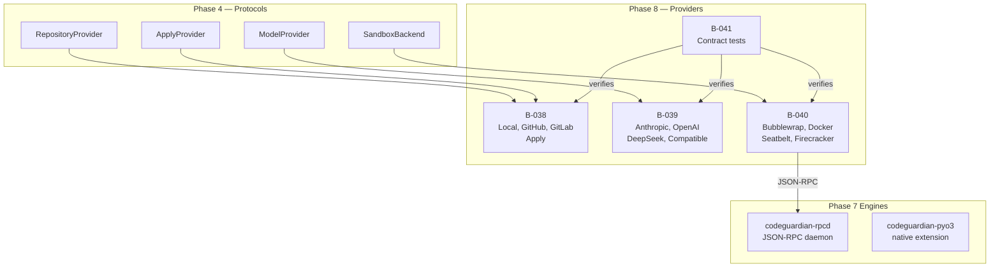

---

## 3. The architecture Phase 8 fits into

Phase 8's providers are thin layers. They do not contain business logic. They do not contain policy. They are adapters between the Phase 4 contracts and the outside world.

```mermaid
flowchart TB
    subgraph Outside["Outside World"]
        Git["git"]
        LLM["LLM APIs"]
        Bwrap["bwrap / docker"]
    end

    subgraph Phase8["Phase 8 Providers"]
        LocalProv["LocalProvider"]
        GithubProv["GitHubProvider"]
        GitlabProv["GitLabProvider"]
        ApplyProv["ApplyProvider"]

        Anthropic["AnthropicProvider"]
        OpenAI["OpenAIProvider"]
        Deepseek["DeepSeekProvider"]
        Compat["OpenAICompatibleProvider"]

        BwrapBackend["BubblewrapBackend"]
        DockerBackend["DockerBackend"]
        SeatbeltBackend["SeatbeltBackend"]
        FirecrackerBackend["FirecrackerBackend"]
        Selector["backend_selector"]
    end

    subgraph Phase7["Phase 7 Engines"]
        Daemon["codeguardian-rpcd"]
    end

    subgraph Phase4["Phase 4 Contracts"]
        R1["RepositoryProvider Protocol"]
        R2["ApplyProvider Protocol"]
        R3["ModelProvider Protocol"]
        R4["SandboxBackend Protocol"]
    end

    LocalProv -.->|"implements"| R1
    GithubProv -.->|"implements"| R1
    GitlabProv -.->|"implements"| R1
    ApplyProv -.->|"implements"| R2
    Anthropic -.->|"implements"| R3
    OpenAI -.->|"implements"| R3
    Deepseek -.->|"implements"| R3
    Compat -.->|"implements"| R3
    BwrapBackend -.->|"implements"| R4
    DockerBackend -.->|"implements"| R4
    SeatbeltBackend -.->|"implements"| R4
    FirecrackerBackend -.->|"implements"| R4

    LocalProv -->|"git clone"| Git
    GithubProv -->|"git clone"| Git
    GitlabProv -->|"git clone"| Git
    ApplyProv -->|"git apply"| Git

    Anthropic -->|"HTTPS"| LLM
    OpenAI -->|"HTTPS"| LLM
    Deepseek -->|"HTTPS"| LLM
    Compat -->|"HTTP/HTTPS"| LLM

    BwrapBackend -->|"sandbox.execute"| Daemon
    DockerBackend -->|"sandbox.execute"| Daemon
    SeatbeltBackend -->|"sandbox.execute"| Daemon
    FirecrackerBackend -->|"sandbox.execute"| Daemon

    Selector -.->|"selects"| BwrapBackend
    Selector -.->|"selects"| DockerBackend
```

Two properties are essential:

**The providers are stateless.** A `LocalProvider` holds a path. An `AnthropicProvider` holds a client. An `ApplyProvider` holds a bridge and a path. None of them hold state between calls that the caller did not supply.

**The providers do not enforce policy.** `ApplyProvider` writes to a repository, but only after the consent gate in Phase 13 has approved. `SandboxBackend` runs commands, but only inside the sandbox that Phase 7 built. Phase 8 is a thin layer, and that is what makes it safe.

---

## 4. B-038 — Repository Providers

### 4.1 What it delivers

Five files. Four implementations of `RepositoryProvider`, plus `ApplyProvider`.

| File | Class | Lines (est.) |
|---|---|---|
| `core/providers/__init__.py` | Public surface | 30 |
| `core/providers/local_repository.py` | `LocalProvider` | 180 |
| `core/providers/github_repository.py` | `GitHubProvider` | 80 |
| `core/providers/gitlab_repository.py` | `GitLabProvider` | 80 |
| `core/providers/apply_provider.py` | `ApplyProvider` | 220 |
| **Total** | | **~590** |

### 4.2 The five Protocol methods

`RepositoryProvider` declares five methods, none of which write:

- `clone(url: str, dest: Path) -> Path` — clone a repository to a destination, return the local path
- `read_file(path: str) -> str` — read one file from the clone
- `list_files() -> list[str]` — list every tracked file in the clone
- `get_diff(changes: Sequence[FileChange]) -> str` — produce a unified diff for a set of changes
- `get_metadata() -> RepoMetadata` — return the repository's identity

`LocalProvider` implements all five by shelling out to `git`. `GitHubProvider` and `GitLabProvider` subclass `LocalProvider` — the clone is the only difference, and after clone, the directory is a git repository regardless of where it came from.

### 4.3 `LocalProvider` in detail

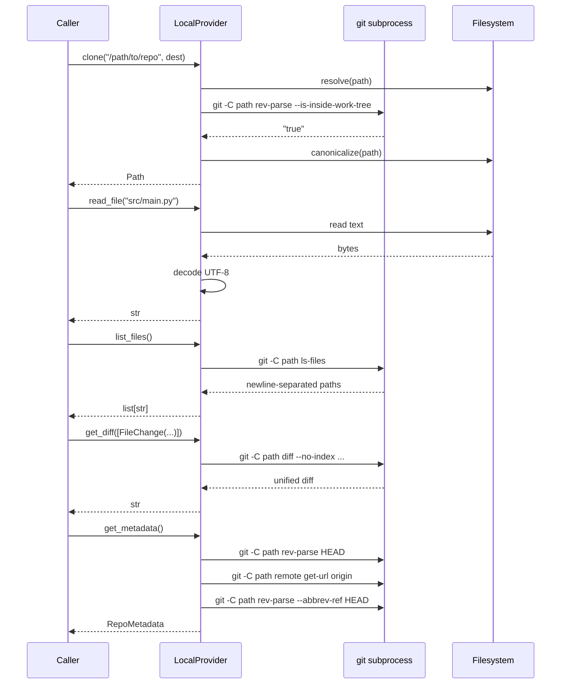

Every `git` call is a subprocess with a timeout, captured stdout and stderr, and a raised `CodeGuardianError` on failure. The errors map to the Phase 1 codes:

| `git` failure | `ErrorCode` |
|---|---|
| path does not exist | `REPO_NOT_FOUND` |
| path is not a git repository | `REPO_NOT_FOUND` |
| `git clone` network failure | `REPO_CLONE_FAILED` |
| authentication failure | `REPO_AUTH_FAILED` |
| file too large (>10 MB) | `FILE_TOO_LARGE` |
| file is binary | `FILE_BINARY` |
| permission denied | `FILE_PERMISSION_DENIED` |

### 4.4 `GitHubProvider` and `GitLabProvider`

Both subclass `LocalProvider` and override only `clone`. `GitHubProvider.clone` runs `git clone https://github.com/{owner}/{repo}.git` into the destination, then delegates to `LocalProvider` for everything else. `GitLabProvider` does the same with the GitLab URL format.

No authentication tokens are handled in Phase 8. A private repository requires the user to have valid credentials configured on the host (SSH keys, git credential helper). The provider inherits them. This is documented as a known limitation.

### 4.5 `ApplyProvider` — the only write path

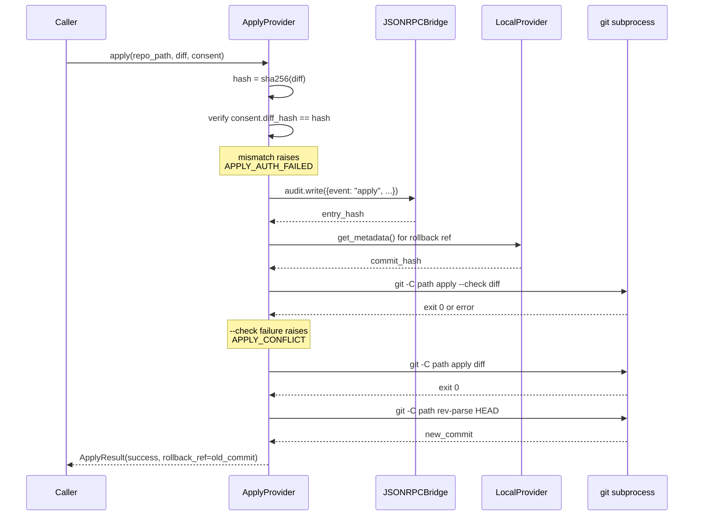

`ApplyProvider` is the only class in the entire build with write access to a repository. Its four-step process — consent verification, audit log, `git apply --check`, `git apply` — is the correctness guarantee.

`rollback` reverses the process: `git reset --hard {rollback_ref}`. If the rollback reference does not exist, it raises `ROLLBACK_REF_NOT_FOUND`.

### 4.6 What B-038 does not do

- No GitHub API. Only `git clone` over HTTPS.
- No GitLab API. Only `git clone` over HTTPS.
- No authentication token handling. The host's git configuration is used.
- No branch creation. `apply` commits to the current branch.
- No PR/MR creation. That is Phase 15's reporter.

---

## 5. B-039 — Model Providers

### 5.1 What it delivers

Four files. Four implementations of `ModelProvider`.

| File | Class | Lines (est.) |
|---|---|---|
| `core/providers/anthropic_model.py` | `AnthropicProvider` | 250 |
| `core/providers/openai_model.py` | `OpenAIProvider` | 240 |
| `core/providers/deepseek_model.py` | `DeepSeekProvider` | 200 |
| `core/providers/openai_compatible.py` | `OpenAICompatibleProvider` | 180 |
| **Total** | | **~870** |

### 5.2 The four Protocol methods

`ModelProvider` declares four methods:

- `complete(prompt: str, options: ModelOptions) -> ModelResponse` — one full completion, async
- `stream(prompt: str, options: ModelOptions) -> AsyncIterator[ModelChunk]` — streamed completion, async
- `count_tokens(text: str, model: str) -> int` — estimate the token count, sync
- `get_available_models() -> list[ModelInfo]` — list the models the provider serves, sync

All four providers share three internal components:

- An `httpx.AsyncClient` with configurable timeout and transport
- A shared SSE line parser for streaming
- A shared HTTP error mapper

### 5.3 The Anthropic Messages API

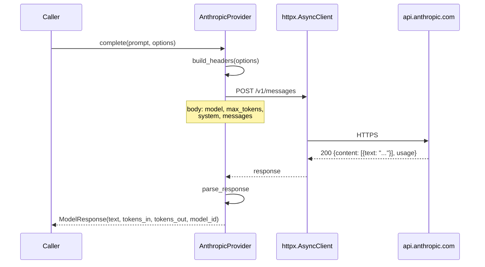

Errors map to Phase 1 codes:

| HTTP status | `ErrorCode` |
|---|---|
| 401 | `MODEL_AUTH_FAILED` |
| 429 | `MODEL_RATE_LIMITED` |
| 400 with `context_length` | `MODEL_CONTEXT_EXCEEDED` |
| 500–599 | `MODEL_UNAVAILABLE` |
| timeout | `NET_TIMEOUT` |
| connection error | `NET_UNREACHABLE` |
| any other 4xx | `MODEL_UNKNOWN` |

### 5.4 OpenAI and DeepSeek

Both use the Chat Completions API with a `/v1/chat/completions` endpoint. `DeepSeekProvider` is an `OpenAIProvider` subclass with a different base URL and a different model list. `OpenAIProvider` is the base class.

### 5.5 `OpenAICompatibleProvider`

The provider for any OpenAI-compatible endpoint: Ollama, vLLM, llama.cpp, LM Studio. It subclasses `OpenAIProvider` and takes a `base_url`. It allows an empty API key so local endpoints work without authentication.

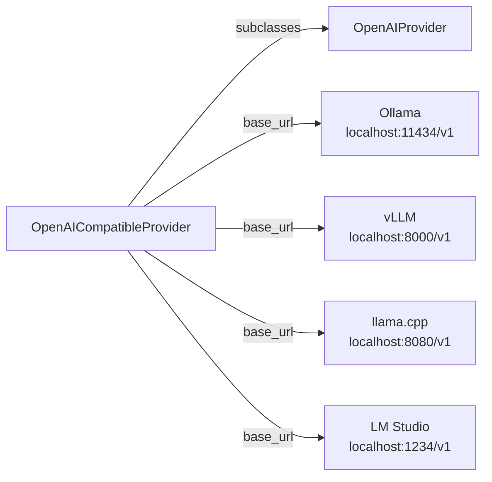

### 5.6 Streaming and token counting

Streaming uses HTTP server-sent events, parsed by `httpx`'s `iter_lines()`. Every provider's streaming endpoint emits `data: {...}\n\n` frames, so the parser is shared.

`count_tokens` returns a character-based estimate with a per-provider multiplier. The multiplier is documented in the docstring and is **an estimate, not a measurement**. Accurate tokenization requires provider-specific tokenizer libraries, which would add a dependency per provider. That is deferred.

### 5.7 What B-039 does not do

- No model selection logic. The caller supplies the model name.
- No prompt management. The caller supplies the prompt.
- No cost tracking beyond token counts in `ModelResponse`.
- No retry logic. Phase 1's `retry_async` handles retries at the caller level.
- No provider-specific SDKs. All four providers use `httpx` directly.

---

## 6. B-040 — Python Sandbox Backends

### 6.1 What it delivers

Six files. Four `SandboxBackend` Protocol implementations and a selector.

| File | Class/Function | Lines (est.) |
|---|---|---|
| `core/sandbox/__init__.py` | Public surface | 30 |
| `core/sandbox/backend_selector.py` | `select_backend` | 80 |
| `core/sandbox/bubblewrap_backend.py` | `BubblewrapBackend` | 130 |
| `core/sandbox/docker_backend.py` | `DockerBackend` | 130 |
| `core/sandbox/seatbelt_backend.py` | `SeatbeltBackend` | 90 |
| `core/sandbox/firecracker_backend.py` | `FirecrackerBackend` | 90 |
| **Total** | | **~550** |

### 6.2 The architecture

**These Python classes do not spawn processes.** They are JSON-RPC clients to the `codeguardian-rpcd` daemon built in Phase 7. The daemon spawns `bwrap` or `docker` with the enforcement that Phase 7 built.

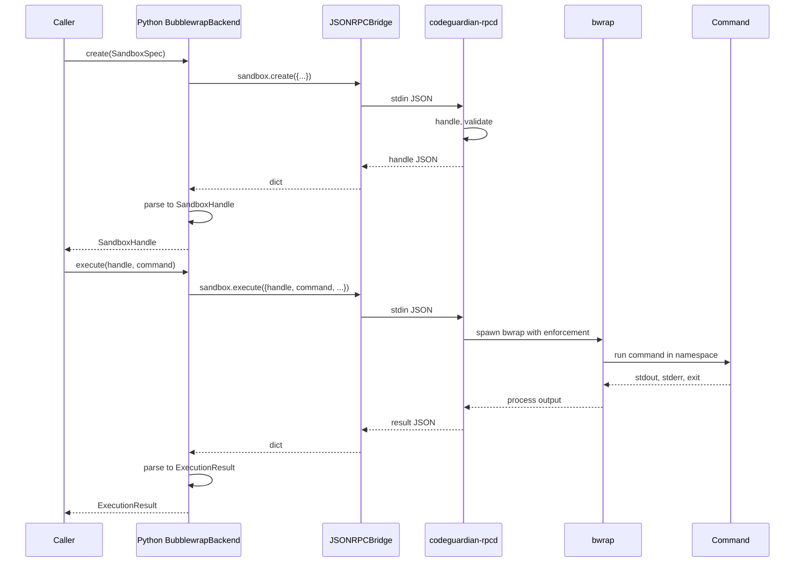

This is why the trust boundary works. The Python sandbox backends never spawn a process themselves. If Python were compromised, it could not remove the enforcement — it would have to talk to the daemon, and the daemon enforces.

### 6.3 `BubblewrapBackend`

```python
class BubblewrapBackend:
    def __init__(self, bridge: JSONRPCBridge) -> None: ...

    def create(self, spec: SandboxSpec) -> SandboxHandle: ...
    def execute(self, handle: SandboxHandle, command: Sequence[str],
                *, env: Mapping[str, str] | None = None,
                cwd: Path | None = None,
                timeout_ms: int | None = None,
                stdin: bytes | None = None) -> ExecutionResult: ...
    def destroy(self, handle: SandboxHandle) -> None: ...
    def supports_language(self, language: str) -> bool:
        return True  # bubblewrap runs any Linux binary
    def get_resource_limits(self) -> ResourceLimits: ...
```

The `bridge` is passed to the constructor. Phase 8 does not own the daemon lifecycle — the caller (Phase 13) does. The provider holds a reference to an already-running daemon.

### 6.4 `DockerBackend`

Same interface, but `create` requires `spec.image`. The docker backend runs the exact image the caller supplies. No language-to-image mapping exists in the code.

### 6.5 `SeatbeltBackend` and `FirecrackerBackend`

Both are stubs. `create` raises `SANDBOX_CREATE_FAILED` with the message "seatbelt backend is not implemented in v1" (or firecracker). `execute` never runs because `create` fails.

### 6.6 `backend_selector`

```python
def select_backend(config: Config) -> str:
    """Return the backend name to use for this host.

    Order of precedence:
    1. If config.general.sandbox_backend names an available backend, use it.
    2. Otherwise, fall back to the next available backend by platform:
       - Linux: bubblewrap, then docker
       - macOS: seatbelt, then docker
       - Windows: docker only
    3. If nothing is available, raise SANDBOX_CREATE_FAILED.
    """
```

The selector checks `shutil.which("bwrap")` and `shutil.which("docker")` to decide what is available. A stub backend (seatbelt on Linux, firecracker anywhere) is **not** considered available.

### 6.7 What B-040 does not do

- No process spawning in Python. All spawning is in Rust.
- No image building. Docker images are caller-supplied.
- No sandbox pooling. That is Phase 13.
- No retry on transient failures. That is Phase 13's orchestrator.
- No environment setup. The beast installs its own toolchains inside the sandbox.

---

## 7. B-041 — Contract Tests

### 7.1 What it delivers

Five files, four contract suites plus a package init.

| File | Lines (est.) |
|---|---|
| `tests/contracts/__init__.py` | 5 |
| `tests/contracts/test_repository_contract.py` | 350 |
| `tests/contracts/test_apply_contract.py` | 280 |
| `tests/contracts/test_model_contract.py` | 400 |
| `tests/contracts/test_sandbox_contract.py` | 380 |
| **Total** | **~1,415** |

### 7.2 The three test strategies

Phase 8 uses **three distinct test strategies**, chosen deliberately per protocol.

| Protocol | Strategy | Why |
|---|---|---|
| `RepositoryProvider` | Real `git` in temp dirs | `git` is always available; real operations prove correctness |
| `ApplyProvider` | Real `git` in temp dirs | `git apply` semantics cannot be mocked without becoming a reimplementation |
| `ModelProvider` | Injected `httpx.MockTransport` | No network, no API keys, deterministic |
| `SandboxBackend` | Real RPC to real daemon | `bwrap` and `docker` run real commands; test skips if unavailable |

The honest split:

- **Real tests where the real thing is always available** — `git` is always present, so repository and apply tests use it.
- **Mock tests where the real thing requires external credentials** — no user should be forced to have an API key to run the test suite. Mock transport proves the request shape, error handling, and response parsing.
- **Real tests where the real thing is host-dependent** — `bwrap` and `docker` are optional; the tests run against whichever is available.

This is the design. It is not a compromise.

### 7.3 `test_repository_contract.py` — real git, no mocks

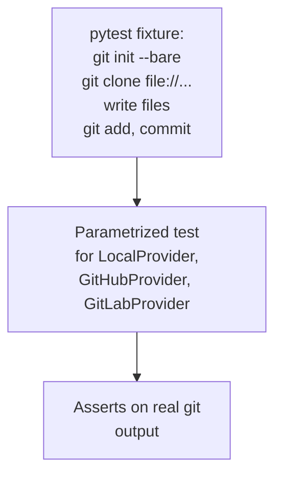

**Every repository provider is exercised against the same real git operations.** A fixture creates a bare repository with known commits. The test parametrizes over every provider implementation. If `GitHubProvider` violates the contract, the test fails.

Boundary tests:

- `clone` on a nonexistent path raises `REPO_NOT_FOUND`
- `read_file` on a missing file raises `FILE_NOT_FOUND`
- `read_file` on a >10 MB file raises `FILE_TOO_LARGE`
- `read_file` on a binary file raises `FILE_BINARY`
- `read_file` on a file with invalid UTF-8 raises `FILE_BINARY`
- `list_files` returns every tracked file (comparison with `git ls-files` output)
- `get_diff` on an empty change list returns `""`
- `get_diff` on a real change returns a diff that `git apply --check` accepts
- `get_metadata` returns a 40-character commit hash, a non-empty branch, and a URL

### 7.4 `test_apply_contract.py` — real git, no mocks

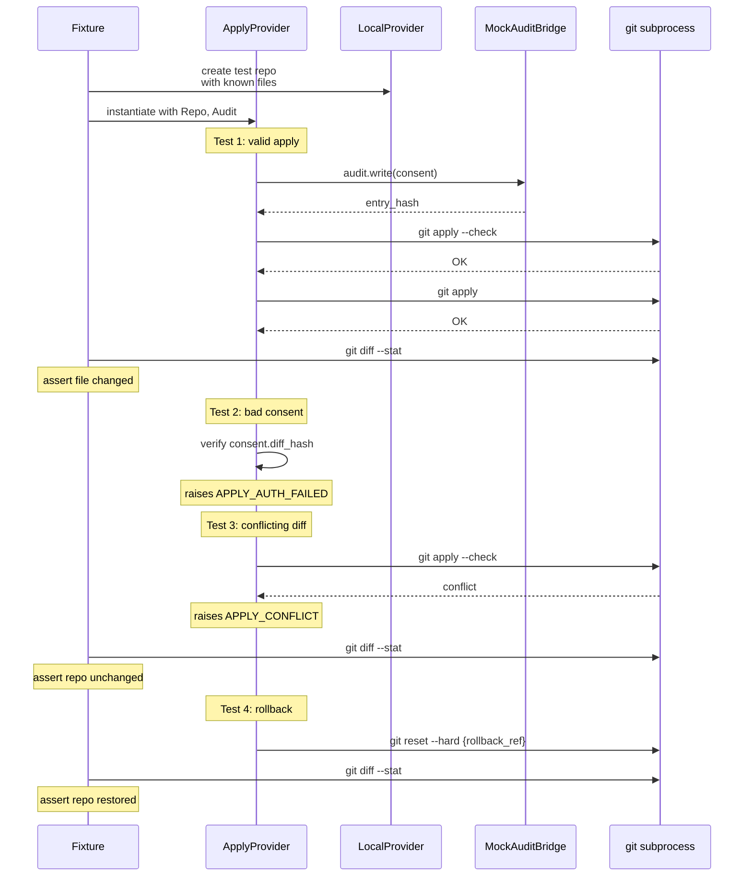

The `Audit` mock here is a deliberate narrow mock — it stubs the JSON-RPC call to the daemon so tests do not need a running daemon. It is not mocking the business logic. The apply logic itself runs against real `git`.

### 7.5 `test_model_contract.py` — mock transport, no network

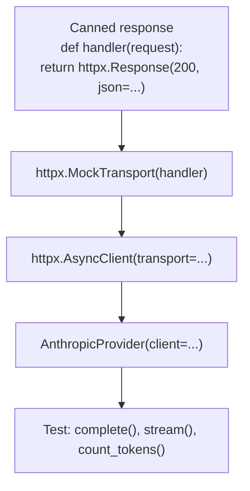

The mock transport intercepts every HTTP request and returns a canned response. The provider code runs unmodified — the only thing replaced is the wire transport.

Boundary tests:

- `complete` returns a `ModelResponse` with non-empty `text`, positive `tokens_in`, positive `tokens_out`
- `stream` yields at least one `ModelChunk`, terminates cleanly, reconstructs the same text as `complete`
- `count_tokens` returns a positive integer for empty input, single-character input, and a 10,000-character input
- `get_available_models` returns at least one `ModelInfo` with a non-empty `id`
- HTTP 401 raises `MODEL_AUTH_FAILED`
- HTTP 429 raises `MODEL_RATE_LIMITED`
- HTTP 500 raises `MODEL_UNAVAILABLE`
- HTTP 400 with `context_length` in the message raises `MODEL_CONTEXT_EXCEEDED`
- Connection timeout raises `NET_TIMEOUT`
- `httpx.ConnectError` raises `NET_UNREACHABLE`

Every error code from Phase 1's taxonomy that a model provider can produce is tested.

### 7.6 `test_sandbox_contract.py` — real daemon, real bwrap/docker

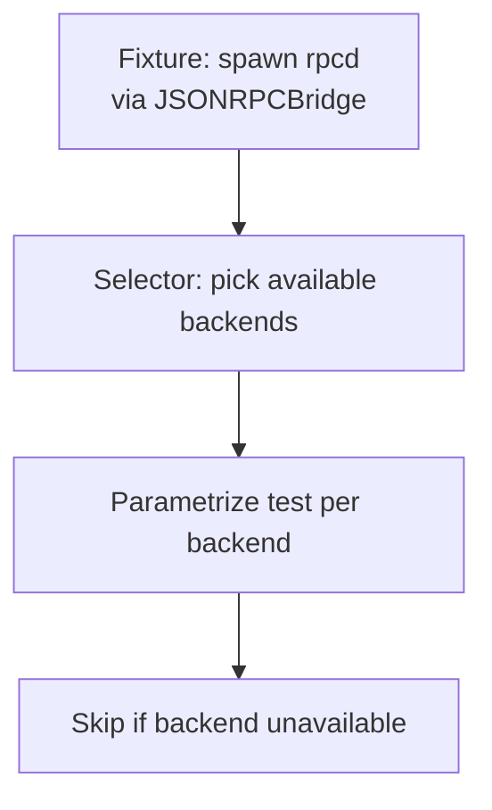

Tests run per backend, parametrized over whatever is available:

- On this host: bubblewrap
- On a host with docker and an image: docker
- On macOS: seatbelt (stub — skipped)
- Anywhere: firecracker (stub — skipped)

Boundary tests:

- `create` returns a `SandboxHandle` with the requested language
- `execute` runs `/bin/echo hello` and returns exit 0 with "hello" in stdout
- `execute` on a command that exits 42 returns exit 42
- `destroy` releases the handle
- `supports_language` returns `True` for Python, TypeScript, and any other language (post B-037A: bubblewrap and docker are language-agnostic)
- `get_resource_limits` returns the configured limits
- Seatbelt and firecracker raise `SANDBOX_CREATE_FAILED` with "not implemented"

### 7.7 What B-041 does not do

- No live API calls to Anthropic, OpenAI, or DeepSeek. That is Phase 15's integration tests.
- No end-to-end pipeline test. That is Phase 13.
- No load testing. That is Phase 16.
- No coverage requirements. The tests are correctness tests, not coverage-driven.

---

## 8. Design decisions

Every design decision in Phase 8, with its reasoning and its consequences.

### D1 — `httpx` for model providers

**Decision.** All four model providers use `httpx` directly.

**Why.** Async-native, streaming built in, mockable via injected transport. No provider SDK dependencies.

**Consequence.** Escalation M — adding `httpx` to `pyproject.toml`. Also a small risk: if `httpx` changes its transport API in a future major version, the mock transport in the tests would need updating.

**Escalation.** Yes.

### D2 — `git` subprocess for repository and apply

**Decision.** All git operations shell out to the `git` binary.

**Why.** `git` is always available. `gitpython` would be another dependency and would eventually drift from the real `git` semantics. `git apply --check` in particular is a real `git` capability that must not be reimplemented.

**Consequence.** Every git operation is a subprocess with a timeout. Errors are captured and typed.

**Escalation.** No. No dependency added.

### D3 — Token count is an estimate

**Decision.** `count_tokens` returns a character-based estimate with a per-provider multiplier.

**Why.** Accurate tokenizers would require a dependency per provider (Anthropic's tokenizer differs from OpenAI's). Phase 8 does not need accuracy — Phase 10 will when prompts are budgeted.

**Consequence.** A caller that relies on `count_tokens` for exact budgeting will be off by 10–20%. This is documented in the docstring.

**Escalation.** No.

### D4 — Streaming uses direct SSE parsing

**Decision.** `httpx`'s `iter_lines()` with a hand-written SSE parser.

**Why.** The SSE format is simple: `data: {json}\n\n` per event. No dependency needed.

**Consequence.** The parser must handle multi-line data fields, which is a small edge case. Handled.

**Escalation.** No.

### D5 — Model lists are static

**Decision.** Each provider module has a `const MODEL_IDS: tuple[str, ...]` list.

**Why.** Querying the provider's API for available models on every `get_available_models` call would require network and complicate the mock transport.

**Consequence.** A newly-released model is not in the list until the module is edited. This is documented.

**Escalation.** No.

### D6 — Sandbox backends are JSON-RPC clients

**Decision.** `BubblewrapBackend` and `DockerBackend` call the daemon. They do not spawn processes.

**Why.** The daemon is the trust boundary. If Python were compromised, it could not remove the isolation.

**Consequence.** Every sandbox call is a JSON-RPC round trip. This costs ~1 ms per call. Acceptable.

**Escalation.** No.

### D7 — Local apply only in v1

**Decision.** `ApplyProvider` writes to local repositories only. GitHub and GitLab apply return `SYS_NOT_IMPLEMENTED`.

**Why.** Remote apply requires API integration (PR/MR creation, review, merge) which is Phase 15's reporter.

**Consequence.** A user with a GitHub repository must clone locally and apply locally, then push manually.

**Escalation.** No.

### D8 — Test strategy is per-protocol

**Decision.** Mocks for models, real git for repository/apply, real bwrap/docker for sandbox.

**Why.** Each protocol has different external dependencies. Git is always present. LLM APIs require credentials. Sandbox backends are host-dependent.

**Consequence.** The test suite is different layers of confidence. It is honest about each layer.

**Escalation.** No.

### D9 — `ApplyProvider` takes an injected audit bridge

**Decision.** `ApplyProvider(repository, audit_bridge, audit_log_path)`.

**Why.** `ApplyProvider` needs to write to the audit log before applying. Taking the bridge as a constructor argument means the caller wires it. In tests, a mock bridge substitutes.

**Consequence.** `ApplyProvider` cannot run without a bridge. This is correct — applying without an audit entry is a policy violation.

**Escalation.** No.

### D10 — Backend selection is config-first with fallback

**Decision.** `select_backend(config)` checks the config first, then falls back to platform defaults.

**Why.** The user should be able to prefer docker over bubblewrap on Linux. The system should also work out of the box without a config.

**Consequence.** A misconfigured `sandbox_backend` value falls back to a default rather than failing.

**Escalation.** No.

---

## 9. Escalations

Phase 8 requires one Rule 1 escalation.

| # | File | Change | Reason |
|---|---|---|---|
| **M** | `python/pyproject.toml`, `pyproject.toml` | Add `httpx` | D1 — model provider HTTP client |

No other escalations. No Phase 1–7 code is touched.

The Phase 7 fix-ups (B-037A) were already approved and are complete. They are:
- `SandboxSpec.image` field added
- `SandboxHandle.image` field added
- `image_for` removed from `docker.rs`
- `SUPPORTED_LANGUAGES` removed from `bubblewrap.rs`
- `supports_language` returns `true` for bubblewrap and docker, `false` for stubs
- `handlers.rs` reads `image` param and passes through
- `test_sandbox.py` updated to reflect new semantics

These are documented in the Phase 7 build history, not this plan.

---

## 10. Test strategy — detailed

### 10.1 The three layers of test confidence

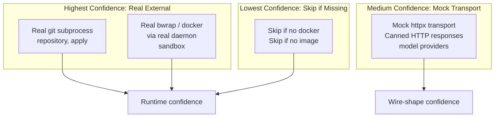

Every test category is labelled in its module docstring with its confidence level. A reader of the test suite knows exactly what each test proves.

### 10.2 What "real test" means for each protocol

| Protocol | Real means |
|---|---|
| `RepositoryProvider` | `git init --bare`, `git clone file://...`, real file I/O, real `git diff`, real `git apply` |
| `ApplyProvider` | Real diff applied to a real repo, verified with `git diff`, rolled back, verified byte-identical |
| `ModelProvider` | Cannot be real without credentials. Mock transport is the design. |
| `SandboxBackend` | Real RPC to a running daemon, real `bwrap` process, real command execution |

### 10.3 The skip policy

Three categories of test skip:

| Skip trigger | Count | Where |
|---|---|---|
| `rpcd` binary not built | All sandbox tests | `test_sandbox_contract.py` |
| `bwrap` not installed | Bubblewrap tests | `test_sandbox_contract.py` |
| `docker` not installed or image missing | Docker tests | `test_sandbox_contract.py` |

Model, repository, and apply tests **never skip**. They either run or fail.

This is deliberate. If a model test starts skipping because of missing credentials, the test suite stops proving that the providers work. The mock transport removes that dependency.

### 10.4 Coverage targets

| Module | Test coverage target | Notes |
|---|---|---|
| `local_repository.py` | 95% | Every method has success and failure tests |
| `apply_provider.py` | 95% | Every branch in the four-step process is tested |
| `anthropic_model.py` | 90% | Every error code path is tested |
| `openai_model.py` | 90% | Same |
| `deepseek_model.py` | 90% | Same |
| `openai_compatible.py` | 85% | Some paths shared with OpenAI |
| `bubblewrap_backend.py` | 90% | Requires bwrap |
| `docker_backend.py` | 90% | Requires docker |
| `seatbelt_backend.py` | 100% | Every method raises the stub error |
| `firecracker_backend.py` | 100% | Same |
| `backend_selector.py` | 95% | Every branch tested |

Coverage numbers are estimated, not measured. A target, not a measurement.

---

## 11. What Phase 8 does not do

Stated explicitly so there are no surprises.

- **No plugin loading.** That is Phase 9.
- **No prompt rendering.** That is Phase 10.
- **No agent execution.** That is Phase 11.
- **No skill retrieval.** That is Phase 12.
- **No orchestrator.** That is Phase 13.
- **No CLI commands.** That is Phase 14.
- **No MCP client or server.** That is Phase 15.
- **No reporters.** That is Phase 15.
- **No remote apply (GitHub/GitLab push).** Deferred to Phase 15.
- **No environment resolution.** That is Phase 11's Tester agent.
- **No dynamic grammar loading for the kernel.** That is a Phase 6 follow-up, tracked as G-28.
- **No docker image building.** Tracked as G-27, Phase 13.

The scope is deliberately narrow. Phase 8 is the plumbing.

---

## 12. What Phase 8 hands forward

- **To Phase 9 (Plugins).** Working `RepositoryProvider` and `ModelProvider` implementations that plugin contract tests can use as reference.
- **To Phase 10 (Prompts).** Working model providers ready to be called with real prompts.
- **To Phase 11 (Agents).** All four provider categories. The Tester agent will use `ModelProvider` to write tests and `SandboxBackend` to run them.
- **To Phase 13 (Orchestrator).** The full set of providers, ready to be wired into the phase pipeline.
- **To Phase 15 (MCP and Reporters).** `ApplyProvider` and the model providers, ready for the output phase.

---

## 13. Estimated size

| Block | Files | Lines |
|---|---|---|
| B-038 | 5 | 590 |
| B-039 | 4 | 870 |
| B-040 | 6 | 550 |
| B-041 | 5 | 1415 |
| **Total** | **20** | **~3,425** |

Plus one line in `pyproject.toml` for `httpx`, plus one line in the root `pyproject.toml` if it also declares dependencies.

Total Phase 8 output: **~3,450 lines**.

---

## 14. Summary

Phase 8 is where the Contracts get their first implementations. It is the plumbing layer, and it is deliberately thin:

- Repository providers that clone and read
- Apply provider that writes with consent
- Model providers that call LLM APIs
- Sandbox backends that delegate to the Rust daemon
- Contract tests that prove each implementation

Three properties are non-negotiable:

1. **The tests are honest.** Model tests use mock transport (no API keys). Repository and apply tests use real git. Sandbox tests use real bwrap/docker when available.
2. **The providers are language-agnostic.** No hardcoded language lists. Docker takes an image. Bubblewrap runs any Linux binary.
3. **The providers are stateless.** The caller supplies the path, the bridge, the client, the spec. The provider does not hold state between calls.

What Phase 8 does not do is equally important. No pipeline. No agents. No prompts. No orchestration. Phase 8 stops at "the provider works in isolation." Phase 11 builds the pipeline that uses them.

When Phase 8 is complete, the phase boundary will run:

```
cargo test --workspace
PYTHONPATH=python python3 -m pytest tests/ -q
```

Every existing test must pass. Every new contract test must pass. The count will rise from 367 to roughly 500+ — the precise number will be known when the tests exist.

If any of this is wrong, the time to correct it is now. Once Phase 8 starts, each block is written once and tested at the phase boundary. This plan is the contract the build will honour.
